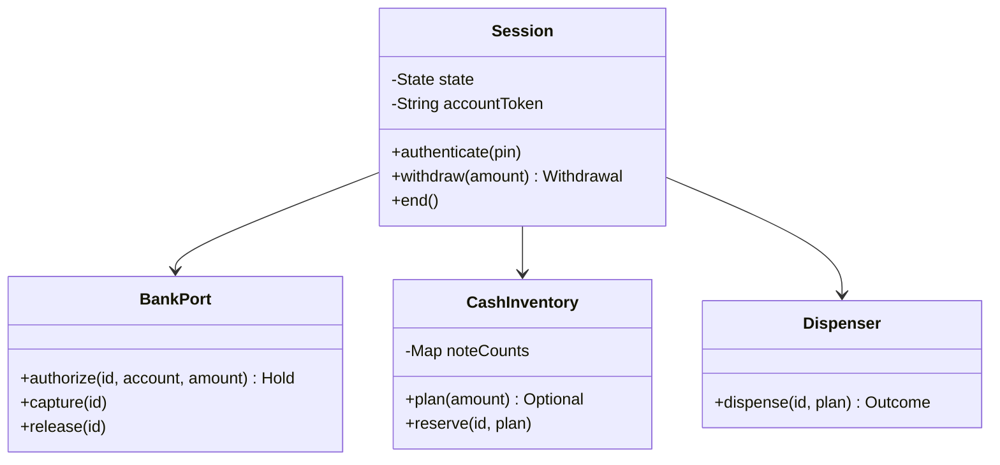

# ATM

Treat cash withdrawal as a session-controlled operation involving both a bank ledger and a physical dispenser.
**Model provenance:** the diagram and Java excerpt are original pedagogical models, not exact repository UML. Cash planning and recovery below extend beyond the two reviewed source files.

## Exact study order

1. **0–5 minutes:** narrate insert card → authenticate → choose withdrawal → collect cash/card.
2. **5–10 minutes:** define session state, amount rules, and cash feasibility.
3. **10–18 minutes:** draw session, bank port, note inventory, and dispenser.
4. **18–25 minutes:** trace authorization, reservation, dispense, and settlement.
5. **25–32 minutes:** implement a non-mutating note-plan check before any debit.
6. **32–40 minutes:** rehearse insufficient funds, impossible denominations, and unknown hardware outcomes.

## Requirements, assumptions, and invariants

- One active card session per terminal; authenticate before balance or withdrawal operations.
- Authentication uses a bank-facing service; never log or persist the raw PIN in application traces.
- States: `IDLE → CARD_INSERTED → AUTHENTICATED → DISPENSING → IDLE`, plus a recovery/fault state.
- Use one currency and integer minor units; requested amounts must be positive and within configured limits.
- Cash feasibility depends on exact denominations and counts, not just total ATM balance.
- Plan and reserve notes before issuing a physical dispense command.
- A withdrawal ID correlates authorization, hardware outcome, settlement, and any reversal.
- Duplicate callbacks cannot debit twice or decrement cassette counts twice.
- A timeout is an unknown outcome; automatic second dispensing is forbidden until the first is resolved.
- Bank authorization/capture semantics are an explicit adapter contract, not assumed universal bank behavior.

## Minimal class diagram



## Incremental DRAW / SAY

1. **DRAW:** session states beside the card. **SAY:** “A withdrawal is illegal before authentication.”
2. **DRAW:** bank balance and note inventory as separate boxes. **SAY:** “Both must permit the amount.”
3. **DRAW:** a note plan before the debit arrow. **SAY:** “Enough total cash does not imply exact dispense feasibility.”
4. **DRAW:** a withdrawal ID across every boundary. **SAY:** “Retries refer to the same operation.”
5. **DRAW:** UNKNOWN to recovery. **SAY:** “We reconcile evidence rather than treating silence as rejection.”

## Main method-call runtime

These are original teaching APIs, not a literal repository call listing.

1. `main()` constructs a session, mock bank adapter, note inventory, and dispenser.
2. `insertCard()` establishes a tokenized identity; `authenticate()` moves to authenticated on success.
3. `withdraw(amount)` calls `planWithdrawal()` and reserves its notes under a terminal-wide lock.
4. `BankPort.authorize(withdrawalId, account, amount)` reserves funds using a stable request ID.
5. A durable withdrawal record is written before `Dispenser.dispense()` is invoked.
6. On definite delivery, capture the authorized amount and commit actual note counts exactly once.
7. End the session and return the card; unfinished settlement remains a recoverable backend task.

**Failure flow:** bank authorization rejects insufficient funds; release reserved notes and do not call the dispenser.
If the dispenser definitively delivers nothing, release authorization and note reservations.
If delivery is unknown or partial, retain the journal and reconcile actual delivery; do not blindly refund the full amount or dispense again.
If capture fails after delivery, retry settlement with the same ID rather than undoing the physical cash delivery.

## Original Java critical method

Excerpt inside `Session`; `limitMinor` and `unitMinor` are positive configured values.
`planner.exact()` searches bounded note counts without modifying them; reservation occurs immediately afterward under the same terminal serialization boundary.

```java
CashPlan planWithdrawal(long amountMinor) {
    if (state != State.AUTHENTICATED) {
        throw new IllegalStateException("Authenticate first");
    }
    if (amountMinor <= 0 || amountMinor > limitMinor
            || amountMinor % unitMinor != 0) {
        throw new IllegalArgumentException("Unsupported amount");
    }
    return planner.exact(amountMinor, inventory.snapshot())
        .orElseThrow(() -> new IllegalStateException("Cannot dispense exactly"));
}
```

An amount divisible by the smallest denomination can still be impossible with current note counts.
For example, available notes of 500 and 200 cannot necessarily make 600: count limits matter, and greedy choices may require backtracking.

## Pattern decision and tradeoffs

- **Primary:** State for legal session operations; use a clear transition table before splitting into classes.
- **Optional:** Chain of Responsibility for denomination handling only if it can prove full feasibility before mutating counts.
- **Avoid:** decrementing money in each denomination handler and discovering an unfillable remainder afterward.
- A pure bounded-change planner is more robust than an irreversible greedy chain, at the cost of more computation.
- Hardware adapters make tests possible, but simulated success does not validate physical fault handling.
- Durable journals and bank reconciliation add complexity because software transactions cannot atomically roll back physical cash.

## Ready-to-speak interview presentation

> “The session controls which operations are legal, while cash inventory and bank funds are separate constraints. I validate a positive amount and compute an exact note plan before changing balances. A withdrawal ID follows authorization, dispense, and settlement. Definite rejection releases reservations; uncertain hardware delivery enters recovery. I would test the state machine and note planner first, then inject failures at every external boundary.”

## Three practice rounds

### Round 1 — guided, 15 minutes
- [ ] Draw authenticated and unauthenticated paths.
- [ ] Trace a feasible withdrawal with explicit note counts.
- [ ] Explain why total ATM balance is insufficient validation.

### Round 2 — implementation, 25 minutes
- [ ] Test negative, zero, over-limit, and impossible exact-change amounts.
- [ ] Verify failed planning changes neither account nor cassette state.
- [ ] Inject authorization rejection, duplicate callback, and partial-delivery outcomes.

### Round 3 — interview, 10 minutes
- [ ] Explain the limitations of a greedy denomination chain.
- [ ] Distinguish definitely no cash from uncertain delivery.
- [ ] Explain how a durable journal supports settlement after a restart.

## Sources and reviewed scope

- Reviewed [ATMRoom entry point](https://gitlab.com/shrayansh8/lld-lowleveldesign/-/blob/5afdde64cd138ed7a8e273870598b41d63914e91/src/main/java/com/conceptcoding/interviewquestions/atm/ATMRoomComponents/ATMRoom.java) and [CashWithdrawalState](https://gitlab.com/shrayansh8/lld-lowleveldesign/-/blob/5afdde64cd138ed7a8e273870598b41d63914e91/src/main/java/com/conceptcoding/interviewquestions/atm/ATMStates/CashWithdrawalState.java) locally at the pinned commit.
- Observed: the entry invokes state-based insert/authenticate/select/withdraw operations; withdrawal checks total balances, deducts them, and invokes a denomination processor chain.
- Individual denomination processors and authentication implementations were not reviewed here. Exact-note feasibility and transaction recovery are not verified source guarantees; Java was not executed.