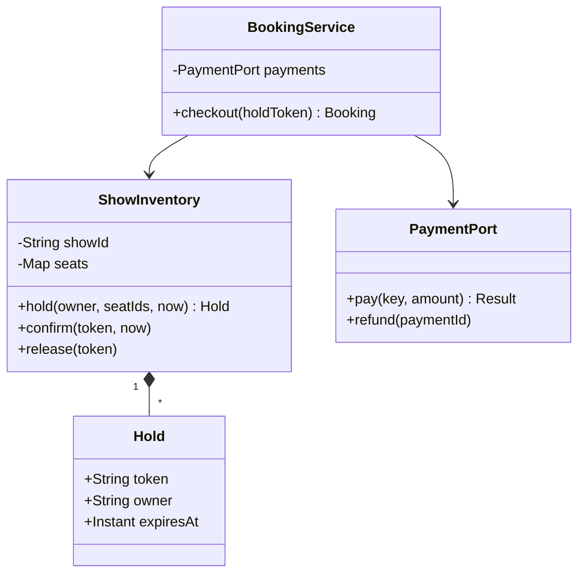

# BookMyShow

The difficult part is not searching movies: it is preventing two customers from owning the same show-seat.
**Model provenance:** the diagram, timed-hold design, and Java excerpt are original pedagogical models, not exact repository UML.

## Exact study order

1. **0–5 minutes:** narrate city → movie → show → seats → payment → ticket.
2. **5–10 minutes:** distinguish a physical seat from its availability for one show.
3. **10–18 minutes:** draw inventory, hold, booking service, and payment port.
4. **18–25 minutes:** trace two buyers competing for the same seat.
5. **25–32 minutes:** implement all-or-nothing hold acquisition before payment.
6. **32–40 minutes:** rehearse expiration, late success, and retry handling.

## Requirements, assumptions, and invariants

- Search by city, movie, and date; select one show and one or more seat IDs.
- A physical seat may be booked for different non-overlapping shows; inventory is keyed by `(showId, seatId)`.
- Seat lifecycle: `AVAILABLE → HELD → BOOKED`, with expiration or cancellation returning a hold to availability.
- A hold has owner, token, and expiry time; only its owner/token may confirm or release it.
- Acquire all requested seats or none; reject empty, duplicate, or unknown seat IDs.
- Hold acquisition and confirmation serialize per show in the initial in-memory model.
- Payment success alone does not create a ticket: confirmation must still validate a live hold.
- A late successful payment for an expired hold requires compensation, not taking seats from another buyer.
- Use a trusted injected clock; notifications are secondary to the persisted booking result.

## Minimal class diagram



## Incremental DRAW / SAY

1. **DRAW:** one physical seat and two show IDs. **SAY:** “Availability belongs to the show-seat pair.”
2. **DRAW:** AVAILABLE, HELD, BOOKED states. **SAY:** “A hold is temporary ownership, not a confirmed sale.”
3. **DRAW:** a token and expiry on the hold. **SAY:** “Stale requests cannot release a newer customer's hold.”
4. **DRAW:** payment outside the inventory lock. **SAY:** “External latency must not block all seat operations.”
5. **DRAW:** a refund arrow from late payment success. **SAY:** “We compensate rather than oversell.”

## Main method-call runtime

The original teaching driver uses an expiry-aware protocol beyond the reviewed sample.

1. `main()` seeds a show and calls `ShowInventory.hold("A", [4,5], now)`.
2. Inventory validates every seat, then assigns one owner token and expiry to the entire set.
3. `BookingService.checkout(token)` creates or loads a payment attempt keyed to that checkout.
4. `PaymentPort.pay()` runs outside the inventory lock; retries reuse the payment key.
5. On success, `ShowInventory.confirm(token, now)` revalidates ownership and expiry atomically.
6. Booking persistence records payment reference and seat ownership together with confirmation.
7. An outbox or retryable task sends the ticket after the booking commits.

**Failure flow:** A's hold expires while payment is pending; B acquires the seats.
A's late success cannot confirm because its token is stale. Mark compensation pending and request a refund using a stable key.
If payment times out, preserve the attempt as unknown and reconcile; a timeout is not proof of failure.

## Original Java critical method

Excerpt inside one `ShowInventory`; every seat writer uses the same monitor and the seat map is never exposed.
`availableAt(now)` treats expired holds as available; `assign()` is a nonthrowing in-memory update after validation.

```java
synchronized Hold hold(String owner, List<Integer> ids, Instant now) {
    if (owner == null || owner.isBlank() || ids.isEmpty()
            || new HashSet<>(ids).size() != ids.size()) {
        throw new IllegalArgumentException("Invalid selection");
    }
    for (int id : ids) {
        SeatSlot slot = seats.get(id);
        if (slot == null || !slot.availableAt(now)) {
            throw new IllegalStateException("Seat unavailable");
        }
    }
    Hold h = Hold.create(owner, List.copyOf(ids), now.plusSeconds(300));
    for (int id : ids) seats.get(id).assign(h);
    return h;
}
```

This excerpt demonstrates atomic validation-before-assignment only; it is not a distributed booking transaction.
Persistent implementations need transactional show-seat updates and a booking record, not JVM locking alone.

## Pattern decision and tradeoffs

- **Primary:** explicit state transitions for show-seat ownership; an enum is enough initially.
- **Optional:** Adapter around payment providers and an outbox for reliable ticket delivery.
- **Avoid:** holding a database transaction open throughout payment or claiming a distributed transaction exists automatically.
- Per-show locking is easy to reason about but limits throughput for popular shows; row-level conditional updates improve concurrency.
- Lazy expiry avoids a mandatory timer for correctness; a cleanup task can reclaim storage and update displays.
- Longer holds improve checkout experience but reduce availability; expiry must be a product decision, not a hidden constant.

## Ready-to-speak interview presentation

> “I key inventory by show and seat, then acquire all requested seats under one expiring owner token. Payment happens outside that lock. Success confirms only a still-valid hold; if it arrives after expiry, I refund rather than steal seats. Retries reuse payment and booking keys. The first model serializes one show's inventory, and the production boundary becomes a transactional conditional update with durable booking records.”

## Three practice rounds

### Round 1 — guided, 15 minutes
- [ ] Draw physical seat versus show-seat and the three ownership states.
- [ ] Trace A and B requesting one identical seat.
- [ ] Explain why the hold token is needed in addition to an expiry.

### Round 2 — implementation, 25 minutes
- [ ] Test empty, duplicate, unknown, and partially unavailable selections.
- [ ] Test exact-expiry boundaries and stale release attempts with a fake clock.
- [ ] Test duplicate payment callbacks and late success compensation.

### Round 3 — interview, 10 minutes
- [ ] Explain why payment is outside the inventory lock.
- [ ] Compare per-show locks with row-level conditional updates.
- [ ] Distinguish a refund-pending booking outcome from an unpaid failure.

## Sources and reviewed scope

- Reviewed [BookMyShowApp](https://gitlab.com/shrayansh8/lld-lowleveldesign/-/blob/5afdde64cd138ed7a8e273870598b41d63914e91/src/main/java/com/conceptcoding/interviewquestions/book_my_show/BookMyShowApp.java) and [BookingService](https://gitlab.com/shrayansh8/lld-lowleveldesign/-/blob/5afdde64cd138ed7a8e273870598b41d63914e91/src/main/java/com/conceptcoding/interviewquestions/book_my_show/service/BookingService.java) locally at the pinned commit.
- Observed: the entry builds theatres/screens/shows; the service calls lock, confirm, or release on a show and constructs a simulated successful payment.
- The Show implementation was not reviewed here. Expiry, ownership tokens, durable confirmation, and reconciliation above are original extensions, not verified source guarantees; Java was not executed.
- [Supplied PDF](https://drive.google.com/file/d/1XbWo8m1hOOdKGww0UO1x3zIskdQjqf2i/view?usp=drive_link) is unreviewed.