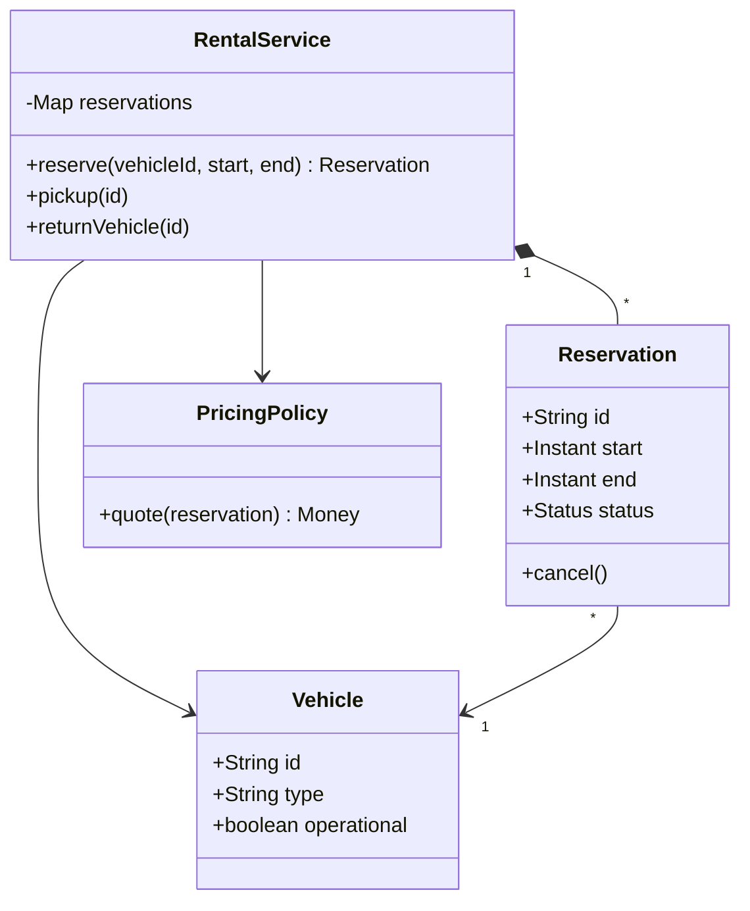

# Car Rental

The central problem is reserving a particular vehicle for a time interval without double booking it.
**Model provenance:** the diagram and excerpt are original pedagogical models, not exact repository UML. The car-rental repository directory was discovered during local inspection, not supplied as a car source link.

## Exact study order

1. **0–5 minutes:** walk through search, reserve, pickup, return, and payment.
2. **5–10 minutes:** define interval boundaries and reservation states before drawing classes.
3. **10–18 minutes:** draw vehicle, reservation, service, and pricing policy.
4. **18–25 minutes:** trace two overlapping requests for the same vehicle.
5. **25–32 minutes:** implement the atomic availability check and insertion.
6. **32–40 minutes:** rehearse cancellation, late return, and billing tradeoffs.

## Requirements, assumptions, and invariants

- One store initially; search by vehicle type and a requested pickup/return interval.
- Use UTC instants and half-open intervals `[start, end)`; adjacent bookings may touch.
- `start` must precede `end`; add a turnaround buffer later if cleaning takes time.
- Lifecycle: `RESERVED → IN_USE → COMPLETED`, or `RESERVED → CANCELLED`.
- Active intervals for the same vehicle cannot overlap; a search result is not a reservation.
- Pickup requires a valid reservation and operational vehicle; completing twice must not bill twice.
- Store money in minor units with currency, and snapshot the accepted pricing policy/version.
- License verification, insurance, and damage claims are external integrations, not implemented in the first model.

## Minimal class diagram



## Incremental DRAW / SAY

1. **DRAW:** one vehicle and a time axis. **SAY:** “Availability is a calendar property, not a single free/busy flag.”
2. **DRAW:** two touching intervals. **SAY:** “Half-open boundaries allow immediate reuse under this assumption.”
3. **DRAW:** `RentalService → Reservation`. **SAY:** “The service owns check-and-reserve as one operation.”
4. **DRAW:** the lifecycle next to the reservation. **SAY:** “Cancellation releases capacity; completion records actual return.”
5. **DRAW:** a separate pricing policy. **SAY:** “A new tariff should not change collision detection.”

## Main method-call runtime

These are original teaching APIs, not a literal reproduction of the discovered implementation.

1. `main()` creates a store, an operational vehicle, and `RentalService`.
2. `search(type, start, end)` returns candidates using current reservation data.
3. `reserve(vehicleId, start, end)` rechecks availability under the vehicle's consistency boundary.
4. The service records a `RESERVED` reservation with immutable interval and quoted price metadata.
5. `pickup(id)` checks state and identity, then records actual pickup and transitions to `IN_USE`.
6. `returnVehicle(id)` records actual return, marks completion, and asks `PricingPolicy.quote()` for the bill.
7. Payment settles the bill separately; a payment retry must not repeat the vehicle return.

**Failure flow:** two customers search before either reserves. Both see the car, but only one overlapping reservation commits.
The second receives an availability conflict and can search again. A later payment failure leaves an unpaid bill, not an occupied car.
If the earlier customer returns late, block the next pickup and offer reassignment; do not pretend planned intervals guarantee physical readiness.

## Original Java critical method

Excerpt inside a single-vehicle `ReservationCalendar`; all writes use this monitor and intervals are immutable.
`active` contains capacity-blocking reservations, and `Reservation.create()` has no external side effects.

```java
synchronized Reservation reserve(Instant start, Instant end) {
    if (start == null || end == null || !start.isBefore(end)) {
        throw new IllegalArgumentException("Invalid interval");
    }
    boolean conflict = active.stream().anyMatch(r ->
        start.isBefore(r.end()) && r.start().isBefore(end));
    if (conflict) throw new IllegalStateException("Unavailable");
    Reservation created = Reservation.create(start, end);
    active.add(created);
    return created;
}
```

The monitor protects one in-memory calendar only. Multiple service instances require transactional range exclusion or serialized writes per vehicle.
Cancellation must remove or deactivate the reservation through the same boundary, never by exposing the mutable collection.

## Pattern decision and tradeoffs

- **Primary:** Strategy for hourly/daily pricing when those policies actually vary.
- **Optional:** Repository for persistence and an explicit State implementation if lifecycle actions become complex.
- **Avoid:** subclasses for every vehicle-rate combination; vehicle category and pricing are separate axes.
- A per-vehicle lock avoids global serialization; database constraints are needed once processes multiply.
- Planned versus actual return times must stay separate; overwriting the plan loses audit and pricing context.
- Conservative turnaround buffers reduce utilization but make late or unclean returns less disruptive.

## Ready-to-speak interview presentation

> “I treat a reservation as a claim on a vehicle over a half-open interval. Search is advisory; reserve rechecks and inserts atomically. Reservation states control pickup, cancellation, and return, while a pricing strategy handles the bill independently. I keep planned and actual timestamps separate. The first implementation uses one serialized vehicle calendar; a database-backed version must preserve the same no-overlap invariant across instances.”

## Three practice rounds

### Round 1 — guided, 15 minutes
- [ ] Draw adjacent, nested, and partially overlapping intervals.
- [ ] Trace reservation through pickup and return without mentioning payment first.
- [ ] Explain why a vehicle status flag cannot represent future availability.

### Round 2 — implementation, 25 minutes
- [ ] Test equal endpoints, invalid intervals, and concurrent overlapping requests.
- [ ] Test cancellation releases only its own interval.
- [ ] Test repeated completion and payment callbacks do not duplicate billing.

### Round 3 — interview, 10 minutes
- [ ] Explain lock scope and the multi-process limitation.
- [ ] Handle a late return that affects the next customer.
- [ ] Add a new tariff without changing reservation conflict logic.

## Sources and reviewed scope

- Discovered and reviewed [carrental Demo](https://gitlab.com/shrayansh8/lld-lowleveldesign/-/blob/5afdde64cd138ed7a8e273870598b41d63914e91/src/main/java/com/conceptcoding/interviewquestions/carrental/Demo.java) and [ReservationManager](https://gitlab.com/shrayansh8/lld-lowleveldesign/-/blob/5afdde64cd138ed7a8e273870598b41d63914e91/src/main/java/com/conceptcoding/interviewquestions/carrental/reservation/ReservationManager.java) locally at the pinned commit.
- Observed: Demo searches dates, reserves, starts and submits a trip, then bills and pays. ReservationManager calls inventory reserve/release and saves or removes reservations.
- The inventory implementation was not reviewed here; its locking and overlap semantics are not verified. The UTC/half-open model above is original; Java was not executed.
- Both supplied PDFs are unreviewed: [PDF 1](https://drive.google.com/file/d/1QR51mRs_1cM7Cq5aDlPLKAvrjHMtLiU0/view?usp=drive_link) and [PDF 2](https://drive.google.com/file/d/11UNsQAciYNTr1iDkkR_H9hJ5lj4A4kr4/view?usp=drive_link).