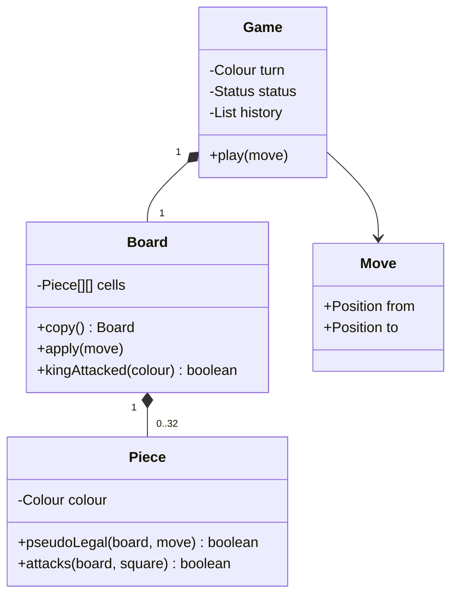

# Chess

A piece's movement shape is only one part of a legal move; a move must also respect turn, occupancy, and king safety.
**Model provenance:** the diagram and excerpt are original pedagogical models, not exact repository UML. They deliberately do not reproduce the reviewed source's king-capture win rule.

## Exact study order

1. **0–5 minutes:** define the difference between pseudo-legal movement and a legal move.
2. **5–10 minutes:** agree which special moves the first exercise omits.
3. **10–18 minutes:** draw game, board, piece behavior, and move value object.
4. **18–25 minutes:** trace one blocked rook move and one move exposing the king.
5. **25–32 minutes:** implement copy-apply-check-commit for ordinary moves.
6. **32–40 minutes:** explain checkmate, stalemate, and later special-rule extensions.

## Requirements, assumptions, and invariants

- Two players, an 8×8 board, white first, and alternating successful moves.
- Start with ordinary moves and captures; castling, en passant, and promotion are explicitly later work.
- This restricted learning version is not a complete rules-compliant chess engine.
- A square has at most one piece; a player moves only their own piece and cannot capture a friendly piece.
- Sliding pieces cannot jump blockers; a knight has a different movement rule.
- Reject a move that leaves the mover's king attacked; kings are not captured to end a legal chess game.
- Checkmate means in check with no legal response; stalemate means not in check with no legal response.
- Attack-square calculation must not recursively call full legal-move generation; pawn attacks differ from pawn forward movement.
- Rejected moves preserve board, side to move, history, and status.
- Special-move omissions also limit which positions the restricted mate detector can adjudicate correctly.

## Minimal class diagram



## Incremental DRAW / SAY

1. **DRAW:** board and two coordinates. **SAY:** “Move is a value object, not permission to mutate immediately.”
2. **DRAW:** `Piece.pseudoLegal()`. **SAY:** “Piece behavior handles shape; the board supplies blockers.”
3. **DRAW:** a temporary board beside the live board. **SAY:** “I simulate before committing to protect king safety.”
4. **DRAW:** `kingAttacked()` as a separate query. **SAY:** “Attack detection is not the same as generating legal moves.”
5. **DRAW:** check/no-check against has/no legal response. **SAY:** “This distinguishes checkmate from stalemate.”

## Main method-call runtime

This original teaching flow corrects and extends the limited behavior seen in the reviewed class.

1. `main()` creates a board position and `Game` with white to move.
2. `Game.play(move)` validates bounds, active status, ownership, and destination occupancy.
3. `Piece.pseudoLegal(board, move)` checks movement shape and intervening blockers.
4. The game copies the board, applies the move there, and calls `kingAttacked(turn)`.
5. Only a safe candidate replaces the current board; history and side-to-move then update.
6. `evaluate(nextColour)` searches legal responses and distinguishes active, checkmate, and stalemate.

**Failure flow:** a white rook shields its king from a black rook. Moving that shield sideways is geometrically valid but exposes check.
The candidate board is discarded; live board, history, and turn remain unchanged.
Capturing an opposing king is rejected by basic validation rather than interpreted as checkmate.

## Original Java critical method

Excerpt inside `Game`; `validateBasic()` includes bounds, turn, friendly occupancy, and king-capture rejection.
`Board.copy()` deep-copies mutable board state; `evaluate()` is pure and scoped to the supported move rules.

```java
void play(Move move) {
    validateBasic(move);
    Piece piece = board.at(move.from());
    if (!piece.pseudoLegal(board, move)) throw new IllegalArgumentException("Shape");
    Board candidate = board.copy();
    candidate.apply(move);
    if (candidate.kingAttacked(turn)) throw new IllegalArgumentException("King exposed");
    Colour next = turn.opposite();
    Status nextStatus = evaluate(candidate, next);
    board = candidate;
    history.add(move);
    turn = next;
    status = nextStatus;
}
```

Computing the next status before committing avoids a partial update if evaluation rejects an unsupported position.
When special moves are added, candidate state must include castling rights, en-passant target, and promotion choice, not just cell contents.

## Pattern decision and tradeoffs

- **Primary:** polymorphic movement rules, using piece subclasses or composed movement Strategies.
- **Optional:** Command for undo/replay, storing captured pieces and special-state changes with each move.
- **Avoid:** a giant game method with duplicated movement logic or treating king capture as full chess adjudication.
- Board copies simplify rollback; make/unmake is faster for search but requires meticulous restoration of every field.
- Legal-move generation is more expensive than shape validation; correctness is the first goal for an interview engine.
- Draw by repetition and move-count rules need position history and are separate extensions beyond stalemate.

## Ready-to-speak interview presentation

> “I separate piece geometry from game legality. Game checks turn and occupancy, asks the piece for a pseudo-legal move, then applies it on a temporary board to ensure the king remains safe. Only then do I commit and switch turns. Checkmate is check with no legal response, never king capture. I will implement ordinary moves first and explicitly name the special moves and draw rules that remain outside this learning version.”

## Three practice rounds

### Round 1 — guided, 15 minutes
- [ ] Draw a blocked rook, a knight jump, and a pinned piece.
- [ ] Explain pseudo-legal versus legal in one sentence.
- [ ] Fill the check/checkmate/stalemate decision table.

### Round 2 — implementation, 25 minutes
- [ ] Test wrong turn, friendly capture, blocked path, and exposed king.
- [ ] Assert history and board are unchanged on rejection.
- [ ] Use restricted-rule positions to test mate and stalemate without omitted special moves.

### Round 3 — interview, 10 minutes
- [ ] Explain deep copy versus make/unmake.
- [ ] Describe extra state required for castling and en passant.
- [ ] State precisely why the reviewed sample is not a complete chess rules engine.

## Sources and reviewed scope

- Reviewed [ChessDemo](https://gitlab.com/shrayansh8/lld-lowleveldesign/-/blob/5afdde64cd138ed7a8e273870598b41d63914e91/src/main/java/com/conceptcoding/interviewquestions/chess/ChessDemo.java) and [Game](https://gitlab.com/shrayansh8/lld-lowleveldesign/-/blob/5afdde64cd138ed7a8e273870598b41d63914e91/src/main/java/com/conceptcoding/interviewquestions/chess/Game.java) locally at the pinned commit.
- Observed: Game delegates to piece validation, mutates cells, records history, and declares a win on capturing a King. Its reviewed move path does not check the supplied player against currentTurn or perform a king-safety simulation.
- Individual piece implementations were not reviewed here; no broad claim about their correctness is made. The corrected teaching protocol above is original; Java was not executed.