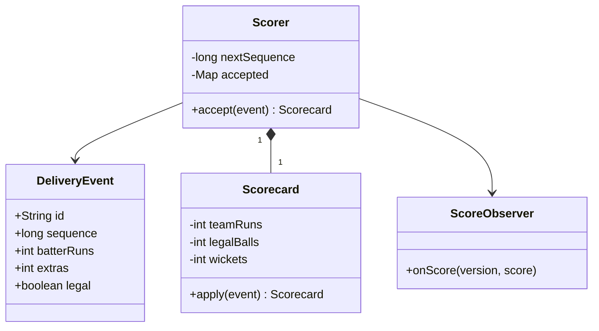

# Cricbuzz

Build a live score model where one accepted delivery updates a consistent score and can notify several views.
**Model provenance:** the diagram, ingestion protocol, and excerpt are original pedagogical models, not exact repository UML. They extend beyond the reviewed random-delivery demonstration.

## Exact study order

1. **0–5 minutes:** score an over with ordinary runs, a wide, and a wicket by hand.
2. **5–10 minutes:** distinguish delivery-event count, legal-ball count, batter runs, and team runs.
3. **10–18 minutes:** draw scorer, event, scorecard, and observer.
4. **18–25 minutes:** trace an accepted event, a duplicate, and an out-of-order arrival.
5. **25–32 minutes:** implement atomic event acceptance and score reduction.
6. **32–40 minutes:** rehearse correction replay and notification failure.

## Requirements, assumptions, and invariants

- Start with one limited-overs innings, two teams, and an authoritative scoring input.
- Each delivery has an immutable event ID, innings sequence, batter runs, extras, legality, and optional wicket details.
- Team runs equal batter runs plus extras; a wide/no-ball does not increment legal-ball count.
- Six legal balls complete an over; seven or more delivery events may occur within that over.
- Display 14 legal balls as `2.2` overs, not decimal 2.333 or 2.2 arithmetic.
- Wicket metadata records dismissal type and bowler credit; not every dismissal counts as a bowler wicket.
- Process one innings in sequence; duplicate IDs with identical payloads have no second effect.
- Same ID with different payload is a conflict; a correction is a new revision, not a disguised duplicate.
- Strike rotation and innings termination are explicit rules; follow-on, rain rules, and full tournament management are excluded.

## Minimal class diagram



## Incremental DRAW / SAY

1. **DRAW:** one event with separate bat runs and extras. **SAY:** “The team total and batter total are not identical projections.”
2. **DRAW:** legal-ball counter next to an event counter. **SAY:** “A wide is recorded but does not advance the over.”
3. **DRAW:** event IDs and sequence numbers. **SAY:** “Identity prevents duplicates; sequence preserves order.”
4. **DRAW:** a reducer producing a new scorecard. **SAY:** “Apply the accepted event atomically before notifying views.”
5. **DRAW:** commentary and scoreboard observers. **SAY:** “Observer failure must not undo the authoritative score.”

## Main method-call runtime

The original teaching driver accepts explicit events instead of randomly simulating match outcomes.

1. `main()` constructs an innings scorer with an empty immutable scorecard and sequence 1.
2. `Scorer.accept(E1)` validates the event, checks identity, and requires sequence 1.
3. `Scorecard.apply(E1)` produces a new score, including team runs, legal balls, and relevant player statistics.
4. The scorer records E1 and its resulting score together, then advances the expected sequence.
5. After commit, a notification dispatcher calls `ScoreObserver.onScore(version, snapshot)`.
6. A subscriber records its last version and ignores repeated notifications or requests a fresh snapshot after a gap.

**Failure flow:** E3 arrives before E2. Reject it as a sequence gap or buffer it outside the authoritative reducer; never score it ahead of E2.
When E1 is replayed with identical content, return its recorded result without changing current totals.
For a corrected wicket, retain the original audit record and replay the ordered stream with a superseding revision; do not subtract a guessed run total alone.

## Original Java critical method

Excerpt inside a single-innings `Scorer`; `Saved` holds the immutable event and result, and `reduce()` is pure.
Notifications happen outside this method after commit; the example is an in-memory boundary, not crash-safe storage.

```java
synchronized Scorecard accept(DeliveryEvent event) {
    Saved prior = accepted.get(event.id());
    if (prior != null) {
        if (!prior.event().equals(event)) throw new IllegalArgumentException("ID conflict");
        return prior.result();
    }
    if (event.sequence() != nextSequence) throw new IllegalStateException("Sequence gap");
    validateDelivery(event);
    Scorecard next = reduce(score, event);
    accepted.put(event.id(), new Saved(event, next));
    score = next;
    nextSequence++;
    return next;
}
```

The replay result is the historical result for that event, not necessarily the latest score; offer a separate `currentScore()` query.
For durability, persist the event, projection version, and notification outbox in one transaction.

## Pattern decision and tradeoffs

- **Primary:** Observer for multiple score consumers, with the authoritative reducer independent of notifications.
- **Optional:** Strategy for match-format limits and event sourcing when corrections/replay are requirements.
- **Avoid:** letting several observers independently mutate shared authoritative totals with no transaction boundary.
- A single scorer per innings simplifies order; partitioning one innings across writers requires a sequencing protocol.
- Immutable snapshots cost allocations but make observer inputs stable and easier to retry.
- Full replay simplifies corrections for a small match; checkpoints improve speed but require revision-aware invalidation.

## Ready-to-speak interview presentation

> “I model each delivery as an immutable ordered event. The scorer deduplicates by ID, checks sequence, and reduces it into an authoritative score before publishing updates. Legal-ball count is separate from delivery count, and team runs are separate from batter runs. Observers receive versioned snapshots and cannot corrupt scoring. Corrections are revisions followed by replay, because wickets, strike, and player statistics cannot safely be fixed by adjusting only a total.”

## Three practice rounds

### Round 1 — guided, 15 minutes
- [ ] Score six legal balls plus a wide and show the correct over notation.
- [ ] Separate batter runs, extras, and team runs on paper.
- [ ] Draw one scorer with two observers.

### Round 2 — implementation, 25 minutes
- [ ] Test identical replay, conflicting duplicate, and a sequence gap.
- [ ] Test legal-ball accounting for wides/no-balls and a non-bowler wicket.
- [ ] Replay a corrected event and assert all affected score projections.

### Round 3 — interview, 10 minutes
- [ ] Explain why an observer exception must not roll back an accepted score.
- [ ] Compare event replay with direct total mutation.
- [ ] Explain notification version gaps and resynchronization.

## Sources and reviewed scope

- Reviewed [BallDetails](https://gitlab.com/shrayansh8/lld-lowleveldesign/-/blob/5afdde64cd138ed7a8e273870598b41d63914e91/src/main/java/com/conceptcoding/interviewquestions/cricbuzz/Inning/BallDetails.java) and [BattingScoreUpdater](https://gitlab.com/shrayansh8/lld-lowleveldesign/-/blob/5afdde64cd138ed7a8e273870598b41d63914e91/src/main/java/com/conceptcoding/interviewquestions/cricbuzz/ScoreUpdater/BattingScoreUpdater.java) locally at the pinned commit.
- Observed: BallDetails creates batting/bowling observers, simulates normal deliveries with random runs/wickets, and notifies them; the batting observer updates player totals and ball count.
- Other match and bowling implementations were not reviewed here. Extras, deduplication, correction replay, and durable ingestion above are original extensions; Java was not executed.