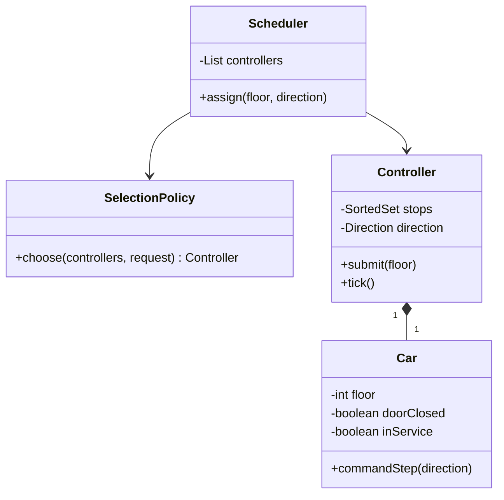

# Elevator

Design a simulation that assigns hall calls to cars and executes each car's stops.
**Model provenance:** this is an original pedagogical model, not exact repository UML and not a production or safety-certified elevator controller.

## Exact study order

1. **0–5 minutes:** distinguish a hall call `(floor, direction)` from an in-car destination.
2. **5–10 minutes:** agree on floor bounds, capacity assumptions, and service status.
3. **10–18 minutes:** draw scheduler, controller, car, and selection policy.
4. **18–25 minutes:** trace a hall call followed by an internal destination.
5. **25–32 minutes:** implement the guarded movement decision and test door-open rejection.
6. **32–40 minutes:** explain fairness, failure reassignments, and the pattern choice.

## Requirements, assumptions, and invariants

- A building has floors 0–9 and two cars; hall calls include UP or DOWN.
- Internal requests belong to the car carrying the passenger; do not reassign them to another car.
- Simulate movement one floor per tick, with arrival acknowledgement separate from command issuance.
- Door, overload, and service-state readings are supplied by a trusted simulation adapter.
- A car must not begin movement with an open door, overload, or out-of-service status.
- Destination floors must be in bounds; duplicate pending stops are coalesced.
- Scheduler chooses a car; each controller chooses its own next stop. These are different decisions.
- Emergency hardware behavior and real-time guarantees are explicitly outside this interview simulation.

## Minimal class diagram



## Incremental DRAW / SAY

1. **DRAW:** a floor button and two car boxes. **SAY:** “A hall request has no car until assignment.”
2. **DRAW:** `Scheduler → SelectionPolicy`. **SAY:** “Assignment policy can change without altering movement.”
3. **DRAW:** a stop set inside each controller. **SAY:** “Internal calls bypass assignment and enter this queue.”
4. **DRAW:** door and service guards before movement. **SAY:** “Scheduling preference cannot override these guards.”
5. **DRAW:** a direction arrow and waiting-age annotation. **SAY:** “A sweep policy needs a starvation rule.”

## Main method-call runtime

This is the teaching driver's flow; method names below need not match repository APIs.

1. `main()` constructs two `Car` objects, their controllers, and a nearest-compatible selection policy.
2. `HallButton.press(3, UP)` calls `Scheduler.assign()`.
3. `SelectionPolicy.choose()` filters out unavailable cars and picks a candidate using current snapshots.
4. `Controller.submit(3)` validates the floor and inserts a deduplicated stop.
5. `Controller.tick()` chooses a stop, checks guards, and issues one movement command.
6. Arrival acknowledgement updates the floor; at the target, the controller stops and opens the door.
7. `InternalButton.press(7)` submits directly to that same controller.

**Failure flow:** the selected car goes out of service before accepting a hall call.
Its controller rejects the assignment; the scheduler retries another eligible car using the same request ID.
An already-boarded passenger's internal call is not blindly reassigned; the simulation enters an explicit fault state.

## Original Java critical method

Excerpt inside `Controller`; execute all car events on one event loop so guard reads and command issuance cannot race.
`nextStop()` returns an `OptionalInt`; `commandStep()` issues a command, not an instantaneous arrival.

```java
void tick() {
    if (!car.inService() || !car.doorClosed() || car.overloaded()) return;
    if (car.movementPending()) return;
    OptionalInt target = nextStop();
    if (target.isEmpty()) return;
    int floor = target.getAsInt();
    if (floor == car.floor()) {
        stops.remove(floor);
        car.openDoor();
        return;
    }
    int step = Integer.compare(floor, car.floor());
    car.commandStep(step); // Arrival event updates floor later.
}
```

The simulation adapter marks a movement command pending before returning; a second tick cannot issue another step.
Real equipment requires independent hardware interlocks and a certified control design, not just this Java guard.

## Pattern decision and tradeoffs

- **Primary:** Strategy for car selection; nearest-car and least-busy policies optimize different goals.
- **Optional:** State when door, moving, idle, and fault behavior develops many event-specific transitions.
- **Avoid:** Singleton scheduler or a thread per request; neither expresses ownership or safety.
- Nearest distance is simple but ignores direction and future stops; estimated arrival time costs more to compute.
- Sweeping in one direction reduces travel, but continuous arrivals can starve the opposite queue; cap sweep duration or age requests.
- A single event loop simplifies consistency; separate car loops improve isolation but require snapshot and assignment protocols.

## Ready-to-speak interview presentation

> “I separate which car receives a hall call from which stop that car serves next. The scheduler uses a replaceable selection strategy, while each controller owns a deduplicated stop set and movement lifecycle. A tick cannot move with an open door or fault. I will first implement deterministic simulation events, then add request aging for fairness. This is an interview simulation; production elevator safety is outside the software sketch.”

## Three practice rounds

### Round 1 — guided, 15 minutes
- [ ] Draw hall and internal request paths in different colors.
- [ ] Trace floor 3 UP and then destination 7 on the assigned car.
- [ ] Explain why selection and stop ordering are separate decisions.

### Round 2 — implementation, 25 minutes
- [ ] Test duplicate stops, invalid floors, and a request at the current floor.
- [ ] Test open door, overload, and movement-pending guards.
- [ ] Simulate a continuous UP workload and demonstrate a bounded DOWN wait policy.

### Round 3 — interview, 10 minutes
- [ ] Compare nearest and least-busy assignment without claiming either is universally best.
- [ ] Describe a failed assignment and safe reassignment of a hall call.
- [ ] State the simulation's safety and hardware limitations explicitly.

## Sources and reviewed scope

- Reviewed [Demo](https://gitlab.com/shrayansh8/lld-lowleveldesign/-/blob/5afdde64cd138ed7a8e273870598b41d63914e91/src/main/java/com/conceptcoding/interviewquestions/elevator/Demo.java) and [ElevatorController](https://gitlab.com/shrayansh8/lld-lowleveldesign/-/blob/5afdde64cd138ed7a8e273870598b41d63914e91/src/main/java/com/conceptcoding/interviewquestions/elevator/ElevatorController.java) locally at the pinned commit.
- Observed: Demo constructs a scheduler with nearest selection and starts controller threads; the controller uses up/down priority queues and monitor wait/notify.
- Only those files were reviewed. The event-loop guards and fairness policy here are original extensions, not verified source behavior; Java was not executed.
- [Supplied PDF](https://drive.google.com/file/d/1MGudMSiJj2JMC75qq3o34gW2Kz-UAYPl/view?usp=drive_link) is unreviewed.