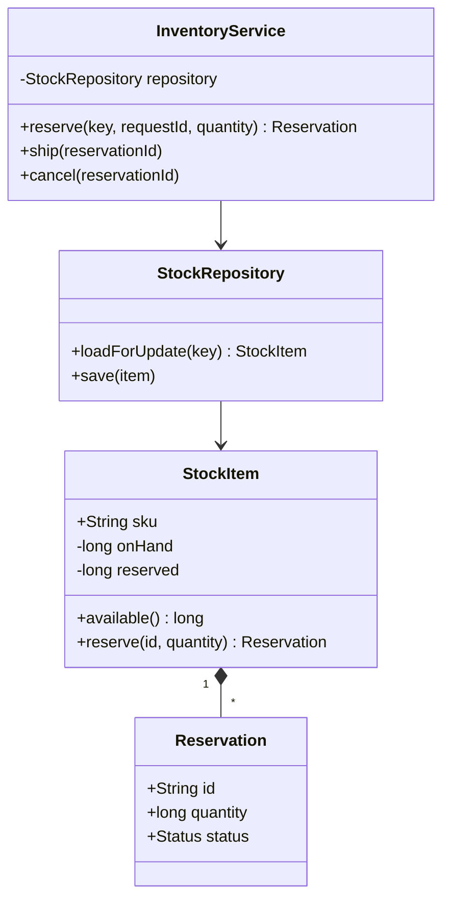

# Inventory Management

Start with the invariant that an order may reserve only stock that is physically on hand and not already reserved.
**Model provenance:** all diagrams and Java below are original pedagogical models, not exact repository UML. The supplied inventory link belongs to a different repository that was not fetched or reviewed.

## Exact study order

1. **0–5 minutes:** distinguish receiving, reserving, canceling, and shipping stock.
2. **5–10 minutes:** calculate on-hand, reserved, and available counts for one SKU.
3. **10–18 minutes:** draw stock item, reservation, inventory service, and repository boundary.
4. **18–25 minutes:** trace two orders competing for the last units.
5. **25–32 minutes:** implement atomic idempotent reservation for one stock item.
6. **32–40 minutes:** rehearse cancellation, shipment retries, and multi-item tradeoffs.

## Requirements, assumptions, and invariants

- Track integer units by `(warehouseId, sku)`; no fractional quantities in the first model.
- `onHand` counts sellable physical units; `reserved` counts units promised to unshipped orders.
- `available = onHand - reserved`; all counts remain nonnegative and reserved never exceeds on-hand.
- Receiving increases on-hand; reservation increases reserved but does not remove physical units.
- Shipping a reservation decreases both on-hand and reserved by its quantity.
- Canceling an unshipped reservation decreases reserved only; repeated cancellation has no second effect.
- Every command has a stable operation ID and payload fingerprint; conflicting ID reuse is rejected.
- Start with one SKU per reservation; an all-or-nothing multi-SKU order needs a wider transaction boundary.
- Backorders, batches, expiry dates, and serial numbers are explicit extensions rather than hidden assumptions.
- Lost or damaged reserved units require shortage resolution; do not silently make available stock negative.

## Minimal class diagram



## Incremental DRAW / SAY

1. **DRAW:** three counters: on-hand 10, reserved 3, available 7. **SAY:** “Reservation promises units without removing them.”
2. **DRAW:** reserve +2, then ship 2. **SAY:** “Shipment reduces both on-hand and reserved.”
3. **DRAW:** a reservation ID next to the counters. **SAY:** “We need ownership to release the correct promise.”
4. **DRAW:** a lock or version on one warehouse-SKU row. **SAY:** “Availability check and increment must commit together.”
5. **DRAW:** canceled and shipped terminal states. **SAY:** “Retries consult the record instead of decrementing again.”

## Main method-call runtime

This wholly original driver is not asserted to match the unreviewed repository.

1. `main()` creates stock W1/SKU1 with on-hand 10, reserved 0.
2. `InventoryService.reserve(key, "R1", 4)` loads the stock item under its write boundary.
3. `StockItem.reserve()` checks the request ID, validates quantity, and verifies four units are available.
4. Commit reservation R1 plus reserved=4 together; available becomes 6.
5. `ship("R1")` checks that R1 is active, then commits on-hand=6, reserved=0, status=SHIPPED.
6. A repeated ship request returns the recorded shipment rather than decrementing the counters again.

**Failure flow:** R2 and R3 each request four units while only six are available.
One reserves successfully; the second rechecks after serialization and is rejected with available=2.
If an order cancels before shipment, cancel its active reservation; do not increase on-hand because the goods never left.
Unknown warehouse fulfillment outcomes need reconciliation before cancellation, otherwise physically shipped goods may be resold.

## Original Java critical method

Excerpt inside one `StockItem`; all writers share its monitor and `requests` retains terminal reservations for idempotency.
`Reservation` is immutable to callers; lifecycle changes also occur through the stock item's guarded methods.

```java
synchronized Reservation reserve(String requestId, long quantity) {
    if (requestId == null || requestId.isBlank() || quantity <= 0) {
        throw new IllegalArgumentException("Invalid request");
    }
    Reservation prior = requests.get(requestId);
    if (prior != null) {
        if (prior.quantity() != quantity) throw new IllegalArgumentException("ID conflict");
        return prior;
    }
    if (quantity > onHand - reserved) throw new IllegalStateException("Insufficient stock");
    Reservation created = Reservation.active(requestId, quantity);
    requests.put(requestId, created);
    reserved += quantity;
    return created;
}
```

Here the object already fixes warehouse and SKU; a service-wide fingerprint must also include those fields and the order owner.
The monitor provides no cross-process protection or crash persistence. A database transaction must save counters and request identity together.

## Pattern decision and tradeoffs

- **Primary:** Repository plus an aggregate transaction boundary for one warehouse-SKU; correctness matters more than a named behavioral pattern.
- **Optional:** Strategy for warehouse selection and Observer/outbox notifications for low-stock alerts.
- **Avoid:** a Singleton inventory map or treating stock search as a guaranteed allocation.
- Pessimistic row locks simplify high-contention updates; optimistic versions work well with fewer collisions but need bounded retries.
- Reserving multiple SKUs in one database can use ordered locks and a transaction; distributed warehouses may require compensation.
- A movement ledger improves auditability, while cached counts accelerate reads; reconciliation checks the two remain consistent.
- Reservations with expiry reduce abandoned stock holds, but cannot expire during uncertain physical fulfillment without coordination.

## Ready-to-speak interview presentation

> “I separate on-hand, reserved, and available stock. Reserve promises units; ship removes them physically and releases the promise; cancel only releases the promise. A warehouse-SKU aggregate owns the availability check and update, and command IDs make retries safe. I start with one-SKU operations, then explain the transaction or compensation needed for a multi-item order. This guide is an original design because the supplied separate repository was not reviewed.”

## Three practice rounds

### Round 1 — guided, 15 minutes
- [ ] Calculate the three counters across receive, reserve, cancel, and ship.
- [ ] Draw ownership from stock item to reservation.
- [ ] Explain why cancel does not add physical stock.

### Round 2 — implementation, 25 minutes
- [ ] Test zero/negative quantities and competing requests for the last units.
- [ ] Test duplicate reserve, conflicting ID reuse, repeated cancel, and repeated ship.
- [ ] Assert the count invariants after every accepted command.

### Round 3 — interview, 10 minutes
- [ ] Compare optimistic versions with row locks.
- [ ] Explain multi-SKU atomicity and rollback/compensation requirements.
- [ ] Handle a shipment timeout without incorrectly releasing stock.

## Sources and reviewed scope

- [Supplied inventory repository directory](https://gitlab.com/shrayansh8/interviewcodingpractise/-/tree/main/src/main/java/com/conceptandcoding/LowLevelDesign/DesignOrderManagementSystem?ref_type=heads) belongs to `interviewcodingpractise`, not the locally reviewed `lld-lowleveldesign` clone.
- That separate source was not fetched or reviewed; its classes, behavior, current revision, and correspondence to this model are unverified.
- No pinned inventory implementation claim is made. The original excerpt was not executed and demonstrates only one in-memory consistency boundary.