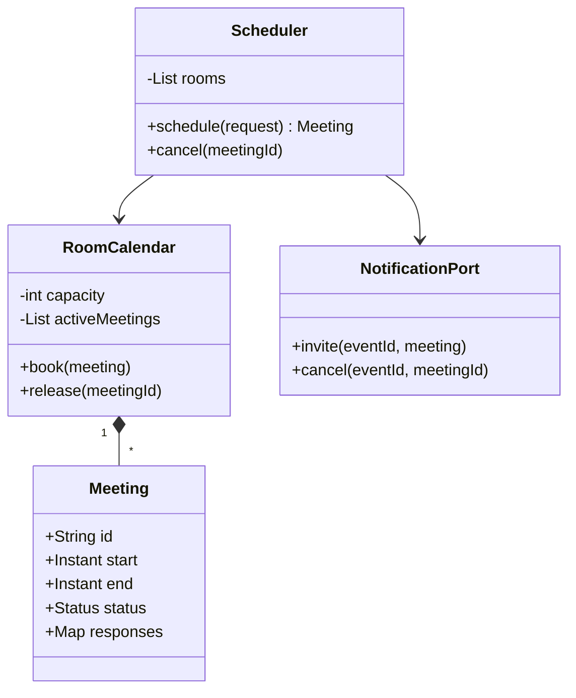

# Meeting Scheduler

The core operation is claiming a room interval; finding a free room and sending invitations are separate steps.
**Model provenance:** the diagram, interval protocol, and Java excerpt are original pedagogical models, not exact repository UML.

## Exact study order

1. **0–5 minutes:** narrate organizer → time → participants → room → invitations.
2. **5–10 minutes:** choose interval boundaries, capacity counting, and participant conflict policy.
3. **10–18 minutes:** draw scheduler, room calendar, meeting, and notification port.
4. **18–25 minutes:** trace competing bookings and an adjacent meeting.
5. **25–32 minutes:** implement atomic room-calendar conflict detection and insertion.
6. **32–40 minutes:** rehearse time zones, cancellation, rescheduling, and notification retries.

## Requirements, assumptions, and invariants

- Schedule one non-recurring meeting with an organizer, distinct attendees, room, and interval.
- Convert user-local date/time plus zone to UTC instants; reject nonexistent or unresolved ambiguous local times.
- Store the presentation zone separately so invitations display the intended local time.
- Use half-open intervals `[start, end)` with start before end; back-to-back meetings are allowed.
- Count distinct physical attendees including the organizer exactly once when checking room capacity.
- No active meetings in one room may overlap; availability search alone does not reserve anything.
- In this initial policy, participant calendar conflicts are warnings, not room-booking rejection conditions.
- Invitation responses (`PENDING`, `ACCEPTED`, `DECLINED`) are distinct from meeting status (`ACTIVE`, `CANCELLED`).
- A declined invitation does not automatically cancel the organizer's meeting or release its room.
- Cancellation is idempotent and removes/marks the meeting across room and participant views, regardless of acceptance.

## Minimal class diagram



## Incremental DRAW / SAY

1. **DRAW:** room timeline with 10:00–11:00 and 11:00–12:00. **SAY:** “Touching endpoints are not overlap under this policy.”
2. **DRAW:** attendee set plus organizer. **SAY:** “Capacity uses distinct people, not a blindly incremented list size.”
3. **DRAW:** `RoomCalendar.book()` around check-and-insert. **SAY:** “The calendar owns the no-overlap invariant.”
4. **DRAW:** responses beside, not inside, room occupancy. **SAY:** “Declining an invitation does not unbook the room.”
5. **DRAW:** notifications after commit. **SAY:** “A mail failure retries delivery; it does not erase the reservation.”

## Main method-call runtime

This original teaching flow makes persistence and notification ordering explicit beyond the reviewed sample.

1. `main()` creates rooms and calls `Scheduler.schedule()` with a normalized interval and attendee IDs.
2. The scheduler validates membership, organizer permissions, interval, and distinct physical headcount.
3. `findCandidates()` filters capacity and current availability, producing advisory candidates.
4. `RoomCalendar.book()` atomically rechecks overlap and records an active meeting on one candidate.
5. Persist the meeting, participant-view updates, and an invitation outbox record in the transaction boundary.
6. A dispatcher calls `NotificationPort.invite()`; each delivery uses a stable event ID for retry handling.
7. `respond(meetingId, userId, ACCEPTED)` updates only that participant's response.

**Failure flow:** two organizers select the same room and interval from a stale availability result.
Only one atomic booking succeeds. The other retries a different candidate or reports no availability without sending invitations.
If email fails after commit, keep the room booking and retry notification; show pending delivery rather than claiming the meeting failed.
Cancellation commits a status change and release once, then notifies all invitees, including those still pending or declined.

## Original Java critical method

Excerpt inside one `RoomCalendar`; meeting IDs and intervals are immutable, and every calendar mutation uses this monitor.
`sameRequest()` compares the full scheduling payload so same-ID conflicting retries cannot silently succeed.

```java
synchronized void book(Meeting meeting) {
    if (!meeting.start().isBefore(meeting.end())
            || meeting.headcount() > capacity || meeting.headcount() <= 0) {
        throw new IllegalArgumentException("Invalid interval or capacity");
    }
    Meeting prior = byId.get(meeting.id());
    if (prior != null) {
        if (!prior.sameRequest(meeting)) throw new IllegalArgumentException("ID conflict");
        return;
    }
    boolean overlap = activeMeetings.stream().anyMatch(existing ->
        meeting.start().isBefore(existing.end())
            && existing.start().isBefore(meeting.end()));
    if (overlap) throw new IllegalStateException("Room unavailable");
    byId.put(meeting.id(), meeting);
    activeMeetings.add(meeting);
}
```

Retain terminal IDs in `byId` for replay detection; cancellation removes only the active occupancy and records canceled status.
A database version requires transactional interval exclusion or serialized room writes; JVM synchronization cannot coordinate independent instances.

## Pattern decision and tradeoffs

- **Primary:** encapsulated calendar aggregate with a repository transaction boundary; no behavioral pattern is required for basic overlap detection.
- **Optional:** Strategy for room selection and Observer/outbox delivery for invitations and updates.
- **Avoid:** Singleton calendars, sending invitations before reservation succeeds, or storing only local wall-clock times.
- A linear scan is sufficient for a small calendar; ordered indexes or interval trees help larger workloads but do not replace write atomicity.
- Treat participant conflicts as a configurable policy; hard conflicts require atomic checks across several calendars and a deadlock-safe locking order.
- Rescheduling should reserve the new slot and release the old within one transaction when possible; a failed move must preserve the old booking.
- Recurrence is a series with exceptions and time-zone rules, not merely copying one UTC interval every 24 hours.

## Ready-to-speak interview presentation

> “I separate finding a room from claiming its interval. The room calendar atomically checks half-open overlap and inserts a meeting, counting the organizer among distinct attendees. Participant responses do not control room ownership. Invitations are emitted after commit and can retry independently. Cancellation releases once and updates every invitee view. I store instants plus the intended zone, and I explicitly defer recurring-series rules until the basic lifecycle is correct.”

## Three practice rounds

### Round 1 — guided, 15 minutes
- [ ] Draw adjacent, nested, and partially overlapping meetings.
- [ ] Count an organizer who is already in the attendee list exactly once.
- [ ] Explain why a decline does not release the room.

### Round 2 — implementation, 25 minutes
- [ ] Test invalid intervals, insufficient capacity, and concurrent identical-slot requests.
- [ ] Test duplicate scheduling IDs, repeated cancellation, and notification failure.
- [ ] Test ambiguous/nonexistent local times at daylight-saving boundaries with an explicit resolution policy.

### Round 3 — interview, 10 minutes
- [ ] Explain a reschedule that fails without losing the original room.
- [ ] Compare soft participant warnings with hard calendar constraints.
- [ ] Describe why recurrence needs local-zone semantics and exception records.

## Sources and reviewed scope

- Reviewed [MeetingScheduler](https://gitlab.com/shrayansh8/lld-lowleveldesign/-/blob/5afdde64cd138ed7a8e273870598b41d63914e91/src/main/java/com/conceptcoding/interviewquestions/meetingscheduler/MeetingScheduler.java) and [Calendar](https://gitlab.com/shrayansh8/lld-lowleveldesign/-/blob/5afdde64cd138ed7a8e273870598b41d63914e91/src/main/java/com/conceptcoding/interviewquestions/meetingscheduler/Calendar.java) locally at the pinned commit.
- Observed: the scheduler finds a room, creates a meeting, updates calendars, sends notifications, and simulates accepted responses; Calendar stores meetings in a map keyed by TimeInterval.
- MeetingRoom and TimeInterval implementations were not reviewed here, so their overlap/equality semantics are not verified. Atomicity, time-zone handling, and outbox delivery above are original extensions; Java was not executed.