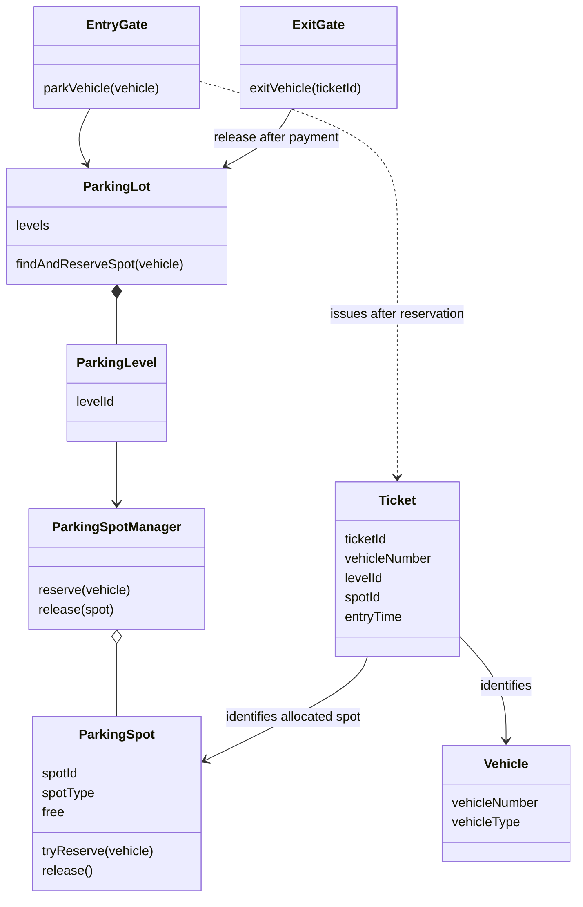
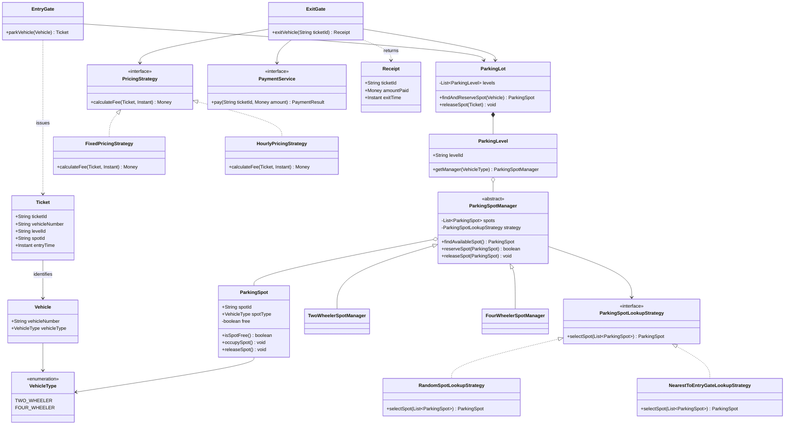
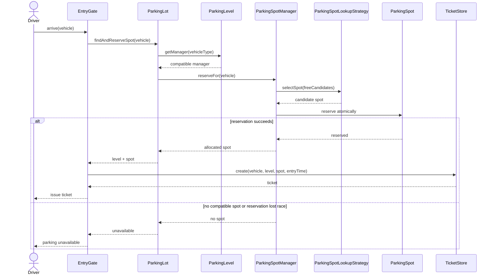
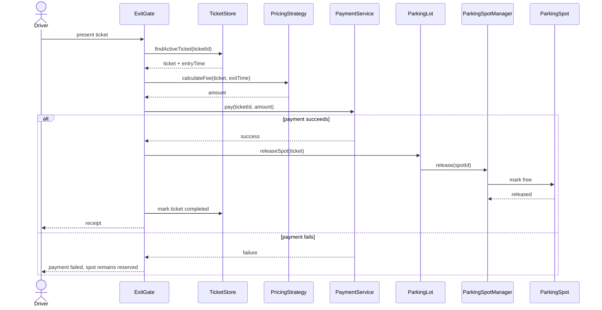

# LLD Interview Playbook — Parking Lot Design

**[START HERE] Read [3. Parking Lot: problem overview](#3-parking-lot-problem-overview) first.** Your complete ready-to-speak script is [EXACTLY HOW TO PRESENT THIS TO THE INTERVIEWER](#exactly-how-to-present-this-to-the-interviewer). Follow the [ten-stage roadmap](#beginner-start-here--your-learning-roadmap) below; you do not need to study the source audit before practising.

> **Purpose:** Learn to present the Parking Lot LLD in an interview: clarify requirements, draw a readable UML design, narrate the runtime flow, explain Java responsibilities, and defend trade-offs.
>
> **Source discipline — updated November 1, 2026:** The supplied playbook is preserved as the learning guide below. The Parking PDF's extracted text and **all 21 Java files** in the local research clone have now been read. Earlier statements that the implementation could not be inspected are superseded by the audit below. **Source-reviewed does not mean model-identical:** the teaching diagrams, speaking scripts, and Java snippets remain illustrative proposals, not transcriptions of the repository.

<details>
<summary>Optional source audit — expand to compare GitLab behavior with the interview model</summary>

## Source audit — verified implementation versus interview model {#source-audit}

**Snapshot:** [GitLab parking_lot at commit 5afdde64cd138ed7a8e273870598b41d63914e91](https://gitlab.com/shrayansh8/lld-lowleveldesign/-/tree/5afdde64cd138ed7a8e273870598b41d63914e91/src/main/java/com/conceptcoding/interviewquestions/parking_lot), commit timestamp **2026-01-12T08:19:51Z**. Audit date: **2026-11-01**. The local clone's HEAD was checked against that hash. This is a pinned snapshot, not a claim about today's remote HEAD.

**Evidence and limits:** This milestone read the local research report, all 21 Java files in the parking package, and the complete six-page Parking PDF text extraction. The existing research records successful public GitLab access and a shallow clone without credentials; no new web requests were needed. The PDF's embedded UML images were **not** visually reviewed/OCRed. Exact picture labels therefore remain unverified. The linked video was not reviewed. Java behavior below is established by **static inspection**, not by running/building the upstream program or testing concurrency/payment failures. Other repository packages were not implementation-audited for this milestone.

Read claims in three layers:

1. **PDF requirements:** multiple gates/levels, vehicle-category allocation, narrow locking scope, selectable lookup/pricing policies, ticket details, and release after successful payment.
2. **Verified implementation:** the exact names and behavior in this audit, with immutable source links.
3. **Interview model / recommended improvements:** the remainder of this guide's diagrams and Java samples. Shared names do not imply shared signatures, algorithms, or guarantees.

### Exact names and behavior checked

All 21 Java files are accounted for in the groups below. Links point to the audited commit; no third-party implementation is reproduced wholesale.

| Area / exact verified types | Verified behavior | Difference from the teaching model |
|---|---|---|
| [Vehicle](https://gitlab.com/shrayansh8/lld-lowleveldesign/-/blob/5afdde64cd138ed7a8e273870598b41d63914e91/src/main/java/com/conceptcoding/interviewquestions/parking_lot/Entity/Vehicle.java), [VehicleType](https://gitlab.com/shrayansh8/lld-lowleveldesign/-/blob/5afdde64cd138ed7a8e273870598b41d63914e91/src/main/java/com/conceptcoding/interviewquestions/parking_lot/enums/VehicleType.java), [ParkingSpot](https://gitlab.com/shrayansh8/lld-lowleveldesign/-/blob/5afdde64cd138ed7a8e273870598b41d63914e91/src/main/java/com/conceptcoding/interviewquestions/parking_lot/Entity/ParkingSpot.java) | Vehicle has number/type; enum contains `TWO_WHEELER` and `FOUR_WHEELER`. Spot has `spotId`, `isFree`, `isSpotFree()`, `occupySpot()`, `releaseSpot()`, and `getSpotId()`. | The actual spot has **no vehicle type, ownership token, or synchronized `tryReserve()`**. Sample validation and spot-level atomic reservation below are improvements. |
| [ParkingLot](https://gitlab.com/shrayansh8/lld-lowleveldesign/-/blob/5afdde64cd138ed7a8e273870598b41d63914e91/src/main/java/com/conceptcoding/interviewquestions/parking_lot/parkinglot/ParkingLot.java), [ParkingBuilding](https://gitlab.com/shrayansh8/lld-lowleveldesign/-/blob/5afdde64cd138ed7a8e273870598b41d63914e91/src/main/java/com/conceptcoding/interviewquestions/parking_lot/parkinglot/ParkingBuilding.java), [ParkingLevel](https://gitlab.com/shrayansh8/lld-lowleveldesign/-/blob/5afdde64cd138ed7a8e273870598b41d63914e91/src/main/java/com/conceptcoding/interviewquestions/parking_lot/parkinglot/ParkingLevel.java), [EntranceGate](https://gitlab.com/shrayansh8/lld-lowleveldesign/-/blob/5afdde64cd138ed7a8e273870598b41d63914e91/src/main/java/com/conceptcoding/interviewquestions/parking_lot/parkinglot/EntranceGate.java) | `ParkingLot.vehicleArrives()` delegates to `EntranceGate.enter()`, then `ParkingBuilding.allocate()`, then `ParkingLevel.park()`. Building owns levels and creates the ticket after allocation. Level routes by `Map<VehicleType, ParkingSpotManager>`. | Actual name is **`EntranceGate`, not `EntryGate`**. The model folds building responsibility into the lot and uses `findAndReserveSpot()`, `getManager()`, and `parkVehicle()` as illustrative APIs. The building's `CostComputation` constructor parameter is unused. |
| [ParkingSpotManager](https://gitlab.com/shrayansh8/lld-lowleveldesign/-/blob/5afdde64cd138ed7a8e273870598b41d63914e91/src/main/java/com/conceptcoding/interviewquestions/parking_lot/spotManagers/ParkingSpotManager.java), [TwoWheelerSpotManager](https://gitlab.com/shrayansh8/lld-lowleveldesign/-/blob/5afdde64cd138ed7a8e273870598b41d63914e91/src/main/java/com/conceptcoding/interviewquestions/parking_lot/spotManagers/TwoWheelerSpotManager.java), [FourWheelerSpotManager](https://gitlab.com/shrayansh8/lld-lowleveldesign/-/blob/5afdde64cd138ed7a8e273870598b41d63914e91/src/main/java/com/conceptcoding/interviewquestions/parking_lot/spotManagers/FourWheelerSpotManager.java) | Abstract manager uses a **fair `ReentrantLock` per manager**. `park()` selects and occupies under one lock; `unPark()` and `hasFreeSpot()` also lock. Category subclasses pass inventory and strategy to the parent. | No `reserve(vehicle)` or retry loop. Compatibility relies on configured category inventories. Correct reservation relies on the same manager guarding its spots and a strategy returning a free managed spot; direct spot mutation or overlapping managers can bypass that protection. |
| [ParkingSpotLookupStrategy](https://gitlab.com/shrayansh8/lld-lowleveldesign/-/blob/5afdde64cd138ed7a8e273870598b41d63914e91/src/main/java/com/conceptcoding/interviewquestions/parking_lot/LookupStrategy/ParkingSpotLookupStrategy.java), [RandomLookupStrategy](https://gitlab.com/shrayansh8/lld-lowleveldesign/-/blob/5afdde64cd138ed7a8e273870598b41d63914e91/src/main/java/com/conceptcoding/interviewquestions/parking_lot/LookupStrategy/RandomLookupStrategy.java) | `selectSpot(List<ParkingSpot>)` receives the **whole manager list**. Despite its name, `RandomLookupStrategy` returns the **first free spot in a linear scan**, or `null`. | Not `RandomSpotLookupStrategy`; not actual randomness. No nearest-to-entry implementation exists in this package. The model's prefiltered candidates and random-number selection are illustrative. |
| [Ticket](https://gitlab.com/shrayansh8/lld-lowleveldesign/-/blob/5afdde64cd138ed7a8e273870598b41d63914e91/src/main/java/com/conceptcoding/interviewquestions/parking_lot/Ticket.java) | Holds `Vehicle`, `ParkingLevel`, and `ParkingSpot` object references plus `LocalDateTime.now()` as entry time. | No `ticketId`, ID-based store, status/completed flag, exit timestamp, or injected clock. The model's IDs and `Instant` are recommendations, not source fields. |
| [PricingStrategy](https://gitlab.com/shrayansh8/lld-lowleveldesign/-/blob/5afdde64cd138ed7a8e273870598b41d63914e91/src/main/java/com/conceptcoding/interviewquestions/parking_lot/pricing/PricingStrategy.java), [FixedPricingStrategy](https://gitlab.com/shrayansh8/lld-lowleveldesign/-/blob/5afdde64cd138ed7a8e273870598b41d63914e91/src/main/java/com/conceptcoding/interviewquestions/parking_lot/pricing/FixedPricingStrategy.java), [CostComputation](https://gitlab.com/shrayansh8/lld-lowleveldesign/-/blob/5afdde64cd138ed7a8e273870598b41d63914e91/src/main/java/com/conceptcoding/interviewquestions/parking_lot/pricing/CostComputation.java) | `CostComputation.compute(ticket)` delegates to `PricingStrategy.calculate(ticket)`, returning `double`. Fixed pricing returns **100**, irrespective of duration/type. | `PricingStrategy` and `FixedPricingStrategy` **are verified names**, but the model's `BigDecimal calculateFee(...)` signatures differ. No `HourlyPricingStrategy`, `Money`, or clock abstraction was found in the package. |
| [ExitGate](https://gitlab.com/shrayansh8/lld-lowleveldesign/-/blob/5afdde64cd138ed7a8e273870598b41d63914e91/src/main/java/com/conceptcoding/interviewquestions/parking_lot/parkinglot/ExitGate.java), [Payment](https://gitlab.com/shrayansh8/lld-lowleveldesign/-/blob/5afdde64cd138ed7a8e273870598b41d63914e91/src/main/java/com/conceptcoding/interviewquestions/parking_lot/payment/Payment.java), [CashPayment](https://gitlab.com/shrayansh8/lld-lowleveldesign/-/blob/5afdde64cd138ed7a8e273870598b41d63914e91/src/main/java/com/conceptcoding/interviewquestions/parking_lot/payment/CashPayment.java), [UPIPayment](https://gitlab.com/shrayansh8/lld-lowleveldesign/-/blob/5afdde64cd138ed7a8e273870598b41d63914e91/src/main/java/com/conceptcoding/interviewquestions/parking_lot/payment/UPIPayment.java) | `ParkingLot.vehicleExits(ticket, payment)` delegates to `ExitGate.completeExit(building, ticket, payment)`: compute price, call `Payment.pay(double)`, throw on `false`, then `building.release(ticket)`. Both payment implementations print and always return `true`. | No real provider integration, ticket lookup/completion, `PaymentService`, `PaymentResult`, or `Receipt`. The failure branch exists, but the supplied payment demos cannot exercise a declined payment. |
| [ParkingLotClient](https://gitlab.com/shrayansh8/lld-lowleveldesign/-/blob/5afdde64cd138ed7a8e273870598b41d63914e91/src/main/java/com/conceptcoding/interviewquestions/parking_lot/ParkingLotClient.java) | Wires two levels, six total spots, two category managers per level, one shared lookup strategy, fixed pricing, bike/car entry, and cash/UPI exit. | A sequential demonstration, not a concurrency test or a demonstration of multiple gate instances. |

### Actual runtime trace and failure limits

**Verified entry:** `ParkingLot.vehicleArrives(vehicle)` → `EntranceGate.enter(building, vehicle)` → `ParkingBuilding.allocate(vehicle)` → level `hasAvailability(type)` / `park(type)` → manager `park()` → strategy `selectSpot(spots)` and spot `occupySpot()` under the manager lock → building creates `Ticket(vehicle, level, spot)`.

**Verified exit:** `ParkingLot.vehicleExits(ticket, payment)` → `ExitGate.completeExit(...)` → `CostComputation.compute(ticket)` → `PricingStrategy.calculate(ticket)` → `Payment.pay(amount)` → `ParkingBuilding.release(ticket)` → `ParkingLevel.unPark(type, spot)` → manager `unPark(spot)` → spot `releaseSpot()` under the manager lock.

- **Full / contention:** availability checking and parking are separate calls. `park()` reselects under lock and can return `null` after another caller takes the spot; the building continues to other levels and eventually throws `RuntimeException("Parking Full")`. There is no explicit retry loop or typed unavailable result.
- **Unsupported category:** `hasAvailability()` returns false if no manager exists. Calling `ParkingLevel.park(type)` directly without a manager throws `IllegalArgumentException`.
- **Payment declined:** the exit gate throws `RuntimeException("Payment failed. Exit denied.")` before releasing. Demonstrating this would require a failing payment implementation; the bundled cash/UPI stubs always succeed.
- **Duplicate / stale ticket risks:** no active-ticket state, ownership validation, or payment idempotency is implemented. A repeated exit can charge again; a stale ticket can free a spot subsequently assigned to another vehicle. These are **static-analysis risks**, not experimentally demonstrated failures.
- **Production gaps:** no durable recovery, persistence, distributed coordination, or robust provider failure handling. A per-manager lock protects only shared in-process inventory; it is not a distributed guarantee.

### How to use the rest of this playbook

Keep the simpler model for interview rehearsal; do not silently rename it to look like a source transcription. Say: “The reference implementation uses `EntranceGate`, `ParkingBuilding`, a manager lock, first-free selection, and fixed pricing. My proposed model adds atomic spot reservation, explicit ticket identity, selectable hourly pricing, and recoverable payment state where the requirements justify them.”

The original PDF-derived responsibility lists are conceptual, **not an exact UML-image transcription**. In particular, text extraction supports random/nearest-to-entrance *policy examples*, but not every expanded class name used below. `ticketId` is a proposed addition; the PDF text lists vehicle number, level, spot, and entry time. No license/copying/notice file was found in the research clone; public access alone is not permission to republish it. This page preserves the supplied playbook and adds explanation and links, not wholesale upstream Java or PDF copies.

</details>

## [START HERE] BEGINNER START HERE — YOUR LEARNING ROADMAP {#beginner-start-here--your-learning-roadmap}

**Read first:** Start with **[Stage 1 — 3. Parking Lot: problem overview](#3-parking-lot-problem-overview)**. Do not begin by memorizing every class or reading every Java file.

**Complete speaking script:** Use **[EXACTLY HOW TO PRESENT THIS TO THE INTERVIEWER](#exactly-how-to-present-this-to-the-interviewer)**. Practise it aloud after Stage 6, then return to it before a mock interview.

**How to use this guide:** Follow the ten stages below. “Ready to move on” means you can do the checkpoint without copying the answer word for word.

| Stage | Exact section heading to read | What to learn | Ready to move on when… | Priority |
|---:|---|---|---|---|
| 1. Understand the problem | [3. Parking Lot: problem overview](#3-parking-lot-problem-overview) | What the system does, the actors, the main flow and the invariants | You can explain vehicle entry through successful exit in 3–5 sentences | **MUST LEARN FIRST** |
| 2. Learn requirements and assumptions | [4. Requirements and clarifying questions](#4-requirements-and-clarifying-questions) | Required features, assumptions, and questions to ask before designing | You can ask at least five useful clarifying questions and state your assumptions | **MUST LEARN FIRST** |
| 3. Understand classes and responsibilities | [5. PDF-derived objects and responsibilities](#5-pdf-derived-objects-and-responsibilities) | What each object owns and what it should not do | You can explain `Vehicle`, `ParkingSpot`, `ParkingSpotManager`, `ParkingLevel`, `ParkingLot`, `EntryGate`, `Ticket`, and `ExitGate` in one sentence each | **MUST LEARN FIRST** |
| 4. Learn the minimum class diagram | [RECOMMENDED INTERVIEW DESIGN — DRAW THIS FIRST](#recommended-interview-design--draw-this-first) | The smallest diagram that covers the main use case | You can redraw the primary diagram from memory in about 3 minutes | **MUST LEARN FIRST** |
| 5. Practise drawing step by step | [6. Whiteboard drawing guide](#6-whiteboard-drawing-guide) and [DRAWING AND SPEAKING GUIDE — DIAGRAM BY DIAGRAM](#drawing-and-speaking-guide--diagram-by-diagram) | When to add each box, line and interface, and what to say while drawing | You can draw without adding every optional class at once | **MUST LEARN FIRST** |
| 6. Practise the exact interview script | [EXACTLY HOW TO PRESENT THIS TO THE INTERVIEWER](#exactly-how-to-present-this-to-the-interviewer) | Ready-to-speak sentences in interview order | You can present the problem and diagram aloud without reading every line | **MUST LEARN FIRST** |
| 7. Learn the runtime sequence diagram | [8. Entry and exit sequence diagrams](#8-entry-and-exit-sequence-diagrams) and [BEGINNER RUNTIME WALKTHROUGH](#beginner-runtime-walkthrough) | Which object calls which method and what happens on success/failure | You can trace entry and exit one call at a time | **MUST LEARN FIRST** |
| 8. Understand the Java code | [9. Java implementation walkthrough](#9-java-implementation-walkthrough) | Reservation, ticket creation, pricing, and exit orchestration | You can explain the key methods and write a basic reservation method | **MUST LEARN FIRST** |
| 9. Learn patterns and trade-offs | [WHICH DESIGN PATTERN SHOULD I USE AND WHY?](#which-design-pattern-should-i-use-and-why), [PATTERNS I SHOULD NOT ADD AUTOMATICALLY](#patterns-i-should-not-add-automatically), and [10. Design patterns and SOLID](#10-design-patterns-and-solid) | Why Strategy fits policy variation, and when not to add more patterns | You can justify the pattern in plain English and explain a simpler alternative | **LEARN AFTER THE BASICS** |
| 10. Practise follow-up questions | [13. Interviewer follow-up questions](#13-interviewer-follow-up-questions) and [FINAL PRACTICE MODE](#final-practice-mode) | Concurrency, failures, extensibility and trade-offs | You can answer the beginner round first, then handle advanced questions | **LEARN AFTER THE BASICS** |

**[MUST LEARN] Beginner rule:** You do not need to memorize the entire detailed diagram before you can practise. Learn the problem, requirements, class responsibilities and primary diagram first. Add abstractions only when you can explain which requirement justifies them.

---

## Table of contents

- [Source audit — verified implementation versus interview model](#source-audit)
- [BEGINNER START HERE — YOUR LEARNING ROADMAP](#beginner-start-here--your-learning-roadmap)
- [1. Source and coverage inventory](#1-source-and-coverage-inventory)
- [2. Reusable 35–45 minute LLD framework](#2-reusable-3545-minute-lld-framework)
- [3. Parking Lot: problem overview](#3-parking-lot-problem-overview)
- [EXACTLY HOW TO PRESENT THIS TO THE INTERVIEWER](#exactly-how-to-present-this-to-the-interviewer)
- [4. Requirements and clarifying questions](#4-requirements-and-clarifying-questions)
- [5. PDF-derived objects and responsibilities](#5-pdf-derived-objects-and-responsibilities)
- [RECOMMENDED INTERVIEW DESIGN — DRAW THIS FIRST](#recommended-interview-design--draw-this-first)
- [6. Whiteboard drawing guide](#6-whiteboard-drawing-guide)
- [DRAWING AND SPEAKING GUIDE — DIAGRAM BY DIAGRAM](#drawing-and-speaking-guide--diagram-by-diagram)
- [7. Interview-ready UML class diagram](#7-interview-ready-uml-class-diagram)
- [8. Entry and exit sequence diagrams](#8-entry-and-exit-sequence-diagrams)
- [BEGINNER RUNTIME WALKTHROUGH](#beginner-runtime-walkthrough)
- [9. Java implementation walkthrough](#9-java-implementation-walkthrough)
- [WHICH DESIGN PATTERN SHOULD I USE AND WHY?](#which-design-pattern-should-i-use-and-why)
- [PATTERNS I SHOULD NOT ADD AUTOMATICALLY](#patterns-i-should-not-add-automatically)
- [10. Design patterns and SOLID](#10-design-patterns-and-solid)
- [11. Concurrency, edge cases, and testing](#11-concurrency-edge-cases-and-testing)
- [12. Interview speaking script](#12-interview-speaking-script)
- [13. Interviewer follow-up questions](#13-interviewer-follow-up-questions)
- [FINAL PRACTICE MODE](#final-practice-mode)
- [14. Final revision sheet](#14-final-revision-sheet)
- [15. Practice checklist and coverage report](#15-practice-checklist-and-coverage-report)

---

## 1. Source and coverage inventory {#1-source-and-coverage-inventory}

| No. | Problem | PDF location | Link | Status |
|---:|---|---|---|---|
| 1 | Parking Lot Design | Pages 1–6 | [GitLab parking_lot directory — audited commit](https://gitlab.com/shrayansh8/lld-lowleveldesign/-/tree/5afdde64cd138ed7a8e273870598b41d63914e91/src/main/java/com/conceptcoding/interviewquestions/parking_lot) | PDF text and all 21 Java files inspected locally on 2026-11-01; see the source audit for exact names, differences, and limits. |
| 2 | Reference video | Pages 1 and 6 | [Design Parking Lot with Complete Implementation](https://www.youtube.com/watch?v=g8AVGr_0Wko&list=PL6W8uoQQ2c611H_IeIcNGnUATVcd2FOav&index=15&t=6s) | URL extracted; video content not reviewed. |

### What the PDF actually specifies

The PDF describes:
- Vehicles arriving through one of potentially multiple entry gates.
- Spot selection based on vehicle type.
- Optional parking strategies, such as random selection or nearest-to-entry.
- Multiple parking levels, each managing its parking independently.
- Separate managers for different spot/vehicle categories, to limit the scope of locking.
- Ticket details including vehicle number, level number, spot number, and entry time.
- Exit processing: calculate cost, accept payment, then release the reserved spot.
- Possible pricing strategies including fixed-price and hourly calculation.

The PDF text names the major concepts vehicle, parking spot, parking level, entry gate, exit gate, ticket, and payment. It introduces `ParkingSpotManager` and discusses random and nearest-to-entrance lookup strategies. This guide expresses those concepts as `Vehicle`, `ParkingSpot`, `ParkingLevel`, `EntryGate`, `ExitGate`, `Ticket`, `Payment`, and a `ParkingSpotLookupStrategy` with illustrative implementations `RandomSpotLookupStrategy` and `NearestToEntryGateLookupStrategy`. Exact UML-image labels were not verified; actual repository names are listed in the audit.

**Important limitation:** The PDF's embedded UML pictures were not visually reviewed. Treat the diagrams and Java snippets below as a clear, interview-ready model aligned to the PDF's concepts, **not** as a line-by-line reconstruction of the GitLab implementation. The repository has now been inspected locally; use the [source audit](#source-audit) to distinguish implemented behavior from proposed improvements.

---

## 2. Reusable 35–45 minute LLD framework {#2-reusable-3545-minute-lld-framework}

| Time | Activity | What the interviewer should hear |
|---|---|---|
| 0–5 min | Clarify requirements | “I’ll confirm vehicle types, levels, allocation policy, pricing, payment and concurrency.” |
| 5–8 min | State assumptions and core flow | “I’ll first model the entry and exit paths, then refine abstractions where requirements vary.” |
| 8–18 min | Draw core classes | Start with entities, then managers, strategies, gates and ticket/payment responsibilities. |
| 18–23 min | Explain runtime sequence | Walk through successful parking and exit; include one failure path. |
| 23–33 min | Code key methods | Implement allocation/reservation and pricing/payment flow, not every getter. |
| 33–39 min | Edge cases and trade-offs | Discuss races, duplicate tickets, payment failure, unavailable capacity and extensibility. |
| 39–45 min | Tests and recap | Summarize invariants, test cases, patterns and alternatives. |

### A reliable speaking habit

Do not draw silently. For every component, say:
1. **Why it exists**
2. **What it owns**
3. **What it does not own**
4. **Which requirement may change independently**

A useful phrase is: “I’m introducing this interface because this business rule may vary; if the requirement is fixed, I can keep the design simpler.”

---

## 3. Parking Lot: problem overview {#3-parking-lot-problem-overview}

### 30–60 second opening

> “I’ll design a parking lot with multiple entry and exit gates, multiple levels, and different parking-spot categories such as two-wheeler and four-wheeler. At entry, the system finds a compatible free spot, reserves it safely, and issues a ticket containing the vehicle and spot details plus entry time. At exit, it calculates the fee from the ticket, processes payment, and releases the spot only after successful payment. I’ll keep spot selection and pricing replaceable so policies such as random versus nearest-to-gate allocation, or fixed versus hourly pricing, can change without rewriting the core flow.”

### System boundary

Inside the system:
- Parking lot and levels
- Spot inventory and spot allocation
- Entry/exit workflow
- Ticket lifecycle
- Fee calculation
- Payment outcome handling

External actors/dependencies:
- Driver/vehicle
- Entry and exit gate terminals
- Payment provider (if modeled externally)
- Clock/time source

### Main invariants

These are the rules worth repeating during the interview:
1. A spot can be reserved by **at most one active vehicle**.
2. A ticket points to the spot and level actually allocated.
3. A vehicle cannot be assigned a spot incompatible with its vehicle type.
4. A spot is not released until payment succeeds (per the PDF's described flow).
5. A failed allocation must not create a valid parking ticket.
6. One vehicle/ticket should not be charged twice due to duplicate exit requests.


---

## EXACTLY HOW TO PRESENT THIS TO THE INTERVIEWER {#exactly-how-to-present-this-to-the-interviewer}

**[START HERE]** This is the complete speaking order. Use it as a practice script, not as a speech you must recite mechanically. Adapt the wording to the interviewer’s answers. The repository has been source-reviewed in the [audit](#source-audit); this script presents the PDF-derived requirements and a clearly labelled **interview model**, not the repository's exact APIs or guarantees.

### Stage 1 — Open with the problem

**WHAT I SHOULD DO:** Briefly restate the problem before drawing.

**WHAT I SHOULD DRAW:** Nothing yet. Keep the board clear.

**[SAY THIS]**
> “I’ll design a parking lot that supports multiple entry and exit gates, multiple levels, and different vehicle types. When a vehicle enters, the system should find and reserve a compatible free spot and issue a ticket. At exit, it should calculate the fee, process payment, and release the spot after successful payment. I’ll first confirm the rules, then draw a simple design and add abstractions only where they help.”

**WHY I AM DOING IT:** This shows you understand the whole use case before jumping into classes.

**WHAT THE INTERVIEWER SHOULD UNDERSTAND:** You have identified the system’s main responsibility and the two primary workflows.

**WHAT I SHOULD DO NEXT:** Ask clarifying questions.

### Stage 2 — Clarify requirements

**WHAT I SHOULD DO:** Ask a few high-impact questions; do not ask every possible question if time is short.

**WHAT I SHOULD DRAW:** Still nothing. Write a small “Assumptions” list only if helpful.

**[SAY THIS]**
> “Before I choose the classes, can I confirm which vehicle types we support, whether each level can support different types, how the system chooses between free spots, and whether pricing is fixed or time-based? Also, should I keep a spot occupied if payment fails? If you’re happy, I’ll start with two-wheeler and four-wheeler spots, multiple levels, a configurable spot-selection policy, and release only after payment succeeds.”

**WHY I AM DOING IT:** Requirements determine whether a strategy or extra abstraction is actually needed.

**WHAT THE INTERVIEWER SHOULD UNDERSTAND:** You do not assume unmentioned features are mandatory.

**WHAT I SHOULD DO NEXT:** State the key invariants.

### Stage 3 — State the correctness rules

**WHAT I SHOULD DO:** Name the rules that must never be violated.

**WHAT I SHOULD DRAW:** Write three short bullets at the side: “one active vehicle per spot”, “ticket only after reservation”, “release after successful payment”.

**[SAY THIS]**
> “The main correctness rule is that two entry gates must never reserve the same spot. I’ll create a ticket only after a reservation succeeds, and I won’t free the spot when payment fails. I’ll keep these rules in mind as I choose responsibilities.”

**WHY I AM DOING IT:** These rules guide the design and the concurrency discussion.

**WHAT THE INTERVIEWER SHOULD UNDERSTAND:** You are designing for correctness, not just drawing boxes.

**WHAT I SHOULD DO NEXT:** Identify the smallest useful classes.

### Stage 4 — Identify the domain classes

**WHAT I SHOULD DO:** Begin with nouns from the requirements.

**[DRAW THIS]** Draw `Vehicle`, `ParkingSpot`, and `Ticket` first. Do not draw every manager, gate, and strategy yet.

**WRITE INSIDE THE BOX:**
- `Vehicle`: `vehicleNumber`, `vehicleType`
- `ParkingSpot`: `spotId`, `spotType`, `free`
- `Ticket`: `ticketId`, `vehicleNumber`, `levelId`, `spotId`, `entryTime`

**[SAY THIS]**
> “I’ll start with three domain objects. Vehicle represents the vehicle and its type. ParkingSpot represents one physical space and its current availability. Ticket records which vehicle was assigned to which level and spot, and when it entered. I’m keeping spot selection out of ParkingSpot because a single spot should not be responsible for searching the whole lot.”

**WHY I AM DOING IT:** These are the core concepts that exist regardless of how allocation or pricing changes.

**WHAT THE INTERVIEWER SHOULD UNDERSTAND:** Data objects are separated from the logic that coordinates them.

**WHAT I SHOULD DO NEXT:** Add the inventory structure and manager.

### Stage 5 — Add the lot, level, and manager

**WHAT I SHOULD DO:** Show how spots are grouped and who allocates them.

**[DRAW THIS]** Add `ParkingLot`, `ParkingLevel`, and `ParkingSpotManager`. Connect the lot to levels, levels to their relevant manager(s), and managers to spots.

**WRITE INSIDE THE BOX:**
- `ParkingLot`: `levels`, `findAndReserveSpot(vehicle)`
- `ParkingLevel`: `levelId`, `getManager(vehicleType)`
- `ParkingSpotManager`: `spots`, `reserve(vehicle)`, `release(spot)`

**[SAY THIS]**
> “The lot contains levels, and each level can organize the spot inventory it supports. I’m adding ParkingSpotManager because finding and reserving a suitable spot is a collection-level responsibility, not a responsibility of one spot. Keeping managers scoped to the relevant category or level also avoids locking the entire building for every parking operation.”

**WHY I AM DOING IT:** Inventory selection and reservation need a single owner.

**WHAT THE INTERVIEWER SHOULD UNDERSTAND:** The manager coordinates multiple spots and provides a place to protect the reservation invariant.

**WHAT I SHOULD DO NEXT:** Add a selection strategy only because the PDF describes alternative policies.

### Stage 6 — Add spot selection strategy

**WHAT I SHOULD DO:** Explain why the selection policy may vary.

**[DRAW THIS]** Add the `ParkingSpotLookupStrategy` interface and two implementations: `RandomSpotLookupStrategy` and `NearestToEntryGateLookupStrategy`. Use dashed realization arrows with hollow triangles pointing to the interface.

**WRITE INSIDE THE BOX:** `selectSpot(freeCandidates)`

**[SAY THIS]**
> “The requirements mention different ways to choose a spot, such as random selection or nearest to the entrance. I’ll use Strategy for that one variable rule. The strategy chooses a candidate, but the manager still has to reserve it atomically because another gate could take the same spot at the same time.”

**WHY I AM DOING IT:** Two policies are explicitly contemplated in the PDF, so this is a justified abstraction rather than a pattern added for decoration.

**WHAT THE INTERVIEWER SHOULD UNDERSTAND:** Selection preference and reservation correctness are different responsibilities.

**WHAT I SHOULD DO NEXT:** Add the gates and ticket creation path.

### Stage 7 — Add entry and exit coordination

**WHAT I SHOULD DO:** Draw the two use-case entry points.

**[DRAW THIS]** Add `EntryGate` and `ExitGate`. Connect `EntryGate` to `ParkingLot` and ticket creation; connect `ExitGate` to ticket lookup, pricing, payment, and spot release.

**WRITE INSIDE THE BOX:**
- `EntryGate`: `parkVehicle(vehicle)`
- `ExitGate`: `exitVehicle(ticketId)`

**[SAY THIS]**
> “EntryGate coordinates the entry use case: request a compatible spot, wait for a successful reservation, and then issue the ticket. ExitGate coordinates the exit use case: load the active ticket, calculate the fee, collect payment, and release the spot only if payment succeeds. The gates coordinate the workflow; they do not independently decide which spot is free.”

**WHY I AM DOING IT:** The gate workflow is distinct from inventory management.

**WHAT THE INTERVIEWER SHOULD UNDERSTAND:** Each operation has a clear owner, and ticket creation happens after successful reservation.

**WHAT I SHOULD DO NEXT:** Add pricing/payment abstractions only if the requirement calls for variable rules or an external provider.

### Stage 8 — Explain pricing and payment

**WHAT I SHOULD DO:** Add only the abstraction needed to support the stated pricing variation.

**[DRAW THIS]** Add `PricingStrategy` with `FixedPricingStrategy` and `HourlyPricingStrategy`. Show `ExitGate` depending on a `PaymentService` abstraction if payment-provider separation is in scope.

**[SAY THIS]**
> “The PDF mentions fixed and hourly pricing, so I can make fee calculation a strategy as well. This is a separate policy from choosing a parking spot. Payment is also a separate service boundary if we need to swap or test a payment provider. If the interviewer only wants one fixed pricing rule, I can start with a simple method and introduce the interface when variation is required.”

**WHY I AM DOING IT:** Separate abstractions are justified by independent variation, not by a desire to use more patterns.

**WHAT THE INTERVIEWER SHOULD UNDERSTAND:** You can scale the design to requirements without overengineering the first version.

**WHAT I SHOULD DO NEXT:** Walk through the runtime flow.

### Stage 9 — Walk through entry and exit

**WHAT I SHOULD DO:** Point at each object as you explain the calls.

**[SAY THIS]**
> “For entry, the gate passes the vehicle to the lot. The lot selects a suitable level and manager. The manager gets candidate spots from the strategy and tries to reserve one atomically. If reservation succeeds, the gate creates a ticket with the vehicle number, level, spot and entry time. If no compatible spot exists, the system returns unavailable and creates no ticket.”
>
> “For exit, the gate finds the active ticket and calculates the fee from entry time and exit time. It requests payment. If payment succeeds, it releases the exact spot associated with that ticket and marks the ticket completed. If payment fails, the spot remains reserved and the ticket remains available for retry or resolution.”

**WHY I AM DOING IT:** A class diagram explains structure; a sequence explains runtime behavior.

**WHAT THE INTERVIEWER SHOULD UNDERSTAND:** You know how the objects collaborate, including failure behavior.

**WHAT I SHOULD DO NEXT:** Explain one key method and the design pattern.

### Stage 10 — Explain the important code

**WHAT I SHOULD DO:** Code the atomic reservation path before getters, setters or infrastructure.

**[SAY THIS]**
> “The important method is reserve or tryReserve. A separate check-then-update is unsafe because two threads could both observe a free spot. I’ll make the state check and reservation one atomic operation. The exact locking mechanism depends on whether this is one JVM or a distributed deployment.”

**WHY I AM DOING IT:** This demonstrates correctness and directly addresses the multiple-gate requirement.

**WHAT THE INTERVIEWER SHOULD UNDERSTAND:** You can translate the diagram into business logic and recognize concurrency risks.

**WHAT I SHOULD DO NEXT:** Justify Strategy and discuss simpler alternatives.

### Stage 11 — Justify patterns and trade-offs

**[SAY THIS]**
> “My primary pattern is Strategy for spot selection because the problem explicitly allows multiple selection policies. Pricing can use the same pattern if fixed and hourly policies need to be interchangeable. I would not add Factory, Observer or Singleton unless there is a concrete creation, event-notification or shared-instance requirement. A smaller design is preferable when the behavior is stable.”

**WHY I AM DOING IT:** Interviewers want a reasoned design, not a list of pattern names.

**WHAT THE INTERVIEWER SHOULD UNDERSTAND:** Each abstraction is tied to a requirement and has a trade-off.

**WHAT I SHOULD DO NEXT:** Close with invariants and extensibility.

### Stage 12 — Closing summary

**[SAY THIS]**
> “To summarize, the manager owns spot allocation, the strategy chooses which candidate is preferred, and the reservation operation guarantees that a spot is claimed by at most one vehicle. Entry issues a ticket only after reservation succeeds. Exit calculates the fee, processes payment, and releases the matching spot only after successful payment. The design supports new spot-selection and pricing rules without making the core workflow depend on each specific policy.”

**WHAT THE INTERVIEWER SHOULD UNDERSTAND:** You can summarize responsibilities, correctness and extensibility clearly.

**WHAT I SHOULD DO NEXT:** Answer follow-up questions, starting with no-space and payment-failure cases.

---

## 4. Requirements and clarifying questions {#4-requirements-and-clarifying-questions}

### Functional requirements from the PDF

- Support multiple entry gates.
- Select a spot based on vehicle type.
- Support multiple levels.
- Allow different spot lookup strategies.
- Generate a ticket when a spot is available.
- Store vehicle number, level number, spot number and entry time in the ticket.
- Calculate parking charges at exit.
- Support different pricing approaches such as fixed and hourly.
- Accept payment against a ticket.
- Release the spot after successful payment.

### Non-functional concerns to discuss

These are design concerns inferred from the PDF's concurrency and multi-gate requirements, not extra features explicitly promised by it:
- **Concurrency:** two entry gates must not reserve the same spot.
- **Correctness:** allocation and release must preserve spot state.
- **Extensibility:** new vehicle categories, allocation strategies and pricing rules should be added with limited changes.
- **Testability:** policies should be unit-testable without gate hardware or a real payment provider.

### Clarifying questions to ask the interviewer

| Question | Reason / design impact |
|---|---|
| Which vehicle types exist: two-wheeler, four-wheeler, truck, EV? | Determines compatibility rules and manager/spot categories. The PDF gives examples, not a complete list. |
| Can one vehicle type use a larger spot? | Defines exact compatibility logic. Assume exact compatible type unless told otherwise. |
| Can a level support multiple vehicle types? | The PDF says yes; each level can have its own supported categories. |
| How is a spot chosen: random, nearest gate, cheapest, or user preference? | Makes spot lookup a replaceable strategy. |
| Is the price fixed per visit or based on elapsed time? | Makes fee calculation a replaceable strategy. |
| Can payment fail or be retried? | Determines ticket state and when the spot is released. |
| What should happen if no spot is available? | Return a clear “full/no compatible spot” result; do not create a ticket. |
| Do we need lost-ticket handling, reservations, EV charging, or monthly passes? | Keep out of the first design unless requested. |
| Are multiple application instances operating on shared inventory? | A local lock is enough only for a single-process model; distributed deployments need shared atomic coordination. |

### State assumptions out loud

For the first design:
- A ticket is created only after a spot is successfully reserved.
- A ticket has an entry timestamp and a unique ticket ID.
- The first version supports two-wheeler and four-wheeler categories; additional categories are extensible.
- Payment is represented by a service/interface, not a concrete provider.
- Payment success is required before releasing the spot.
- We first design an in-memory object model; persistence and distributed coordination can be added if required.

---

## 5. PDF-derived objects and responsibilities {#5-pdf-derived-objects-and-responsibilities}

**Conceptual mapping, not an exact PDF-image or repository transcription.** Field/method names below describe the teaching model; compare the source audit before describing an API as implemented.

| Object | Responsibility | Important data / operations | Notes |
|---|---|---|---|
| `Vehicle` | Represents the arriving vehicle | `vehicleNumber`, `vehicleType` | The model uses a vehicle number and a `VehicleType` enum, including `TWO_WHEELER` and `FOUR_WHEELER`; those names also exist in the inspected source. |
| `ParkingSpot` | Represents a physical space | `spotId`, free/occupied state, `isSpotFree()`, `occupySpot()`, `releaseSpot()` | PDF describes it as a simple POJO rather than the allocation brain. |
| `ParkingSpotManager` | Finds and manages spots | Add/remove, park, unpark, find free spot | PDF proposes different managers for different spot categories. Add/remove operations are conceptual; the inspected manager does not implement them. |
| `ParkingSpotLookupStrategy` | Defines the spot-selection policy | `selectSpot(...)` | PDF policy examples: random and nearest-to-entry; exact picture labels not verified. |
| `ParkingLevel` | Owns a level's parking inventory/managers | Level ID and managers | Levels manage parking independently and can support different categories. |
| `ParkingLot` / building | Represents the whole facility | Levels; high-level entry/exit coordination | The model combines concepts that the source separates into `ParkingLot` and `ParkingBuilding`. |
| `EntryGate` | Initiates entry and ticket creation | Vehicle entry operation | PDF states there may be multiple entry gates. Actual source uses `EntranceGate` and creates tickets in the building. |
| `Ticket` | Records an active parking session | Ticket ID, vehicle number, level, spot, entry time | Vehicle, level, spot, and entry time are listed in the PDF; ticket ID is a proposed addition. |
| `ExitGate` | Starts exit, fee computation, payment and release | Exit operation | PDF lists these three exit activities. |
| `Payment` | Represents payment against the ticket | Amount, status/reference (details not specified in PDF) | Keep provider-specific implementation separate if the interviewer asks. Actual `Payment` is an interface with `boolean pay(double)`. |

### Proposed additions for a clean interview model

These abstractions remain useful; distinguish verified names from model-only additions:
- `PricingStrategy` / `FixedPricingStrategy` **exist in source**, with different signatures and a constant `double` fee. `HourlyPricingStrategy` is proposed.
- `FeeCalculator` or `PricingService` is a model naming option; the actual wrapper is `CostComputation`.
- `PaymentService` is proposed; source uses `Payment`.
- `TicketRepository` or a ticket store is proposed.
- Explicit ticket/payment status enums are proposed.
- A `Clock` abstraction for deterministic tests is proposed.

---

## 6. Whiteboard drawing guide {#6-whiteboard-drawing-guide}

**[MUST LEARN]** Use the incremental guide below after practising the minimum diagram. It expands the design gradually; it is not a requirement to draw every detail at the start.

### Drawing order: simple first, then add variation

#### Step 1 — Draw the domain objects

Place `Vehicle` at the upper left, `Ticket` near the upper middle, and `ParkingSpot` at the upper right.

Write only the important fields:
- `Vehicle`: `vehicleNumber`, `vehicleType`
- `Ticket`: `ticketId`, `vehicleNumber`, `levelId`, `spotId`, `entryTime`
- `ParkingSpot`: `spotId`, `spotType`, `isFree`

Say aloud:

> “I’m starting with the nouns from the requirements. Vehicle describes who is parking, ParkingSpot describes the physical resource, and Ticket records the parking session. I’m not putting allocation logic inside the spot because the PDF describes the spot as a simple object.”

Draw an association from `Ticket` to the allocated `Vehicle` and `ParkingSpot` conceptually. In code, a ticket can store IDs or object references; choose one approach and be consistent.

#### Step 2 — Add the level and lot

Place `ParkingLevel` below `ParkingSpot`, and `ParkingLot` below the levels.

Show:
- One `ParkingLot` contains one or more `ParkingLevel`s.
- Each level owns/manages its available spot inventory or spot managers.

Say:

> “The level is the boundary for inventory management. Different levels can support different vehicle categories, and we don’t need a single global lock for every spot.”

Use composition only if the design treats levels as lifecycle-owned parts of the lot. If independent lifecycle is allowed, plain association may be more appropriate.

#### Step 3 — Add the manager

Place `ParkingSpotManager` between `ParkingLevel` and `ParkingSpot`.

Include:
- `findAvailableSpot(...)`
- `park(...)` / `reserve(...)`
- `unpark(...)` / `release(...)`

Say:

> “The manager owns the allocation operation. It searches only its relevant set of spots, checks compatibility, and performs reservation atomically. That keeps the spot model simple and narrows contention.”

#### Step 4 — Add strategy polymorphism

Below the manager, draw:
- `ParkingSpotLookupStrategy` as an interface
- `RandomSpotLookupStrategy`
- `NearestToEntryGateLookupStrategy`

Use a dashed line with a hollow triangle from each concrete strategy to the interface (UML realization).

Say:

> “The manager delegates the choice of which suitable spot to prefer. The strategy changes the selection policy; it does not get to bypass the reservation check.”

#### Step 5 — Add the gates

Place `EntryGate` to the left of `ParkingLot` and `ExitGate` to the right.

- `EntryGate` uses the lot/level manager to reserve a spot and issues a ticket.
- `ExitGate` obtains the ticket, computes the fee, initiates payment, and asks the manager to release the spot after successful payment.

Say:

> “The gate coordinates the use case, while the manager owns spot allocation. The exit gate should not directly flip a spot to free before payment succeeds.”

#### Step 6 — Add pricing and payment variation

Draw `PricingStrategy` with implementations such as:
- `FixedPricingStrategy`
- `HourlyPricingStrategy`

Draw `PaymentService` as a dependency of the exit workflow.

Say:

> “Pricing and payment are separate reasons to change. I can add a new pricing policy or payment provider without rewriting the parking inventory logic.”

These are model abstractions. `PricingStrategy` and `FixedPricingStrategy` also exist in source with different APIs; hourly pricing and `PaymentService` do not exist in the inspected package.

#### Step 7 — Add multiplicities and review

Useful multiplicities:
- `ParkingLot 1 *-- 1..* ParkingLevel`
- `ParkingLevel 1 o-- 0..* ParkingSpotManager` (if the level groups managers by category)
- `ParkingSpotManager 1 o-- 0..* ParkingSpot`
- `Ticket 1 --> 1 Vehicle` (or ticket stores vehicle number)
- `Ticket 1 --> 1 ParkingSpot` (or ticket stores spot/level IDs)

Explain that multiplicity is a model decision: if tickets only store IDs, show the relationship as a logical reference rather than object ownership.

### UML notation cheat sheet

- **Inheritance:** solid line + hollow triangle pointing to the parent.
- **Interface realization:** dashed line + hollow triangle pointing to the interface.
- **Association:** solid line; objects know or reference one another.
- **Dependency:** dashed arrow; one class temporarily uses another.
- **Composition:** solid line + filled diamond at the owner; strong lifecycle ownership.
- **Aggregation:** solid line + hollow diamond; weaker whole/part relationship. Use sparingly because it can be ambiguous.
- **Multiplicity:** `1`, `0..1`, `0..*`, `1..*` indicate cardinality.
- Do not use composition merely because one object has a field referencing another.


---

## RECOMMENDED INTERVIEW DESIGN — DRAW THIS FIRST {#recommended-interview-design--draw-this-first}

**[RECOMMENDED] RECOMMENDED FIRST DIAGRAM — INTERVIEW MODEL**

For a typical interview, start with the following **minimum correct diagram**. It covers the main requirements without making the first drawing too crowded. The PDF-derived concepts are shown, but names, methods, and ownership are illustrative. The [source audit](#source-audit) explains actual `EntranceGate` / `ParkingBuilding` responsibilities and manager locking. This diagram is not a source transcription or proof of a complete failure-safe implementation.



### Why this is the first diagram

- **Simplified version:** This is the one to draw first. It shows the core entities, inventory ownership, and entry/exit coordinators.
- **Optional implementation details:** `TicketStore`, `PaymentService`, `Receipt`, `Clock`, explicit state enums and persistence can wait until the interviewer asks about storage, failure recovery or testability.
- **More detailed diagram:** The later section [7. Interview-ready UML class diagram](#7-interview-ready-uml-class-diagram) adds strategy interfaces, strategy implementations, pricing policies and more explicit relationships. Draw those only after the basic flow is clear or the requirements demand policy variation.
- **Why not start with every class?** A large diagram makes it harder to explain the core idea and can look overengineered. Begin with the smallest model, then extend it for multiple selection and pricing rules.

### Minimum relationship explanation

**[SAY THIS]** “The lot contains levels. Each level exposes the managers for the kinds of spots it supports. A manager coordinates its spots. Entry uses the lot to reserve a spot and then issues a ticket. Exit uses the ticket to charge and release the same spot. I’ll add Strategy next because spot-selection policy is explicitly allowed to vary.”

**Checkpoint:** You should be able to draw these boxes and arrows from memory before moving to the detailed UML.


---

## DRAWING AND SPEAKING GUIDE — DIAGRAM BY DIAGRAM {#drawing-and-speaking-guide--diagram-by-diagram}

Use this guide while practising at a whiteboard. Draw only the next step; do not sketch the whole system before you can explain the current boxes.

### Diagram A — Minimum class diagram

#### Step 1 — Vehicle, ParkingSpot and Ticket

**DRAW:** Three separate class boxes in a row: `Vehicle` on the left, `Ticket` in the middle, `ParkingSpot` on the right.

**WRITE INSIDE THE BOX:**
- `Vehicle`: `vehicleNumber`, `vehicleType`
- `Ticket`: `ticketId`, `vehicleNumber`, `levelId`, `spotId`, `entryTime`
- `ParkingSpot`: `spotId`, `spotType`, `free`

**SAY TO THE INTERVIEWER:** “I’m starting with the main domain concepts. Vehicle describes the vehicle, ParkingSpot represents one physical space, and Ticket records the allocation and entry time.”

**WHY THIS DESIGN:** These concepts exist independently of the chosen allocation algorithm.

**CHECKPOINT:** Three boxes with only essential fields are visible; no strategies yet.

**NEXT:** Add the manager that owns the search and reservation operation.

#### Step 2 — Add ParkingSpotManager

**DRAW:** Add `ParkingSpotManager` above or below `ParkingSpot`; draw an association from manager to one or more spots.

**WRITE INSIDE THE BOX:** `reserve(vehicle)`, `release(spot)`, `findAvailableSpot()`.

**SAY TO THE INTERVIEWER:** “A spot should not search the entire inventory. The manager coordinates the set of spots, filters compatible candidates, and owns the allocation operation.”

**WHY THIS DESIGN:** Finding a spot is a collection-level responsibility.

**CHECKPOINT:** The manager is connected to spots; reservation logic has a clear owner.

**NEXT:** Add levels and the lot to represent multiple inventories.

#### Step 3 — Add ParkingLevel and ParkingLot

**DRAW:** Add `ParkingLevel` and `ParkingLot`. Show `ParkingLot` containing one or more levels, and each level connecting to the manager(s) for its supported spot types.

**WRITE INSIDE THE BOX:** `ParkingLevel: levelId`; `ParkingLot: levels`, `findAndReserveSpot(vehicle)`.

**SAY TO THE INTERVIEWER:** “The PDF allows multiple levels, and levels may support different vehicle categories. The lot coordinates the levels, while a level directs the request to the appropriate manager.”

**WHY THIS DESIGN:** It represents multi-level inventory without a single global spot collection.

**CHECKPOINT:** Lot → levels → manager → spots is visible.

**NEXT:** Add entry and exit gates to show the use cases.

#### Step 4 — Add EntryGate and ExitGate

**DRAW:** Place `EntryGate` to the left of `ParkingLot`, `ExitGate` to the right. Connect both to the lot. Show EntryGate issuing a ticket only after reservation succeeds.

**WRITE INSIDE THE BOX:** `parkVehicle(vehicle)` and `exitVehicle(ticketId)`.

**SAY TO THE INTERVIEWER:** “The gates coordinate the use cases. Entry asks for a reservation and then creates a ticket. Exit finds the ticket, calculates the fee, takes payment and requests release after payment succeeds.”

**WHY THIS DESIGN:** Gate workflow stays separate from spot inventory management.

**CHECKPOINT:** The main system path is represented from entry to exit.

**NEXT:** Practise the entry and exit sequences before adding optional abstractions.

### Diagram B — Add the Strategy pattern only when you can explain the need

#### Step 5 — Add ParkingSpotLookupStrategy

**DRAW:** Add interface `ParkingSpotLookupStrategy`; add `RandomSpotLookupStrategy` and `NearestToEntryGateLookupStrategy` below it. Draw dashed realization arrows with hollow triangles pointing to the interface. Draw a dependency from `ParkingSpotManager` to the interface.

**WRITE INSIDE THE BOX:** `selectSpot(freeCandidates)`.

**SAY TO THE INTERVIEWER:** “The PDF mentions random and nearest-to-entry selection. Strategy lets me change that preference without changing the manager. The manager still performs the atomic reservation because choosing a candidate is not the same as owning it.”

**WHY THIS DESIGN:** The selection rule is explicitly variable in the problem.

**CHECKPOINT:** One interface, two implementations and manager dependency are visible.

**NEXT:** Add pricing policy only if fixed and hourly pricing need to be selectable.

#### Step 6 — Add PricingStrategy (optional extension)

**DRAW:** Add `PricingStrategy`, `FixedPricingStrategy`, and `HourlyPricingStrategy`; connect `ExitGate` to the abstraction and use dashed realization arrows to the implementations.

**WRITE INSIDE THE BOX:** `calculateFee(ticket, exitTime)`.

**SAY TO THE INTERVIEWER:** “Pricing also varies in the PDF. I can model it as a strategy when the system needs to switch between fixed and hourly rules. If only one pricing rule is required, a simple fee-calculation method is sufficient for the first version.”

**WHY THIS DESIGN:** Pricing varies independently from spot selection.

**CHECKPOINT:** The basic flow is still easy to see; optional pricing details do not obscure it.

**NEXT:** Walk through the sequence diagram and explain the reservation race.

### Diagram review — What not to draw initially

**[AVOID]** Do not start by drawing every payment result, repository, receipt, factory, observer, singleton, database or recovery component. Add them only when the interviewer asks for persistence, external payment integration, events, distributed deployment or failure recovery.

---

## 7. Interview-ready UML class diagram {#7-interview-ready-uml-class-diagram}

> **[OPTIONAL] Detailed extension diagram — interview model.** This diagram is based on the PDF's concepts, **not a transcription of GitLab source**. Draw the minimum diagram first; add this detail only when policy variation is relevant or the interviewer asks. Use the [source audit](#source-audit) when explaining how this proposed model differs from the verified implementation.



### Explain the key relationships

- `ParkingLot` contains levels; each level can organize managers by supported spot type.
- A manager controls only its own relevant spots, aligning with the PDF's contention-isolation goal.
- The manager depends on a lookup strategy to choose a candidate spot.
- A candidate is not truly allocated until the manager reserves it atomically.
- Entry uses the lot and creates a ticket after reservation succeeds.
- Exit coordinates pricing, payment and release. Pricing and payment are independent policies/services.
- The diagram's pricing signatures and `PaymentService`, `Receipt`, and `Money` concepts are illustrative. Source has `PricingStrategy.calculate(Ticket)` returning `double`, not this model API.

**Model consistency note:** The minimal diagram, this expanded responsibility sketch, and the focused Java snippets are different teaching views, not one generated API contract. In working code, choose one reservation API (`tryReserve` or manager-locked reserve), return both level and spot in an allocation result so a ticket can identify them, and standardize pricing on either `Ticket`/`Money` or the snippets' `Instant`/`BigDecimal`. The snippets use a final configurable manager rather than this sketch's abstract manager/category subclasses. Do not mix these alternatives without adapting the interfaces.

---

## 8. Entry and exit sequence diagrams {#8-entry-and-exit-sequence-diagrams}

**Interview model:** These sequences include proposed ticket storage, pricing APIs, and payment results. They are not a trace of the upstream program; the [source audit](#source-audit) gives that exact trace.

### Successful entry



**Narration:** “The strategy chooses a candidate, but the manager owns the atomic reservation. If another gate wins the race, this attempt must retry or return unavailable; it must never issue a ticket for a spot it did not reserve.”

**Reading the simplified failure branch:** If selection returns no candidate, skip the call to the spot entirely and return unavailable. If ticket creation/storage fails after reservation, compensate by releasing only that reservation or recover it durably; the sketch is not a transaction implementation.

### Successful exit



**Narration:** “The PDF says the spot becomes free after successful payment. I keep it reserved on payment failure and allow a safe retry. In production, payment and inventory changes need idempotency and recovery logic so a retry cannot charge twice or release the wrong spot.”


---

## BEGINNER RUNTIME WALKTHROUGH {#beginner-runtime-walkthrough}

**[MUST LEARN]** A class diagram answers “what objects exist?” A sequence diagram answers “which object calls which other object, and in what order?” The names below follow the **proposed model**. Exact repository names and behavior are verified separately in the [source audit](#source-audit).

### Entry: vehicle arrives and receives a ticket

1. **Driver → `EntryGate.parkVehicle(vehicle)`**: entry begins with a vehicle number and type.
2. **`EntryGate` → `ParkingLot.findAndReserveSpot(vehicle)`**: the gate asks the lot to find a compatible spot.
3. **`ParkingLot` → `ParkingLevel`**: the lot checks levels and chooses a level that supports the vehicle type.
4. **`ParkingLevel` → `ParkingSpotManager.reserve(vehicle)`**: the level selects the relevant inventory manager.
5. **`ParkingSpotManager` → `ParkingSpotLookupStrategy.selectSpot(candidates)`**: the strategy chooses a preferred candidate from compatible free spots.
6. **Manager/spot: atomic reservation**: the candidate is reserved only if it is still free. This is the correctness-critical operation.
7. **Return to `EntryGate`**: if reservation succeeds, the gate creates a `Ticket` with vehicle number, level, spot and entry time.
8. **Return ticket to driver**: the ticket is the record used later at exit.

**Why this order matters:** Ticket creation follows successful reservation. If the manager cannot reserve a spot, there is no valid ticket to issue.

### Entry failure: no compatible spot or race lost

1. The manager finds no compatible candidate, or another entry gate reserves the candidate first.
2. The manager returns “unavailable” or retries using the latest inventory state.
3. The gate reports that parking is unavailable.
4. No ticket is created for a spot that was not reserved.

**[INTERVIEW MODEL]** The PDF specifies finding a spot and concurrency concerns, but not an exact retry policy or return type. In the actual source, manager `park()` returns `null` when selection fails and building allocation eventually throws `RuntimeException("Parking Full")`; there is no explicit retry loop.

### Exit: calculate fee, pay, release

1. **Driver → `ExitGate.exitVehicle(ticketId)`**: the driver presents a ticket.
2. **ExitGate → ticket storage**: find the active ticket. A ticket store/repository is a proposed implementation detail, not a verified PDF class.
3. **ExitGate → `PricingStrategy.calculateFee(ticket, exitTime)`**: calculate the fee using entry and exit times or the configured fixed rule.
4. **ExitGate → `PaymentService.pay(ticketId, amount)`**: request payment against this ticket.
5. **If payment succeeds**: release the exact spot identified by the ticket, then mark the ticket completed and return a receipt.
6. **If payment fails**: return a failure result; keep the spot reserved and ticket active/pending so the vehicle is not treated as having completed exit.

**Responsibility reminder:** Pricing computes the amount; payment processes the amount; the manager releases inventory; the ticket records the parking session; the gate coordinates the steps.

### Why concurrency changes the flow

Two gates can both see the same spot as free. The selection strategy can return the same candidate to both. Only an atomic reserve/check-and-update operation can guarantee one winner. A local Java lock is sufficient only inside one JVM; multiple service instances need shared transactional coordination.

---

## 9. Java implementation walkthrough {#9-java-implementation-walkthrough}

**[MUST LEARN]** Start with reservation and the ticket lifecycle. Read this section in order, but do not try to memorize the entire codebase on the first pass.

The following snippets illustrate the **core ideas to reproduce in an interview**. They are not copied from the linked repository and do not form a complete runnable application. The original source uses manager-level `ReentrantLock`, object-reference tickets, `double` fixed pricing, and demo `Payment` implementations; the examples below intentionally explore alternatives.

### 9.1 Domain types

**[MUST UNDERSTAND]** These fields represent the vehicle identity and category. **[MUST BE ABLE TO EXPLAIN]** Why the vehicle does not allocate its own spot. **[OPTIONAL IMPLEMENTATION DETAIL]** The exact constructor validation style.

```java
enum VehicleType {
  TWO_WHEELER,
  FOUR_WHEELER
}

final class Vehicle {
  private final String vehicleNumber;
  private final VehicleType vehicleType;

  Vehicle(String vehicleNumber, VehicleType vehicleType) {
    if (vehicleNumber == null || vehicleNumber.isBlank()) {
      throw new IllegalArgumentException("Vehicle number is required");
    }
    this.vehicleNumber = vehicleNumber;
    this.vehicleType = java.util.Objects.requireNonNull(vehicleType);
  }

  public String getVehicleNumber() { return vehicleNumber; }
  public VehicleType getVehicleType() { return vehicleType; }
}
```

**Interview explanation:** `Vehicle` holds vehicle data and validates its own basic invariants. It does not search for or reserve parking.

### 9.2 Spot model with atomic reservation

**[MUST UNDERSTAND]** This is the most important correctness method. **[SHOULD BE ABLE TO CODE]** The check-and-reserve operation. **[MUST BE ABLE TO EXPLAIN]** Why separate check and update operations can race.

```java
final class ParkingSpot {
  private final String spotId;
  private final VehicleType spotType;
  private boolean free = true;

  ParkingSpot(String spotId, VehicleType spotType) {
    this.spotId = java.util.Objects.requireNonNull(spotId);
    this.spotType = java.util.Objects.requireNonNull(spotType);
  }

  public String getSpotId() { return spotId; }
  public VehicleType getSpotType() { return spotType; }

  public synchronized boolean tryReserve(Vehicle vehicle) {
    if (!free || vehicle.getVehicleType() != spotType) {
      return false;
    }
    free = false;
    return true;
  }

  public synchronized void release() {
    free = true;
  }

  public synchronized boolean isFree() {
    return free;
  }
}
```

**Why `tryReserve` returns a boolean:** Checking “free” and then reserving in separate unsynchronized operations creates a race. The state check and update must be one atomic operation. A production implementation should also track the active vehicle/ticket and ensure that only the matching reservation can release the spot.

**Scope note:** `synchronized` protects one object in one JVM. It does not coordinate multiple application instances sharing a database. For a distributed system, use a database transaction/conditional update, a unique active reservation constraint, or another shared atomic mechanism.

### 9.3 Lookup strategy

**[MUST BE ABLE TO EXPLAIN]** The strategy chooses a candidate; it does not reserve the candidate. **[OPTIONAL]** Memorizing the exact random-number implementation.

```java
interface ParkingSpotLookupStrategy {
  ParkingSpot selectSpot(java.util.List<ParkingSpot> freeCandidates);
}

final class RandomSpotLookupStrategy implements ParkingSpotLookupStrategy {
  private final java.util.Random random = new java.util.Random();

  @Override
  public ParkingSpot selectSpot(java.util.List<ParkingSpot> candidates) {
    if (candidates.isEmpty()) return null;
    return candidates.get(random.nextInt(candidates.size()));
  }
}
```

A nearest-to-entry implementation would need a grounded distance/order field and the entry-gate context. Do not invent distance data if the model does not store it.

### 9.4 Manager owns allocation

**[MUST UNDERSTAND]** The manager owns inventory search and reservation coordination. **[SHOULD BE ABLE TO CODE]** A simplified `reserve(vehicle)` method. **[OPTIONAL IMPLEMENTATION DETAIL]** The exact collection implementation.

```java
final class ParkingSpotManager {
  private final java.util.List<ParkingSpot> spots;
  private final ParkingSpotLookupStrategy strategy;

  ParkingSpotManager(
      java.util.List<ParkingSpot> spots,
      ParkingSpotLookupStrategy strategy) {
    this.spots = new java.util.ArrayList<>(spots);
    this.strategy = strategy;
  }

  public synchronized ParkingSpot reserve(Vehicle vehicle) {
    while (true) {
      java.util.List<ParkingSpot> candidates = spots.stream()
          .filter(ParkingSpot::isFree)
          .filter(s -> s.getSpotType() == vehicle.getVehicleType())
          .toList();

      if (candidates.isEmpty()) return null;

      ParkingSpot candidate = strategy.selectSpot(candidates);
      if (candidate == null) return null;

      // Recheck-and-reserve atomically on the spot itself.
      if (candidate.tryReserve(vehicle)) return candidate;

      // Another caller reserved it after the candidate list was built.
      // Retry against the latest state.
    }
  }

  public void release(ParkingSpot spot) {
    if (!spots.contains(spot)) {
      throw new IllegalArgumentException("Spot is not managed here");
    }
    spot.release();
  }
}
```

**Concurrency caveat:** This example illustrates the race and an atomic reservation, but it is not a complete production implementation. Holding the manager monitor while calling other code can affect throughput. Real code should avoid unbounded retry loops, ensure a reservation is released by the correct ticket/vehicle, and choose a synchronization scheme appropriate to the deployment. Stream `.toList()` requires Java 16+; use a collector or explicit list construction for older Java versions.

**Contract caveat:** This sample trusts the strategy to return a member of `candidates`. Validate that contract at the boundary if implementations are not trusted. Calls through the same synchronized manager serialize reservations; the spot recheck protects against other callers that bypass that manager. Neither this sample's `release()` nor the upstream `unPark()` validates ticket ownership.

### 9.5 Ticket model

**[MUST BE ABLE TO EXPLAIN]** Why the ticket must identify the allocated level/spot and entry time. **[OPTIONAL IMPLEMENTATION DETAIL]** Every getter.

```java
final class Ticket {
  private final String ticketId;
  private final String vehicleNumber;
  private final String levelId;
  private final String spotId;
  private final java.time.Instant entryTime;

  Ticket(String ticketId, String vehicleNumber,
       String levelId, String spotId,
       java.time.Instant entryTime) {
    this.ticketId = ticketId;
    this.vehicleNumber = vehicleNumber;
    this.levelId = levelId;
    this.spotId = spotId;
    this.entryTime = entryTime;
  }

  public String getTicketId() { return ticketId; }
  public String getVehicleNumber() { return vehicleNumber; }
  public String getLevelId() { return levelId; }
  public String getSpotId() { return spotId; }
  public java.time.Instant getEntryTime() { return entryTime; }
}
```

Ticket fields align with the PDF's description, with `ticketId` added as a practical identifier.

### 9.6 Pricing strategy

**[MUST UNDERSTAND]** Pricing is independent of spot selection. **[SHOULD BE ABLE TO CODE]** One simple pricing policy if asked. **[OPTIONAL]** Complex discounts, caps and tax rules unless requested.

```java
import java.math.BigDecimal;
import java.time.Duration;
import java.time.Instant;

interface PricingStrategy {
  BigDecimal calculateFee(Instant entryTime, Instant exitTime);
}

final class FixedPricingStrategy implements PricingStrategy {
  private final BigDecimal fixedFee;

  FixedPricingStrategy(BigDecimal fixedFee) {
    this.fixedFee = fixedFee;
  }

  @Override
  public BigDecimal calculateFee(Instant entry, Instant exit) {
    return fixedFee;
  }
}

final class HourlyPricingStrategy implements PricingStrategy {
  private final BigDecimal ratePerHour;

  HourlyPricingStrategy(BigDecimal ratePerHour) {
    this.ratePerHour = ratePerHour;
  }

  @Override
  public BigDecimal calculateFee(Instant entry, Instant exit) {
    if (exit.isBefore(entry)) {
      throw new IllegalArgumentException("Exit time precedes entry time");
    }
    Duration elapsed = Duration.between(entry, exit);
    long wholeHours = elapsed.toHours();
    long roundedHours = elapsed.minusHours(wholeHours).isZero()
        ? wholeHours : wholeHours + 1;
    long billableHours = Math.max(1, roundedHours);
    return ratePerHour.multiply(BigDecimal.valueOf(billableHours));
  }
}
```

**Clarify rounding policy with the interviewer.** The sample rounds any partial hour up and charges at least one hour. Unlike truncating to whole minutes first, it correctly charges two hours for 1 hour plus 1 second (or 1 nanosecond). Check zero duration, exactly one hour, just over one hour, and invalid negative duration. A real policy may include grace periods, daily caps, overnight rates, taxes or vehicle-specific rates. Those are not specified by the PDF.

### 9.7 Exit workflow pseudocode

**[MUST UNDERSTAND]** Payment failure must not release the spot; retries must not charge twice. **[MUST BE ABLE TO EXPLAIN]** Why this workflow needs idempotency in production. **[OPTIONAL IMPLEMENTATION DETAIL]** The exact repository/store APIs, which are illustrative here.

```java
ExitResult exit(String ticketId) {
  Ticket ticket = ticketStore.findActive(ticketId);
  if (ticket == null) {
    return ExitResult.invalidTicket();
  }

  BigDecimal fee = pricingStrategy.calculateFee(
    ticket.getEntryTime(), clock.instant());

  PaymentResult result = paymentService.pay(ticketId, fee);
  if (!result.isSuccessful()) {
    return ExitResult.paymentFailed(fee);
  }

  // Must be idempotent and tied to the ticket's reserved spot.
  parkingLot.releaseSpotForCompletedTicket(ticket);
  ticketStore.markCompleted(ticketId);

  return ExitResult.success(ticketId, fee);
}
```

This is pseudocode: `TicketStore`, `PaymentService`, `Clock`, and `ExitResult` are proposed interfaces/types. In production, consider a payment idempotency key and a recoverable workflow for the case where payment succeeds but the process crashes before the spot/ticket state is updated.

**Do not claim this pseudocode already implements safe retries.** Before charging, atomically claim the active ticket for an exit attempt and persist a stable payment key/amount. An ambiguous timeout needs reconciliation, not a fresh charge. Release must check reservation ownership and be recoverable/idempotent; `releaseSpotForCompletedTicket` is only a placeholder name here, not proof that the ticket has already transitioned to completed.

### What to code first in an interview

Prioritize:
1. `ParkingSpotLookupStrategy`
2. `ParkingSpotManager.reserve(...)`
3. `Ticket`
4. Pricing strategy interface plus one implementation
5. Exit happy path and one failure path

Skip getters, setters, constructors and full persistence layers unless the interviewer asks.


---

## WHICH DESIGN PATTERN SHOULD I USE AND WHY? {#which-design-pattern-should-i-use-and-why}

**[RECOMMENDED] Primary pattern: Strategy for spot selection.** This is the clearest pattern supported by the PDF because it explicitly discusses multiple spot lookup policies, including random and nearest-to-entry. Pricing Strategy is a useful second, independent option because the PDF also mentions fixed and hourly pricing.

| Candidate | Requirement that makes it relevant | Status | Classes / interfaces | Simpler alternative | Trade-off | What to say in the interview |
|---|---|---|---|---|---|---|
| **Strategy — spot selection** | The interviewer may choose random, nearest-to-entry, or another spot-selection policy | **RECOMMENDED primary pattern** | Model: `ParkingSpotLookupStrategy`, `RandomSpotLookupStrategy`, `NearestToEntryGateLookupStrategy`, used by `ParkingSpotManager` | One `findAvailableSpot()` method if only one stable policy exists | More types and indirection, but policy changes are isolated | “I’m using Strategy because the selection algorithm is an explicit variation point. The manager remains responsible for validating and reserving the candidate.” |
| Strategy — pricing | Fixed and hourly fee rules may be selected or changed independently | **Optional but justified if both rules are needed** | Model: `PricingStrategy`, `FixedPricingStrategy`, `HourlyPricingStrategy`; source verifies the first two names, not these model signatures or hourly implementation | A single fee method for one fixed rule | Adds an interface and implementations | “Pricing varies independently from spot selection, so I’ll use a separate strategy if we need to switch pricing policies.” |
| Factory | Creation/configuration of managers or strategies becomes complicated, or configuration selects implementations dynamically | **Optional; not needed initially** | Proposed `ParkingManagerFactory` or configuration factory | Constructor injection / direct object creation | Hides construction details but adds another abstraction | “I’d add a factory only if creation logic becomes conditional or complex. Right now, direct construction is clearer.” |
| Observer | Multiple components must react to state changes such as spot availability or ticket completion | **Not required by the stated core flow** | Would require an event/subject and observers; none are implemented in the inspected parking package | Call the required service directly | Event ordering, retries and debugging become harder | “I don’t need Observer for a synchronous entry/exit flow. I’d introduce events if independent subscribers genuinely need notifications.” |
| Singleton | A requirement explicitly demands one shared process-wide instance | **Usually unnecessary** | No singleton class is required by the PDF | Dependency injection / one configured instance in application wiring | Global state, testing and lifecycle concerns | “The parking lot can be created and injected normally. Singleton is not needed to enforce unique spot reservations.” |

### Necessary, optional, unnecessary — quick decision

- **Necessary for the design presented here:** no named pattern is mathematically required; a straightforward method can work. Strategy is the **recommended** abstraction because the PDF explicitly asks for interchangeable selection policies.
- **Optional:** Pricing Strategy, when multiple pricing policies must be supported; Factory, when object construction becomes complex.
- **Unnecessary for the baseline:** Observer and Singleton, unless additional requirements make them useful.

### Distinguish source from recommendation

**[SOURCE-REVIEWED]** The PDF text discusses random and nearest-to-entry policies. The inspected Java implements `ParkingSpotLookupStrategy` with `RandomLookupStrategy` (actually first-free), plus `PricingStrategy`, `FixedPricingStrategy`, and `CostComputation`. `Payment` has cash and UPI implementations. Factory, Observer, and Singleton are not implemented in the inspected parking package. The model's nearest-to-entry strategy, true random selection, hourly pricing, ticket store, and idempotent payment workflow remain proposals. See the [audit](#source-audit); do not generalize this package review to the entire repository.

---

## PATTERNS I SHOULD NOT ADD AUTOMATICALLY {#patterns-i-should-not-add-automatically}

**[AVOID]** Do not add a pattern simply to make the diagram look advanced. First name the requirement it solves.

| Common overengineering mistake | Why it is unnecessary in the baseline | When it might become justified |
|---|---|---|
| Factory for every class | Constructing a `Vehicle` or `Ticket` is straightforward; a factory adds indirection without a creation decision | Many implementations must be selected from configuration or creation involves complex validation/dependencies |
| Observer for every state change | The basic flow already knows which service to call next | Multiple independent consumers need to react to spot/ticket/payment events asynchronously |
| Singleton for `ParkingLot` or `ParkingSpotManager` | A singleton does not prevent two threads or multiple service instances from racing on a spot | Rarely; only when process-wide lifecycle is a real requirement, and even then dependency injection is usually cleaner |
| Strategy for a rule that will never vary | An interface plus implementations can be more code than one method | Requirements explicitly allow several algorithms or policies, as the PDF does for spot selection |
| Abstract base class for every category | Two categories do not automatically mean inheritance is useful | Categories have genuinely different behavior and a shared contract is useful; composition/configuration may still be simpler |
| Repository abstraction before persistence is in scope | It can distract from the core LLD if the interview only asks for an in-memory design | The interviewer asks for persistence, storage replacement, or isolated data-access testing |

### How to answer: “Why did you use this pattern instead of a simpler approach?”

**[SAY THIS]**
> “I only introduce the pattern where the requirements show that behavior can vary. Here, spot selection can be random or nearest-to-entry, so Strategy keeps that policy separate from allocation. If the interviewer confirms there will only ever be one selection rule, I can remove the interface and keep one method. I’m optimizing for clear responsibilities and likely change, not for the number of patterns in the design.”

**Follow-up:** “Why not Factory/Observer/Singleton too?”

**[SAY THIS]**
> “They solve different problems. I don’t currently have complex object creation, multiple event subscribers, or a requirement for a process-wide global instance. Adding them now would make the solution harder to explain without satisfying another requirement.”

---

## 10. Design patterns and SOLID {#10-design-patterns-and-solid}

### Strategy pattern

**Supported by the PDF's conceptual design and the inspected Java interfaces.** In the interview model, `ParkingSpotLookupStrategy` allows random and nearest-to-entry selection policies. A separate pricing strategy supports fixed versus hourly pricing. The source currently supplies only first-free lookup under a misleading random name and a constant fixed-price implementation.

- **Benefit:** add a policy without rewriting manager or exit orchestration.
- **Trade-off:** extra types and indirection.
- **When not needed:** if there is exactly one stable policy and no expected variation, a simpler method may be enough.

### Single Responsibility Principle (SRP)

- `Vehicle`: vehicle data.
- `ParkingSpot`: spot state.
- `ParkingSpotManager`: allocate/release a category's spots.
- `ParkingSpotLookupStrategy`: choose which candidate is preferred.
- `Ticket`: parking session details.
- `PricingStrategy`: compute fee.
- `PaymentService`: perform payment.
- `EntryGate` / `ExitGate`: coordinate gate use cases.

Avoid putting allocation, pricing, payment and ticket storage into one `ParkingLot` god class.

### Open/Closed Principle (OCP)

Adding `NearestToEntryGateLookupStrategy` or `HourlyPricingStrategy` should not require rewriting the core orchestration. Existing classes may need a new wiring/configuration choice, but should not need policy-specific branching everywhere.

### Dependency Inversion Principle (DIP)

High-level exit logic should depend on a `PricingStrategy` and `PaymentService` abstraction rather than a concrete payment vendor or hard-coded pricing rule.

### Liskov Substitution Principle (LSP)

Any `ParkingSpotLookupStrategy` should obey the contract: return a valid candidate from the supplied candidates, or return no candidate. It must not choose an occupied or incompatible spot from its input snapshot; reservation still rechecks availability atomically. Any pricing implementation should honor the same documented input/output and validation contract. The teaching sample's fixed fee intentionally ignores duration, whereas hourly pricing rejects negative durations; put shared timestamp validation in the caller if every policy must reject invalid times uniformly.

### Interface Segregation Principle (ISP)

Keep interfaces focused. Do not force a pricing class to implement spot allocation methods or force a payment provider to manage parking levels.

### Factory pattern?

Not required by the PDF. A factory may help create the correct manager or strategy from configuration, but don't introduce it merely to show a pattern. Simple constructor injection is adequate for an interview solution.

---

## 11. Concurrency, edge cases, and testing {#11-concurrency-edge-cases-and-testing}

### Concurrency story to tell

The PDF explicitly warns against locking the entire building for a parking operation. The design goal is to restrict coordination to the relevant level/manager/spot set.

Example race:
1. Entry gate A reads spot S as free.
2. Entry gate B reads spot S as free.
3. Both attempt to reserve S.

If the check and state change are separate, both can believe they won. Use an atomic `tryReserve` operation or an equivalent transactional conditional update. The lookup strategy only selects a candidate; it does not guarantee ownership.

### Edge cases and expected handling

**Recommended behavior, not a claim that the upstream demo implements every safeguard.** Compare the source-audit failure limits before describing these as existing features.

| Scenario | Expected behavior |
|---|---|
| No compatible spot | Return unavailable; no ticket created. |
| Two gates choose the same spot | Only one atomic reservation succeeds; the other retries or returns unavailable. |
| Vehicle type incompatible with spot | Reservation fails. |
| Ticket ID unknown or already completed | Reject safely; do not charge or release again. |
| Payment fails | Keep spot reserved and ticket active/pending for retry or resolution. |
| Payment succeeds, app crashes before release | Recovery/reconciliation must complete release without charging again. |
| Duplicate payment request | Use ticket/payment idempotency to avoid duplicate charges. |
| Exit time before entry time | Reject invalid duration. |
| Wrong ticket attempts to release a spot | Verify ticket/spot ownership before release. |
| Concurrent exit attempts | Atomically claim/transition ticket state so only one exit workflow wins. |

### Test checklist

**Unit tests**
- Vehicle rejects missing number or type.
- Strategy returns a candidate only from the candidate set.
- Manager selects a compatible free spot.
- Manager returns no spot when full.
- Reservation fails when a spot is already occupied.
- Pricing fixed fee ignores duration.
- Hourly pricing applies the agreed rounding rule.
- Exit does not release the spot on failed payment.
- Exit releases the correct spot after successful payment.

**Concurrency tests**
- Run many simultaneous reservation attempts against a small set of spots.
- Assert no spot is reserved twice.
- Assert successful reservations never exceed spot capacity.
- Race reservation and release operations.
- Race two exit requests for the same ticket.

**Integration tests**
- End-to-end park → ticket → fee → payment → release.
- Payment provider timeout followed by retry.
- Duplicate exit request with the same ticket ID.

### Local lock versus distributed coordination

- **Single JVM:** `synchronized`, `Lock`, or an atomic state transition can coordinate threads.
- **Multiple instances sharing a database:** local locks are insufficient. Use a transaction and conditional update such as “reserve only if status is FREE,” plus a uniqueness constraint for active reservations.
- **External payment:** never hold a database lock while waiting on a slow payment provider. Use explicit state transitions and idempotent/recoverable processing.

---

## 12. Interview speaking script {#12-interview-speaking-script}

### Requirements

> “Before drawing, I’d like to clarify vehicle categories, level support, spot-selection policy, pricing rules and payment failure behavior. The PDF requires multiple gates, levels, ticketing and releasing a spot after successful payment. I’ll begin with two vehicle categories and make allocation and pricing policies replaceable.”

### Class identification

> “I see three groups. First, domain data: Vehicle, ParkingSpot and Ticket. Second, inventory management: ParkingLot, ParkingLevel and ParkingSpotManager. Third, use-case coordination: EntryGate and ExitGate. I’ll introduce strategy interfaces only where behavior is expected to vary.”

### While drawing the manager

> “ParkingSpot is deliberately simple. ParkingSpotManager searches the compatible inventory and performs the reservation. This also gives us a narrow synchronization boundary instead of locking the entire parking building.”

### While drawing the strategy

> “The selection strategy decides which compatible free spot is preferred. Random and nearest-to-entry are two policies mentioned by the problem. I’ll keep the atomic reservation in the manager because a strategy cannot guarantee that the candidate remains free.”

### Entry flow

> “The entry gate asks the lot for a compatible spot. The manager chooses a candidate and reserves it atomically. Only after reservation succeeds do we issue a ticket containing vehicle, level, spot and entry time.”

### Exit flow

> “At exit, I load the active ticket, calculate the fee, request payment, and release the matching spot only on payment success. The ticket and payment operations must be idempotent so retries don’t cause duplicate charges or release the spot twice.”

### Trade-offs

> “I’ve used separate strategies because spot selection and pricing vary independently. I haven’t added reservations, subscriptions or EV charging yet because they weren’t required. If we need multiple application instances, I’d move the reservation invariant into a database transaction or another shared atomic mechanism rather than rely on JVM locks.”

### Closing summary

> “The key invariants are: a compatible spot is reserved by at most one vehicle, a ticket is created only after reservation, and the spot is released only after successful payment. The design separates domain state, allocation policy, pricing policy and gate orchestration, making the required variations testable.”

---

## 13. Interviewer follow-up questions {#13-interviewer-follow-up-questions}

### 1. Why not put `park()` directly inside `ParkingSpot`?
A spot can expose a small atomic reserve/release operation, but it should not search the inventory or choose among many spots. The manager owns allocation policy and the collection of spots. This separates local state protection from inventory decisions.

### 2. Why use different managers for two-wheelers and four-wheelers?
The PDF proposes dedicated managers so each manages its own set, uses a suitable strategy, and limits the scope of synchronization. If the design grows to many categories, a single configurable manager may be simpler than a subclass per category; choose based on genuinely different behavior.

### 3. Does a strategy guarantee that a spot is free?
No. It selects a preferred candidate from the available candidate list. The spot can be taken by another thread immediately afterward. Reservation must recheck and update atomically.

### 4. How do you prevent two entry gates from reserving the same spot?
Make check-and-reserve one atomic operation. In one JVM, a lock or atomic state transition can do this. Across multiple instances, use a transactional conditional update/shared coordination and enforce uniqueness for active reservations.

### 5. Why does each level manage parking independently?
The PDF says levels manage parking independently and can support different vehicle categories. This limits contention and allows different inventory/configuration per level.

### 6. How would you add a new EV spot category?
Add the category and compatibility rules, configure the relevant inventory/manager, and add EV-specific behavior only if needed. If EV charging is required, model charging as a separate capability rather than assuming every EV spot needs a new subclass.

### 7. How would you add a “nearest to entrance” strategy?
Store or calculate a grounded distance/order from each spot to the relevant entrance, then implement the strategy to choose the nearest compatible candidate. If there are multiple entry gates, clarify whether “nearest” means nearest to the gate the vehicle entered through.

### 8. How would you change hourly pricing to a fixed fee?
Provide a different `PricingStrategy` implementation and inject/configure it. Avoid scattered `if (pricingType == ...)` checks throughout exit processing.

### 9. What happens if payment fails?
According to the PDF's intended order, the spot is released only after payment success. On failure, keep the spot reserved and the ticket in an active or payment-pending state; allow safe retry or operator resolution.

### 10. What if payment succeeds but the application crashes before releasing the spot?
Persist the payment result and ticket state, make payment requests idempotent, and run a reconciliation/recovery process. Do not retry the charge blindly. A transactional outbox or durable workflow can help in a distributed system.

### 11. How do you prevent duplicate payment?
Use a stable idempotency key derived from the ticket/exit attempt and have the payment provider or payment service return the existing result for a repeated request. Also protect ticket completion with an atomic state transition.

### 12. Should a ticket hold an object reference to `ParkingSpot` or just IDs?
For a small in-memory LLD, object references are straightforward. In a persisted/distributed design, stable IDs are often preferable. The important part is that exit resolves the exact level/spot and verifies it belongs to the active ticket.

### 13. Is `synchronized` enough?
Only for the relevant in-process objects within one JVM. It does not coordinate multiple service instances. Also, locking a whole manager may reduce throughput; a spot-level atomic operation or transactional inventory update can provide narrower coordination.

### 14. Why not use a single global lock?
It would serialize unrelated parking operations and reduce throughput. The PDF specifically argues for locking only the relevant level and manager/spot category rather than the whole building.

### 15. What if a car can occupy a larger spot?
The interviewer must define compatibility. Model a compatibility policy (for example, `canFit(vehicleType, spotType)`) instead of assuming equality. The current sample uses exact type matching as a simplifying assumption.

### 16. How would you test concurrency?
Use a small fixed number of spots and many concurrent reservation attempts. Verify that no spot has more than one active reservation and that the number of successful reservations never exceeds capacity. Use barriers/latches to make races reproducible where possible.

### 17. Is a factory necessary?
Not automatically. If object creation/configuration becomes complicated, a factory can choose a manager or strategy. Otherwise, constructor injection is simpler and easier to explain.

### 18. How do you handle a lost ticket?
Not specified in the PDF. Ask for the policy. Options include lookup by vehicle number, operator verification, or a penalty fee. Do not silently choose one without clarifying.

### 19. How would you support reservations made before arrival?
That is a new requirement. Add a reservation lifecycle and expiry rules; distinguish a future reservation from an occupied spot and decide how reservations affect capacity. Do not conflate a reservation with an active parked vehicle.

### 20. What is the most important design decision here?
Keep spot selection separate from atomic reservation. A good selection strategy is not enough for correctness under concurrency; the system must atomically claim the chosen resource and only then issue the ticket.

---

## 14. Final revision sheet {#14-final-revision-sheet}

### The problem in three sentences

A vehicle enters through a gate and needs a compatible free spot on one of potentially several levels. The system reserves the spot and issues a ticket with vehicle, level, spot and entry-time details. At exit, it calculates the charge, processes payment, and releases the spot only after payment succeeds.

### Essential objects

`Vehicle` · `ParkingSpot` · `ParkingSpotManager` · `ParkingSpotLookupStrategy` · `ParkingLevel` · `ParkingLot` · `EntryGate` · `Ticket` · `ExitGate` · `Payment`

Recommended variations: `PricingStrategy`, `PaymentService`.

**Naming reminder:** This revision sheet uses the interview model. Actual entry uses `EntranceGate` and `ParkingBuilding`; actual pricing has `PricingStrategy` / `FixedPricingStrategy` / `CostComputation`; actual payment uses `Payment`. See the audit for signatures and limitations.

### Primary method flow

**Entry:** `EntryGate.parkVehicle` → `ParkingLot.findAndReserveSpot` → `ParkingLevel.getManager` → `ParkingSpotManager.reserve` → `ParkingSpotLookupStrategy.selectSpot` → atomic spot reservation → ticket creation.

**Exit:** `ExitGate.exitVehicle` → find active ticket → calculate fee → payment → release matching spot → mark ticket completed → receipt.

### Five things to remember

1. Reserve atomically; do not trust a stale “free” check.
2. Issue the ticket only after successful reservation.
3. Keep selection strategy separate from reservation correctness.
4. Release only after payment succeeds.
5. Use idempotency and durable state transitions for retries and failures.

### Main trade-offs

- Per-category managers isolate inventory and may simplify locking, but can create extra classes.
- Strategies make policy variation clean, but add abstraction.
- In-memory locks are simple, but insufficient for multiple service instances.
- Object references simplify a small LLD; IDs suit persistence and distributed flows.
- Payment and spot release are separate operations, so crash recovery must be designed if production reliability is in scope.


---

## FINAL PRACTICE MODE {#final-practice-mode}

Run these rounds in order. Do not jump to Round 3 until you can complete Round 1 without reading the document.

### ROUND 1 — Beginner

**Goal:** Present the problem and draw the simplest correct class diagram.

**Task:** Explain the system in 30–60 seconds, ask a few clarification questions, then draw the minimum diagram from [RECOMMENDED INTERVIEW DESIGN — DRAW THIS FIRST](#recommended-interview-design--draw-this-first).

Checklist:
- [ ] I described entry, ticketing, payment and release in my own words.
- [ ] I stated at least three assumptions or asked relevant clarifying questions.
- [ ] I drew `Vehicle`, `ParkingSpot`, `Ticket`, `ParkingSpotManager`, `ParkingLevel`, `ParkingLot`, `EntryGate`, and `ExitGate` progressively.
- [ ] I explained why the manager, not the spot, owns inventory search.
- [ ] I explained that a ticket is issued only after reservation succeeds.
- [ ] I completed the drawing without adding every optional interface.

**Self-score:** 0–2 points per checklist item. Move on when you can explain every box and score at least 10/12.

### ROUND 2 — Interview-ready

**Goal:** Explain responsibilities, relationships, Strategy, and runtime flow.

Checklist:
- [ ] I explained the manager-to-strategy relationship.
- [ ] I justified Strategy using the PDF's random/nearest-to-entry examples.
- [ ] I explained the entry sequence one call at a time.
- [ ] I explained the exit sequence one call at a time.
- [ ] I described what happens if no spot is available.
- [ ] I described what happens if payment fails.
- [ ] I distinguished verified constant fixed pricing from the model's proposed hourly pricing and `BigDecimal` API.
- [ ] I explained one trade-off and one simpler alternative.

**Self-score:** 0–2 points per item. Move on when you can answer all eight without relying on memorized wording.

### ROUND 3 — Advanced

**Goal:** Handle concurrency, edge cases, extensibility and trade-offs.

Checklist:
- [ ] I explained the two-entry-gates race condition.
- [ ] I distinguished candidate selection from atomic reservation.
- [ ] I explained why `synchronized` only coordinates within one JVM.
- [ ] I proposed a shared atomic database update/transaction for multiple instances.
- [ ] I explained duplicate payment and idempotency.
- [ ] I explained recovery if payment succeeds but spot release fails.
- [ ] I explained when Factory, Observer and Singleton would or would not be justified.
- [ ] I named tests for full capacity, incompatible spots, payment failure and concurrent reservations.

**Self-score:** 0–2 points per item. A strong performance means you can explain the invariant first, then propose the mechanism and its trade-off.

### 5-minute final rehearsal

1. One minute: problem and assumptions.
2. Two minutes: minimum class diagram and responsibilities.
3. One minute: entry/exit runtime flow.
4. One minute: Strategy justification and concurrency invariant.

If you get stuck, return to the roadmap rather than rereading the whole document. Start again at Stage 1 and practise the next missing skill.

---

## 15. Practice checklist and coverage report {#15-practice-checklist-and-coverage-report}

### Practice checklist

- [ ] Explain the problem in under 60 seconds.
- [ ] Ask at least five requirement questions before drawing.
- [ ] Draw the core entities without looking at the notes.
- [ ] Add manager and strategy abstractions only after explaining why.
- [ ] Walk through successful entry from gate to ticket.
- [ ] Walk through successful exit from ticket to released spot.
- [ ] Explain the race between two entry gates.
- [ ] Explain what happens when payment fails.
- [ ] Code atomic reservation and one pricing strategy.
- [ ] Answer the 20 follow-up questions aloud.
- [ ] Keep actual source behavior separate from improvements.

### Coverage report

| Check | Result |
|---|---|
| Problems identified in the PDF | 1 — Parking Lot Design |
| GitLab links extracted | 1 original directory link; audit adds commit-pinned file citations |
| Reference video links extracted | 1; video not reviewed |
| GitLab implementation inspected | All 21 Java files in the local parking package at commit `5afdde64cd138ed7a8e273870598b41d63914e91`, reviewed on 2026-11-01 |
| Repository-specific class/method names verified | All 21 types accounted for in the source audit, with exact entry/exit, selection, locking, pricing, and payment APIs distinguished from the teaching model |
| PDF-derived concepts covered | Yes; all six pages of extracted text read; embedded UML images not visually verified |
| Interview-ready class diagram | Minimum and detailed diagrams included; illustrative, not source transcriptions |
| Entry and exit sequence diagrams | Included; illustrative; actual source trace separately documented |
| Whiteboard drawing instructions | Included in incremental and diagram-by-diagram guides |
| Java walkthrough | Included; supplied illustrative examples preserved, with partial-hour rounding corrected; not copied from upstream Java |
| Interview script and follow-up questions | Complete 12-stage script, short script, 20 follow-ups, and three practice rounds included |
| Execution scope | Upstream Java was not built or run; concurrency, stale-ticket, and payment risks are static-analysis observations, not test results |
| Remaining limitation | Video and embedded PDF UML images not reviewed; proposed safeguards are not implemented by the upstream demo or by this documentation milestone |

### Source links

- [Parking PDF notes](https://drive.google.com/file/d/1aE9QhlRZgtUDI-p_2NiPdVWaq3eP-Mn7/view)
- [GitLab parking_lot directory — audited commit](https://gitlab.com/shrayansh8/lld-lowleveldesign/-/tree/5afdde64cd138ed7a8e273870598b41d63914e91/src/main/java/com/conceptcoding/interviewquestions/parking_lot)
- [GitLab parking_lot directory — moving main branch](https://gitlab.com/shrayansh8/lld-lowleveldesign/-/tree/main/src/main/java/com/conceptcoding/interviewquestions/parking_lot?ref_type=heads)
- [Reference video — not reviewed](https://www.youtube.com/watch?v=g8AVGr_0Wko&list=PL6W8uoQQ2c611H_IeIcNGnUATVcd2FOav&index=15&t=6s)