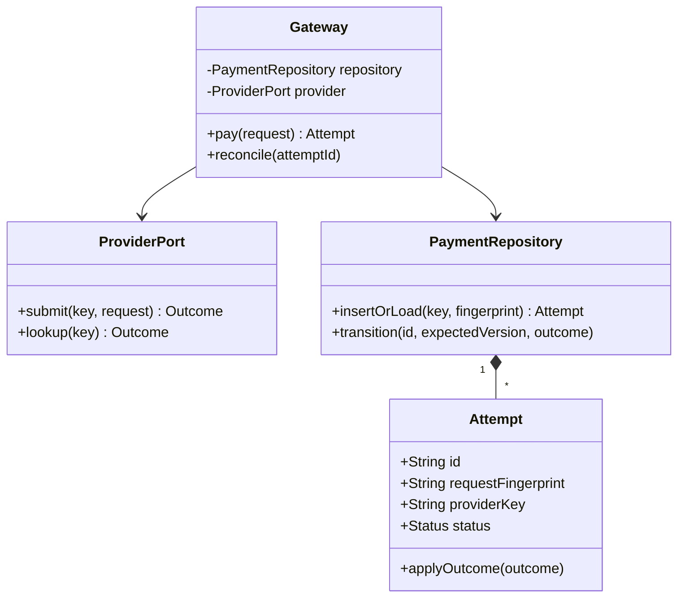

# Payment Gateway

The central question is what to do when a payment request may have succeeded but its response never arrived.
**Model provenance:** the diagram, protocol, and Java excerpt are original pedagogical models, not exact repository UML. The reviewed processor is a stub, not a working financial integration.

## Exact study order

1. **0–5 minutes:** distinguish payment intent, provider attempt, success, failure, and unknown outcome.
2. **5–10 minutes:** define request identity, money representation, and tokenized instrument ownership.
3. **10–18 minutes:** draw gateway, payment attempt, provider adapter, and repository.
4. **18–25 minutes:** trace a successful request followed by a response timeout and retry.
5. **25–32 minutes:** implement atomic create-or-replay before the provider call.
6. **32–40 minutes:** rehearse webhook ordering, reconciliation, and refunds.

## Requirements, assumptions, and invariants

- Support one payment operation for a merchant, amount, currency, and tokenized payment instrument.
- The example assumes a provider with idempotent submission and status lookup by a stable provider key.
- Use integer minor-unit amounts and validate a positive amount and supported currency.
- Never store or log raw card security codes; token ownership and authorization must be checked before processing.
- Scope client idempotency keys by merchant; one key maps to exactly one immutable request fingerprint.
- Same key and payload returns the same attempt; different payload with that key is a conflict.
- States include `PENDING`, `SUCCEEDED`, `FAILED`, and `UNKNOWN`; only a definitive provider rejection establishes failure.
- Provider calls happen outside a database transaction; local persistence does not make the external charge atomic.
- Duplicate or stale callbacks cannot regress a succeeded payment to pending or initiate a second charge.
- Refunds are separate idempotent operations referencing a successful payment; they do not erase it.

## Minimal class diagram



## Incremental DRAW / SAY

1. **DRAW:** merchant key → one attempt. **SAY:** “The idempotency key names a business operation, not a network request.”
2. **DRAW:** a unique constraint on merchant/key. **SAY:** “Concurrent retries must converge before calling the provider.”
3. **DRAW:** a provider adapter outside the transaction box. **SAY:** “No database lock spans slow network I/O.”
4. **DRAW:** timeout → UNKNOWN. **SAY:** “Unknown is an information state, not permission to charge again.”
5. **DRAW:** webhook and lookup converging on one transition function. **SAY:** “Every outcome path follows the same monotonic state rules.”

## Main method-call runtime

This original teaching protocol adds durable request identity and recovery beyond the reviewed sample.

1. `main()` constructs `Gateway` with a fake provider and persistent repository contract.
2. `pay(request)` validates merchant/instrument ownership, amount, currency, and a canonical request fingerprint.
3. `insertOrLoad()` atomically creates a pending attempt with a stable provider key or returns an existing attempt.
4. A worker claims the pending attempt and calls `ProviderPort.submit(providerKey, request)` outside the database transaction.
5. A definitive response is applied through a version-checked state transition and an outbox event is recorded.
6. The merchant reads the current attempt; retried client calls reuse it rather than creating another payment.
7. Authenticated webhooks and scheduled lookup reconcile attempts left pending or unknown after crashes/timeouts.

**Failure flow:** the provider charges successfully but the response is lost.
Mark the attempt unknown and call `lookup(providerKey)` or safely resubmit using the same provider key if its contract permits.
Never fail over to another provider while the first outcome is unknown: provider-local deduplication does not cross provider boundaries.
If the provider lacks idempotency/status guarantees, explicitly limit automated retries and escalate unresolved attempts for reconciliation.

## Original Java critical method

Excerpt inside `Gateway`; the repository contract atomically inserts or loads under a unique `(merchantId, key)` constraint.
The fingerprint covers canonical amount, currency, instrument token, merchant, and operation type; authentication is performed before this method.

```java
Attempt createOrReplay(PaymentRequest request) {
    if (request.amountMinor() <= 0 || request.key().isBlank()) {
        throw new IllegalArgumentException("Invalid payment request");
    }
    validateCurrencyAndInstrument(request);
    String fingerprint = canonicalFingerprint(request);
    Attempt attempt = repository.insertOrLoad(
        request.merchantId(), request.key(), fingerprint, request);
    if (!attempt.requestFingerprint().equals(fingerprint)) {
        throw new IllegalArgumentException("Idempotency key reused with different payload");
    }
    return attempt; // Provider submission is a separate recoverable worker step.
}
```

Workers need a claim/lease protocol; if a worker crashes after submission, the stable provider key makes recovery safe under the assumed contract.
A unique local row alone prevents duplicate rows, not duplicate external charges. Do not market this as unconditional exactly-once payment processing.

## Pattern decision and tradeoffs

- **Primary:** Adapter to normalize provider request/response semantics behind `ProviderPort`.
- **Optional:** Strategy for choosing a provider before an attempt starts, plus an outbox for reliable merchant notifications.
- **Avoid:** automatic failover after ambiguous submission, blind retry loops, or hard-coded success responses presented as real processing.
- Synchronous responses are convenient but incomplete; asynchronous outcomes are unavoidable when networks or providers delay.
- Keeping an attempt journal improves support and auditability but requires retention, access control, and sensitive-data minimization.
- A two-step authorize/capture product needs additional states and separate idempotency identities; do not silently reuse the one-step model.

## Ready-to-speak interview presentation

> “I model a payment as a durable attempt keyed by merchant and client idempotency key. A canonical fingerprint rejects conflicting reuse. The provider call happens outside the transaction with its own stable deduplication key. Timeouts become unknown, and webhooks or lookup reconcile the attempt through one versioned transition function. Adapter handles provider differences; provider selection happens before submission, not as blind failover after an ambiguous charge.”

## Three practice rounds

### Round 1 — guided, 15 minutes
- [ ] Draw pending, succeeded, failed, and unknown states.
- [ ] Trace a successful charge whose response is lost.
- [ ] Explain client key versus provider key and their scopes.

### Round 2 — implementation, 25 minutes
- [ ] Test simultaneous identical requests and conflicting key reuse.
- [ ] Inject crashes before submission, after submission, and before local outcome persistence.
- [ ] Test duplicate/stale webhooks and reconciliation without a second charge.

### Round 3 — interview, 10 minutes
- [ ] Explain why database uniqueness alone is insufficient.
- [ ] Discuss a provider lacking idempotency and lookup support.
- [ ] Add a refund as a new operation rather than overwriting payment history.

## Sources and reviewed scope

- Reviewed [TransactionService](https://gitlab.com/shrayansh8/lld-lowleveldesign/-/blob/5afdde64cd138ed7a8e273870598b41d63914e91/src/main/java/com/conceptcoding/interviewquestions/paymentgateway/transaction/TransactionService.java) and [Processor](https://gitlab.com/shrayansh8/lld-lowleveldesign/-/blob/5afdde64cd138ed7a8e273870598b41d63914e91/src/main/java/com/conceptcoding/interviewquestions/paymentgateway/transaction/Processor.java) locally at the pinned commit.
- Observed: TransactionService loads instruments, calls Processor, hard-codes SUCCESS, and appends sender/receiver history; Processor contains comments rather than implemented payment logic.
- Instrument implementations were not reviewed here. Idempotency, durable state, security integration, and reconciliation above are original guidance, not verified source guarantees; Java was not executed.
- [Supplied Zoho payment notes](https://notebook.zohopublic.in/public/notes/bietv6993f5a023ec4e9f89436149ac3ed2f7) are preserved but were not reviewed.