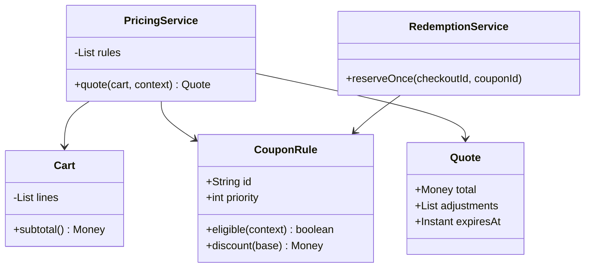

# Shopping Cart Coupons

The challenge is not subtracting a percentage: it is defining which discounts apply, in what order, and with what audit trail.
**Model provenance:** the diagram and Java excerpt are original pedagogical models, not exact repository UML. Pricing policy details below are explicit teaching choices.

## Exact study order

1. **0–5 minutes:** calculate a 100-unit item with 20% off followed by 10% off.
2. **5–10 minutes:** agree on eligible base, stacking order, exclusions, and rounding.
3. **10–18 minutes:** draw cart, pricing rule, quote, and redemption service.
4. **18–25 minutes:** trace quote creation separately from checkout redemption.
5. **25–32 minutes:** implement one bounded, rounded percentage adjustment.
6. **32–40 minutes:** rehearse stale quotes, exhausted coupons, and pattern tradeoffs.

## Requirements, assumptions, and invariants

- A cart holds product IDs, quantities, and price snapshots in one currency.
- Support percentage and fixed-amount coupons with eligibility predicates and explicit priority.
- Two percentage discounts compose multiplicatively: 100 → 80 → 72, not a 30% total discount.
- Fixed and percentage discounts may produce different results when their order changes.
- Prices and discounts use integer minor units or exact decimal arithmetic; never binary floating-point money.
- Round each adjustment once with a documented currency rounding mode; never allow a negative subtotal.
- A quote contains line totals, applied rule IDs/versions, adjustment amounts, and expiry time.
- Eligibility evaluation is pure; computing a quote must not consume a limited-use coupon.
- At checkout, atomically validate and reserve redemption quota; repeated checkout IDs consume it at most once.
- Tax, shipping, refunds, and multi-currency conversion are outside the first pricing exercise.

## Minimal class diagram



## Incremental DRAW / SAY

1. **DRAW:** 100 → 80 → 72. **SAY:** “The next percentage applies to the already-discounted base.”
2. **DRAW:** eligibility before each adjustment. **SAY:** “We must define whether thresholds use original or current subtotal.”
3. **DRAW:** an ordered rule list and a quote ledger. **SAY:** “Users should see exactly which rule changed the price.”
4. **DRAW:** redemption outside quote calculation. **SAY:** “Refreshing a cart cannot consume a coupon.”
5. **DRAW:** checkout ID beside quota reservation. **SAY:** “Two concurrent checkouts must not overspend the final redemption.”

## Main method-call runtime

This original teaching flow separates policy and quota handling beyond the reviewed decorator example.

1. `main()` builds a cart and a stable priority-ordered set of coupon rules.
2. `PricingService.quote()` snapshots prices and evaluates eligibility against the documented original subtotal.
3. Apply eligible rules sequentially to the remaining eligible base, capping each adjustment at that base.
4. Store rule versions and adjustment amounts in an immutable quote without consuming redemption quota.
5. `checkout(quoteId)` revalidates expiry, cart identity, and rule versions before reserving coupon usage.
6. Payment/order completion commits redemption; a definite failed checkout releases its reservation.

**Failure flow:** a limited coupon has one use left and two buyers hold valid-looking quotes.
Only one atomic redemption reservation succeeds. The other receives a revised quote and must accept the changed price before payment.
An unknown payment outcome retains the usage reservation until reconciliation; blindly releasing it could permit excess redemptions.

## Original Java critical method

Original pure helper using `BigDecimal` and `RoundingMode`; `basisPoints=2000` means 20%.
The caller supplies the currently eligible minor-unit base; rule ordering and quota handling are separate responsibilities.

```java
long afterPercentage(long baseMinor, int basisPoints) {
    if (baseMinor < 0 || basisPoints < 0 || basisPoints > 10_000) {
        throw new IllegalArgumentException("Invalid price or rate");
    }
    long discount = BigDecimal.valueOf(baseMinor)
        .multiply(BigDecimal.valueOf(basisPoints))
        .divide(BigDecimal.valueOf(10_000), 0, RoundingMode.HALF_UP)
        .longValueExact();
    return baseMinor - discount;
}
```

For 101 minor units at 50%, the adjustment is 51 and the remaining amount is 50 under this chosen policy.
Rounding the remaining price instead would produce a different tie result; publish the adjustment-rounding rule and test it.
Use the returned difference to record the applied discount; do not recompute it later with a different rounding path.

## Pattern decision and tradeoffs

- **Primary:** Decorator is useful when each price wrapper preserves the same pricing interface and simple ordered composition is enough.
- **Optional:** an explicit Strategy/rule pipeline when eligibility, exclusions, priorities, and explanation records become central.
- **Avoid:** deep opaque wrapper chains that hide applied rule IDs, mutable product prices, or side-effecting quote reads.
- Decorators make small compositions elegant; a rule list is easier to inspect, reorder, and serialize as an audit trail.
- Product-level and cart-level coupons need separate eligible bases; applying a cart threshold independently to each line changes semantics.
- Immutable quotes improve reproducibility but need expiry and revalidation when prices or coupon availability change.
- Percentage-only discounts commute before rounding, but mixed fixed discounts, caps, and rounding make order observable.

## Ready-to-speak interview presentation

> “I first define eligible bases, stacking order, and rounding, because patterns do not decide those business rules. Pricing is a pure ordered transformation that returns an auditable quote. Decorator fits simple nested adjustments; an explicit rule pipeline is clearer once exclusions and priorities matter. Coupon quota is reserved only at checkout with an idempotency key. A stale or exhausted coupon produces a new quote, never a silently changed charge.”

## Three practice rounds

### Round 1 — guided, 15 minutes
- [ ] Calculate two percentages and compare fixed-before-percent with percent-before-fixed.
- [ ] Draw quote calculation separately from redemption.
- [ ] State the threshold base and rounding policy explicitly.

### Round 2 — implementation, 25 minutes
- [ ] Test zero/full discount, half-cent rounding, and invalid rates.
- [ ] Test category exclusions, capped discounts, and deterministic rule order.
- [ ] Race two checkouts against one remaining redemption and replay the winner's request.

### Round 3 — interview, 10 minutes
- [ ] Compare Decorator with an explicit rule pipeline.
- [ ] Explain why product price should not be permanently mutated by a quote.
- [ ] Handle a stale quote without charging an unapproved amount.

## Sources and reviewed scope

- Reviewed [ShoppingCart](https://gitlab.com/shrayansh8/lld-lowleveldesign/-/blob/5afdde64cd138ed7a8e273870598b41d63914e91/src/main/java/com/conceptcoding/interviewquestions/couponappln/ShoppingCart.java) and [PercentageCouponDecorator](https://gitlab.com/shrayansh8/lld-lowleveldesign/-/blob/5afdde64cd138ed7a8e273870598b41d63914e91/src/main/java/com/conceptcoding/interviewquestions/couponappln/coupons/PercentageCouponDecorator.java) locally at the pinned commit.
- Observed: the cart wraps products in percentage then type decorators and sums decorated prices; the percentage decorator calculates a discount using double arithmetic.
- The type decorator was not reviewed here, so its eligibility behavior is not verified. Exact rounding, quote expiry, and redemption quotas above are original extensions; Java was not executed.