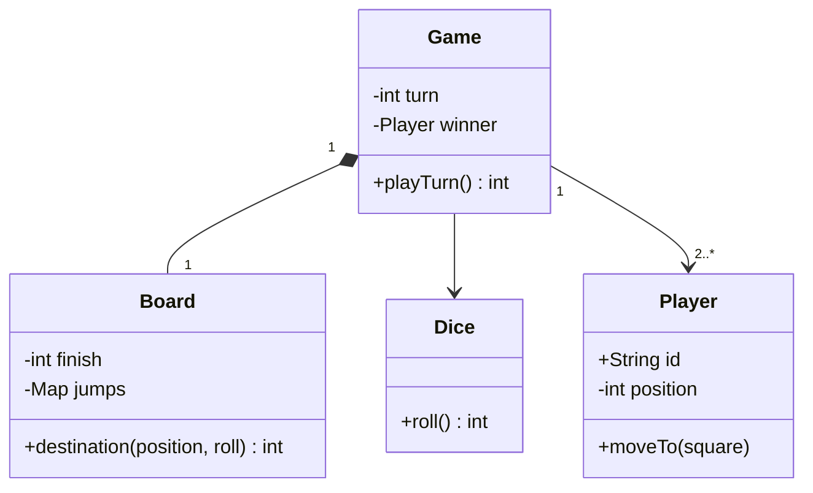

# Snake and Ladder

Start with a deterministic turn engine; randomness should be an input you can replace in tests.
**Model provenance:** the diagram and Java excerpt are original pedagogical models, not exact repository UML. This guide deliberately chooses an exact-finish rule different from the reviewed game.

## Exact study order

1. **0–5 minutes:** manually play two turns on a ten-square board.
2. **5–10 minutes:** choose start, finish, overshoot, and jump-chaining rules.
3. **10–18 minutes:** draw game, board, player, and dice.
4. **18–25 minutes:** trace a ladder, snake, ordinary move, and overshoot.
5. **25–32 minutes:** implement `destination()` and inject a scripted dice sequence.
6. **32–40 minutes:** rehearse the presentation and test termination boundaries.

## Requirements, assumptions, and invariants

- Players start at square 0; playable squares are 1–100, and exactly 100 wins.
- One six-sided die; every completed roll consumes a turn, including an overshoot.
- No extra turn on six and no multiple dice in the first version.
- A destination beyond 100 leaves the player at the previous position.
- Apply at most one jump per turn; do not recursively follow jump endpoints.
- Every jump starts and ends within 1–99, with different endpoints and unique start positions.
- A ladder points forward; a snake points backward. The finish cannot be a jump start or end in this model.
- Reject malformed board configuration at construction and reject rolls outside 1–6 before moving.
- After a winner is recorded, no further turn may modify player positions.

## Minimal class diagram



## Incremental DRAW / SAY

1. **DRAW:** a number line with 0 and 100. **SAY:** “Movement is arithmetic; a visual grid is only presentation.”
2. **DRAW:** an arrow 4→18 and another 26→9. **SAY:** “One jump map represents both snakes and ladders.”
3. **DRAW:** `Game → Dice`. **SAY:** “Tests supply rolls instead of depending on luck.”
4. **DRAW:** players in a ring. **SAY:** “Turn rotation occurs after every completed roll unless someone wins.”
5. **DRAW:** 98 + 5 → 98. **SAY:** “Overshoot consumes a turn but does not change position.”

## Main method-call runtime

The original teaching driver uses these calls rather than reproducing repository method names.

1. `main()` validates a fixed board and constructs `Game(players, board, dice)`.
2. `Game.playTurn()` rejects calls after a winner exists and selects the current player.
3. `Dice.roll()` produces 4 for a player currently on 0.
4. `Board.destination(0, 4)` finds jump 4→18 and returns 18.
5. `Player.moveTo(18)` commits the result; `Game` checks finish and rotates the turn.
6. A later roll from 98 with value 2 lands on 100; the game stores that player as winner.

**Failure flow:** a test dice returns 0. `destination()` rejects the roll before any player mutation.
Do not rotate the turn for a malformed roll; surface a faulty dependency rather than silently treating it as a valid turn.
A legal roll that overshoots is different: keep the position but advance to the next player.

## Original Java critical method

Excerpt inside immutable `Board`; `jumps` maps validated integer starts to integer endpoints.
The caller enforces game status and turn ownership; this method only calculates movement.

```java
int destination(int position, int roll) {
    if (position < 0 || position >= finish) {
        throw new IllegalArgumentException("Not a playable position");
    }
    if (roll < 1 || roll > 6) throw new IllegalArgumentException("Invalid roll");
    if (roll > finish - position) return position;
    int landed = position + roll;
    if (landed == finish) return finish;
    return jumps.getOrDefault(landed, landed);
}
```

The subtraction-based overshoot check avoids adding before checking the limit.
To support chained jumps later, add cycle detection and a bounded resolution rule; do not simply insert a recursive call.

## Pattern decision and tradeoffs

- **Primary:** dependency inversion through `Dice`, a small Strategy seam for random versus scripted rolls.
- **Optional:** a movement-rule Strategy if exact-finish and reach-or-pass variants must coexist.
- **Avoid:** separate Snake and Ladder subclasses when both only map one square to another.
- A map uses space proportional to jumps; an array provides simple constant-time lookup for a small fixed board.
- Fixed board construction makes tests repeatable; random board generation needs validation and may create pathological layouts.
- A move log aids replay, but recording the actual roll is more reliable than storing only a random seed across implementations.

## Ready-to-speak interview presentation

> “I model the board as positions and a jump map rather than a matrix of behavior-heavy cells. The game owns player order and the winner; an injected dice supplies rolls. I explicitly choose exact finish, one jump per turn, and no extra turn on six. Invalid rolls change nothing, while legal overshoots still consume the turn. This lets me test ladders, snakes, and boundaries with a short scripted sequence.”

## Three practice rounds

### Round 1 — guided, 15 minutes
- [ ] Trace ordinary movement, one ladder, and one snake by hand.
- [ ] State the difference between invalid roll and legal overshoot.
- [ ] Draw only the four classes shown above.

### Round 2 — implementation, 25 minutes
- [ ] Test 98+2 wins and 98+3 stays at 98.
- [ ] Test duplicate jump starts, invalid endpoints, and post-win calls.
- [ ] Use a scripted dice and assert both positions and next-player order.

### Round 3 — interview, 10 minutes
- [ ] Explain the deliberate finish-rule difference from the reviewed source.
- [ ] Add a six-gives-another-turn variant without touching board lookup.
- [ ] Explain why chained jumps require cycle handling.

## Sources and reviewed scope

- Reviewed [SnakeNLadderDemo](https://gitlab.com/shrayansh8/lld-lowleveldesign/-/blob/5afdde64cd138ed7a8e273870598b41d63914e91/src/main/java/com/conceptcoding/interviewquestions/snakeNladder/SnakeNLadderDemo.java) and [Game](https://gitlab.com/shrayansh8/lld-lowleveldesign/-/blob/5afdde64cd138ed7a8e273870598b41d63914e91/src/main/java/com/conceptcoding/interviewquestions/snakeNladder/Game.java) locally at the pinned commit.
- Observed: the entry constructs and starts a game; Game rotates a deque, rolls dice, resolves one jump, and wins on reaching or passing its final index.
- Board generation and dice implementation were not reviewed here; the exact-finish model is original and Java was not executed.
- [Supplied PDF](https://drive.google.com/file/d/1cGyGGWOrp_b4Jm2xHFlI_FitPivDHgiN/view?usp=drive_link) is unreviewed.