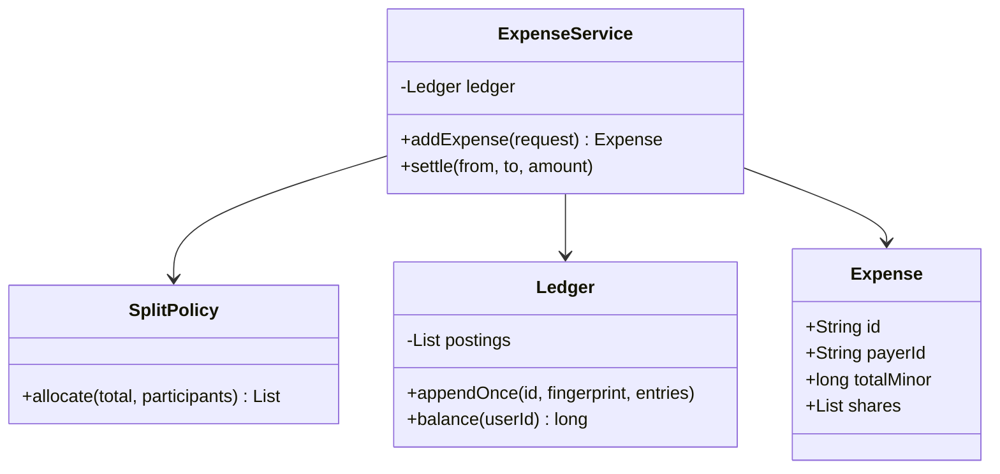

# Splitwise

This page merges the design walkthrough and implementation notes: create expenses, split money exactly, and derive who owes whom.
**Model provenance:** the diagram, ledger approach, and Java excerpt are original pedagogical models, not exact repository UML.

## Exact study order

1. **0–5 minutes:** work a 100-cent expense shared by three people on paper.
2. **5–10 minutes:** define payer, participants, currency, rounding, and balance sign convention.
3. **10–18 minutes:** draw expense service, split policy, expense record, and ledger.
4. **18–25 minutes:** trace postings for one expense and one settlement.
5. **25–32 minutes:** implement deterministic equal splitting and test remainder conservation.
6. **32–40 minutes:** rehearse duplicate requests, reversals, and debt simplification limits.

## Requirements, assumptions, and invariants

- A group records expenses paid by one member, with equal, exact-amount, or percentage allocation.
- All participants and the payer must belong to the group; the payer may or may not consume a share.
- Use integer minor units and one currency per group; do not add unlike currencies.
- Shares are nonnegative and sum exactly to the expense total; participant IDs are unique.
- Define positive net balance as money a member should receive and negative as money owed.
- Posting an expense credits the payer by the total and debits each participant by their share; net postings sum to zero.
- The payer's own share is debited too, reducing what they should receive from others.
- One expense ID identifies one immutable request; same ID with different content is a conflict, not a retry.
- Settlements transfer obligations without rewriting expense history; edits use reversal plus replacement.

## Minimal class diagram



## Incremental DRAW / SAY

1. **DRAW:** A pays 100, shares A=34/B=33/C=33. **SAY:** “Remainders are real money, not a floating-point tolerance.”
2. **DRAW:** +100 for A and −34/−33/−33. **SAY:** “The postings sum to zero and A's net is +66.”
3. **DRAW:** `SplitPolicy` before `Ledger`. **SAY:** “Allocation is validated before any balance changes.”
4. **DRAW:** expense ID and fingerprint on the write boundary. **SAY:** “A replay is safe only when the payload matches.”
5. **DRAW:** a reversal linked to the expense. **SAY:** “Corrections preserve the audit trail.”

## Main method-call runtime

These original teaching calls are intentionally ledger-oriented rather than a copy of the reviewed balance-sheet API.

1. `main()` creates group members A, B, C and submits expense E1: payer A, total 100 cents.
2. `ExpenseService.addExpense()` validates currency, membership, participant uniqueness, and request identity.
3. `SplitPolicy.allocate()` returns 34/33/33 using a stable participant order.
4. Build immutable postings: A +100, A −34, B −33, C −33; verify their sum is zero.
5. `Ledger.appendOnce()` atomically stores expense, postings, and idempotency fingerprint.
6. A balance view derives A +66, B −33, C −33 from committed postings.
7. B settling 33 to A adds B +33 and A −33, leaving A +33, B 0, C −33.

**Failure flow:** shares total 99 for a 100-cent expense. Reject before appending any posting.
A duplicate E1 with identical content returns the recorded expense; E1 with a different total is rejected.
If the process crashes mid-write, the database transaction commits all postings and identity metadata or none.

## Original Java critical method

Excerpt for equal splitting; `orderedMembers` is a validated immutable list of distinct IDs in stable order.
`Share` is a small value record `(memberId, amountMinor)`; imports and service wiring are omitted.

```java
List<Share> equalShares(long total, List<String> orderedMembers) {
    if (total <= 0 || orderedMembers.isEmpty()) {
        throw new IllegalArgumentException("Positive total and participants required");
    }
    int count = orderedMembers.size();
    long base = total / count;
    long remainder = total % count;
    List<Share> result = new ArrayList<>();
    for (int i = 0; i < count; i++) {
        long amount = base + (i < remainder ? 1 : 0);
        result.add(new Share(orderedMembers.get(i), amount));
    }
    return List.copyOf(result);
}
```

## Implementation notes and tradeoffs

- **Primary:** Strategy for equal, exact, and percentage allocations; the ledger should not know which produced the shares.
- **Optional:** Repository plus transaction boundary for durable postings and materialized balance views for fast reads.
- **Avoid:** `double` money, independent updates to many user totals without a transaction, and silently rounding every share downward.
- Percentage splits can use integer basis points totaling 10,000, then allocate residual cents deterministically by a documented remainder rule.
- Validate bounded amounts or use exact arithmetic helpers when summing; integer money still can overflow.
- Net balances are compact but lose pairwise debt provenance; retain expenses/postings and add a separate pairwise view if required.
- Greedy debtor-creditor matching proposes a settlement plan but does not generally prove the minimum number of transfers.
- Treat simplification as a view; it must not erase the underlying obligations or imply money actually moved.

## Ready-to-speak interview presentation

> “I separate share calculation from accounting. A split strategy produces exact minor-unit shares whose sum equals the expense. Posting credits the payer and debits each consumer, including the payer's own share, so total net balance stays zero. Expense IDs make retries idempotent inside one transaction. Implementation details include deterministic remainder allocation, currency validation, and reversal records for edits. Debt simplification is a separate suggested settlement view.”

## Three practice rounds

### Round 1 — guided, 15 minutes
- [ ] Calculate 100 cents across three participants and write all postings.
- [ ] Trace one settlement and verify the net sum remains zero.
- [ ] Explain why the payer may also have an expense share.

### Round 2 — implementation, 25 minutes
- [ ] Test remainders, duplicate participants, invalid percentages, and mismatched totals.
- [ ] Test same-ID same-payload replay versus same-ID different-payload conflict.
- [ ] Test reversal plus replacement and ensure history is preserved.

### Round 3 — interview, 10 minutes
- [ ] Compare net balances with pairwise obligations.
- [ ] Explain the transaction boundary for all balance changes.
- [ ] Describe why greedy settlement is not a universal minimum-transfer proof.

## Sources and reviewed scope

- Reviewed [ExpenseController](https://gitlab.com/shrayansh8/lld-lowleveldesign/-/blob/5afdde64cd138ed7a8e273870598b41d63914e91/src/main/java/com/conceptcoding/interviewquestions/splitwise/Expense/ExpenseController.java) and [BalanceSheetController](https://gitlab.com/shrayansh8/lld-lowleveldesign/-/blob/5afdde64cd138ed7a8e273870598b41d63914e91/src/main/java/com/conceptcoding/interviewquestions/splitwise/BalanceSheetController.java) locally at the pinned commit.
- Observed: expense creation selects a split validator, constructs an expense, and updates user balance sheets; the reviewed balance updater uses double amounts and separate payer/debtor mutations.
- Split validator implementations were not reviewed here. Integer allocation, append-only postings, idempotency, and transactional writes above are original implementation guidance, not verified source features; Java was not executed.