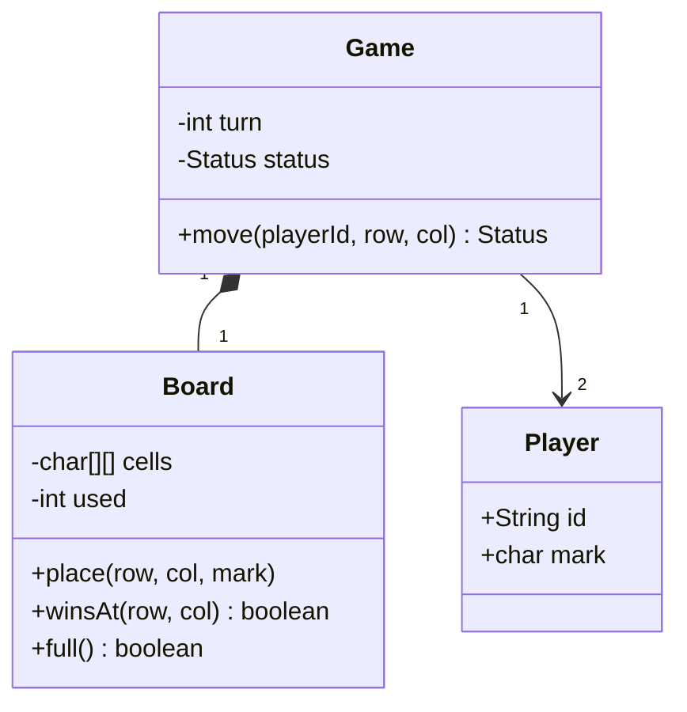

# Tic Tac Toe

Build a two-player game where an invalid move never consumes a turn.
**Model provenance:** the diagram, API, and Java excerpt below are original pedagogical models, not exact repository UML or copied implementations.

## Exact study order

1. **0–5 minutes:** write a three-move example and identify whose turn comes next.
2. **5–10 minutes:** agree on board size, coordinates, and win conditions.
3. **10–18 minutes:** draw `Game`, `Board`, and `Player` in that order.
4. **18–25 minutes:** trace one valid move, one occupied-cell rejection, and one win.
5. **25–32 minutes:** implement the validation-before-mutation boundary below.
6. **32–40 minutes:** rehearse the presentation and complete round one before generalizing.

## Requirements, assumptions, and invariants

- Two local players alternate X and O on a 3×3 board; X begins.
- Coordinates are zero-based. A row, column, or either full diagonal wins.
- A full board with no winner is a draw; a final-cell win takes precedence over a draw.
- No network sessions, AI, undo, or persistence in the initial scope.
- Every cell is empty or contains exactly one mark; marks cannot be overwritten.
- Only the current player can move while status is `ACTIVE`.
- Rejected input changes neither board, move count, status, nor turn.
- A successful nonterminal move changes the current player exactly once.

## Minimal class diagram



## Incremental DRAW / SAY

1. **DRAW:** a board with `(0,0)` labelled. **SAY:** “Board owns occupancy, not whose turn it is.”
2. **DRAW:** two players beside the game. **SAY:** “Game coordinates turns; players carry identity and mark.”
3. **DRAW:** `ACTIVE → WON / DRAW` beside `Game`. **SAY:** “Terminal states reject every later move.”
4. **DRAW:** `move → validate → place → evaluate`. **SAY:** “All rejection checks precede mutation.”
5. **DRAW:** an arrow back to the same player on rejection. **SAY:** “Bad input is not a completed turn.”

## Main method-call runtime

The following is the original model's driver flow, not a literal repository call listing.

1. `main()` constructs two players, a board, and `Game` with turn index zero.
2. UI parsing converts a coordinate string to integers; malformed input stops at the UI boundary.
3. `Game.move("A", 0, 0)` verifies status, identity, bounds, and vacancy.
4. `Board.place()` writes X and increments the occupied-cell count.
5. `Board.winsAt()` inspects the affected row/column and relevant diagonals.
6. If neither win nor draw applies, `Game` switches the turn to B and returns `ACTIVE`.

**Failure flow:** B selects `(0,0)` next. Vacancy validation throws before `place()`.
The UI shows the error and asks B again; the turn remains B and the used count remains one.
After a winning move, even a vacant-cell request is rejected because the game is terminal.

## Original Java critical method

Excerpt inside `Game`; `board`, `players`, `turn`, and `status` are surrounding fields.
`Board.place()` has no external side effects; the input checks are repeated here to make the boundary visible.
`Status` contains `ACTIVE`, `WON`, and `DRAW`; this is not a standalone program.

```java
Status move(String playerId, int row, int col) {
    if (status != Status.ACTIVE) throw new IllegalStateException("Finished");
    Player current = players.get(turn);
    if (!current.id().equals(playerId)) throw new IllegalArgumentException("Turn");
    if (!board.inBounds(row, col) || !board.empty(row, col)) {
        throw new IllegalArgumentException("Invalid cell");
    }
    board.place(row, col, current.mark());
    if (board.winsAt(row, col)) status = Status.WON;
    else if (board.full()) status = Status.DRAW;
    else turn = 1 - turn;
    return status;
}
```

Check why the win test occurs before `full()`: the ninth move can simultaneously fill the board and win.
For concurrent clients, serialize commands per game; an unsynchronized method alone does not prevent simultaneous moves.

## Pattern decision and tradeoffs

- **Primary:** plain aggregate encapsulation. A game is one consistency boundary; no named pattern is mandatory.
- **Optional:** Strategy for genuinely different win rules or computer move selection.
- **Avoid:** a class per square, Singleton games, or State subclasses for three trivial status values.
- Scanning a row is linear in board width and easy to explain; counters reduce work but increase update invariants.
- Separating input parsing from domain logic makes scripted tests possible without console input.
- Persisting a move log enables replay, but is unnecessary for the first in-memory version.

## Ready-to-speak interview presentation

> “I will support two local players on a three-by-three board. Game owns turn and terminal status; Board owns cells. A move validates identity, bounds, and vacancy before writing anything. I check victory before draw, then advance the turn only for a valid nonterminal move. I start with simple row scans and introduce a rule strategy only if the requirements vary. The key test is that an invalid move preserves every part of game state.”

## Three practice rounds

### Round 1 — guided, 15 minutes
- [ ] Draw the three classes without adding UI or persistence classes.
- [ ] Trace X at `(0,0)`, O at `(1,0)`, and an occupied-cell retry.
- [ ] State all four rejection checks in order.

### Round 2 — implementation, 25 minutes
- [ ] Test every row, column, and diagonal win plus a full-board draw.
- [ ] Test a ninth-move win and a move after termination.
- [ ] Assert board and turn are unchanged after invalid coordinates.

### Round 3 — interview, 10 minutes
- [ ] Give the presentation without reading it.
- [ ] Explain an N×N extension and its scan complexity.
- [ ] Describe how per-game serialization changes a networked version.

## Sources and reviewed scope

- Reviewed [PlayGame entry point](https://gitlab.com/shrayansh8/lld-lowleveldesign/-/blob/5afdde64cd138ed7a8e273870598b41d63914e91/src/main/java/com/conceptcoding/interviewquestions/tictactoe/PlayGame.java) and [TicTacToeGame](https://gitlab.com/shrayansh8/lld-lowleveldesign/-/blob/5afdde64cd138ed7a8e273870598b41d63914e91/src/main/java/com/conceptcoding/interviewquestions/tictactoe/TicTacToeGame.java) locally at the pinned commit.
- Observed: the entry initializes and starts the game; the game rotates a deque, restores the player to the front after a rejected placement, and scans lines for wins.
- Review is limited to those two files; Java was not executed and no claim is made about complete input safety.
- [Supplied PDF](https://drive.google.com/file/d/1JgTipI2hutFrd3YxDpE8L2KukIr0VC7H/view?usp=drive_link) was not reviewed; its diagrams are not being reproduced.