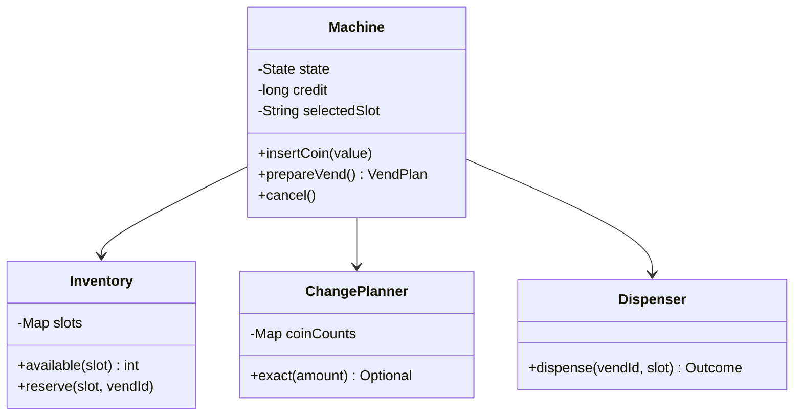

# Vending Machine

Design a cash-only machine that never promises a product unless both stock and exact change can be reserved.
**Model provenance:** this is an original pedagogical model, not exact repository UML. Only a PDF link was supplied for this topic; that PDF is unreviewed and no repository implementation was reviewed.

## Exact study order

1. **0–5 minutes:** describe select → insert coins → vend → collect product/change.
2. **5–10 minutes:** choose cancellation, exact-change, and hardware-failure policies.
3. **10–18 minutes:** draw machine state, inventory, change planner, and dispenser.
4. **18–25 minutes:** trace one successful purchase and one insufficient-change rejection.
5. **25–32 minutes:** implement preflight planning without stock or money mutation.
6. **32–40 minutes:** distinguish definite failure from an unknown hardware outcome.

## Requirements, assumptions, and invariants

- One active customer session; fixed product slots and integer minor-unit prices.
- Accept a configured set of coin denominations; reject unsupported coins before crediting them.
- Keep inserted coins in escrow until a purchase succeeds; cancellation can return those same coins.
- States: `IDLE`, `COLLECTING`, `DISPENSING`, and `OUT_OF_SERVICE`.
- Selection may change while collecting; credit belongs to the session, not a product.
- A vend needs available stock, sufficient credit, and a feasible bounded change plan.
- Exact-change planning respects coin counts, not just total monetary value.
- Once dispensing starts, block further input until a definite outcome or recovery decision.
- Decrement stock and consume escrow once per successful vend ID; never retry an uncertain physical dispense blindly.

## Minimal class diagram



## Incremental DRAW / SAY

1. **DRAW:** four state circles. **SAY:** “The same input has different legality depending on lifecycle state.”
2. **DRAW:** escrow separately from the coin bank. **SAY:** “Cancellation returns the customer's inserted coins.”
3. **DRAW:** stock and change reservations before the motor. **SAY:** “Check both resources before issuing a physical command.”
4. **DRAW:** a vend ID on the command. **SAY:** “Recovery identifies one operation, not a new sale.”
5. **DRAW:** UNKNOWN leading to out-of-service. **SAY:** “An absent acknowledgement is not proof that nothing was dispensed.”

## Main method-call runtime

This is a wholly original teaching protocol; no correspondence to an unreviewed source is asserted.

1. `main()` loads product counts and coin counts and creates an idle `Machine`.
2. `select("A1")` records a product; `insertCoin()` moves to collecting and increases escrow credit.
3. `prepareVend()` checks stock, price, and whether exact change exists without mutating resources.
4. Under the machine's serialized event loop, reserve stock and change and persist a vend ID before hardware I/O.
5. `Dispenser.dispense(vendId, slot)` runs while input is disabled.
6. A definite success commits product removal, moves escrow to cash holdings, and dispenses reserved change.
7. Complete the vend record and return to idle only after the outcome is accounted for.

**Failure flow:** no exact change exists despite enough total money. Keep the session collecting and offer more suitable coins or cancellation.
For a definite no-product motor failure, release reservations and return escrow.
For a timeout with unknown physical outcome, retain the vend record, disable sales, and reconcile sensors/operator evidence before refunding or retrying.
If product succeeds but change delivery fails, record a change liability; do not roll back the already delivered product.

## Original Java critical method

Excerpt inside `Machine`; fields are read on one event loop, prices are positive, and the planner is a pure bounded-coin search.
This method deliberately plans only; reservation, persistence, and hardware handling are separate steps.

```java
VendPlan prepareVend() {
    if (state != State.COLLECTING || selectedSlot == null) {
        throw new IllegalStateException("Select and fund first");
    }
    Product product = inventory.product(selectedSlot);
    if (inventory.available(selectedSlot) == 0) {
        throw new IllegalStateException("Sold out");
    }
    if (credit < product.price()) throw new IllegalStateException("More credit needed");
    long change = credit - product.price();
    CoinPlan coins = planner.exact(change)
        .orElseThrow(() -> new IllegalStateException("Exact change unavailable"));
    return new VendPlan(selectedSlot, product.price(), coins);
}
```

The plan must be reserved before any other event can consume its stock or coins; a read-only plan is not a resource lock.
Greedy largest-coin-first is not correct for arbitrary denominations and bounded counts; test a case requiring a different combination.

## Pattern decision and tradeoffs

- **Primary:** State-oriented event handling; use an enum transition table first, then State classes if behavior grows.
- **Optional:** Strategy for change planning and Adapter for hardware ports.
- **Avoid:** product subclasses for every slot and a payment strategy hierarchy for a cash-only requirement.
- Escrow simplifies cancellation but requires compatible hardware; merging coins immediately requires a refund-change algorithm.
- A pure planner is easy to test; a durable vend journal is needed for crash recovery around physical actions.
- Availability may be sacrificed after an uncertain motor result because a second dispense can create a second physical delivery.

## Ready-to-speak interview presentation

> “I first define legal inputs for idle, collecting, dispensing, and out-of-service states. Customer coins stay in escrow until success. Before vending I reserve both a product and an exact change combination. Every hardware action has a vend ID and durable outcome record. A timeout is uncertain, so I stop and reconcile instead of issuing another motor command. The critical method I would code first is the side-effect-free preflight planner.”

## Three practice rounds

### Round 1 — guided, 15 minutes
- [ ] Draw the state transitions and place cancellation only on legal states.
- [ ] Trace a product costing 65 with 100 credit and a 35 change plan.
- [ ] Explain escrow versus the machine's existing coin bank.

### Round 2 — implementation, 25 minutes
- [ ] Test sold-out, insufficient credit, unsupported coin, and no-exact-change cases.
- [ ] Verify preparation mutates neither stock nor coin counts.
- [ ] Inject definite failure, unknown dispense, and change-delivery failure outcomes.

### Round 3 — interview, 10 minutes
- [ ] Explain why greedy change may fail with bounded coins.
- [ ] State what evidence permits recovery after an unknown outcome.
- [ ] Explain why the example is an original model, not audited PDF behavior.

## Sources and reviewed scope

- [Supplied vending-machine PDF](https://drive.google.com/file/d/1FDEdh2xhvlZpftC_392pml9h2lcl_q3A/view?usp=drive_link) is retained for study but was not reviewed.
- No vending-machine repository source was supplied or reviewed for this guide; no pinned implementation claim is made.
- All requirements, state transitions, diagram relationships, and Java logic here are original teaching choices. The Java excerpt was not executed and omits hardware-specific recovery implementation.