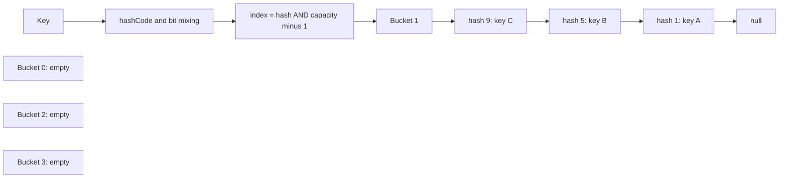

# Design a HashMap — correctness before speed

**Goal:** explain and implement key-to-value storage without hiding the difficult parts behind “hashing is O(1).” The key questions are equality, bucket selection, collisions, updates, resizing, and worst-case behavior.

**Source scope (2026-11-01):** the supplied `MyHashMap` source was accessible and read, including the raw file pinned at **86f5cba306799544cb10f9b57adf00dedf16253f** in the separate `interviewcodingpractise` repository. The **5afdde64cd138ed7a8e273870598b41d63914e91** pin used for the LLD repository does not apply here. [Supplied and pinned links](../sources.mdx#topic-guides-and-original-sources) are stored in the shared metadata. The implementation below is original, not copied from the repository.

## 1. State the contract first

Our teaching map supports `put`, `get`, `containsKey`, `remove`, and `size`.

- **Null keys and null values are rejected** with `NullPointerException`. Therefore a null return unambiguously means “no previous/current mapping.” This intentionally differs from `java.util.HashMap`, which permits nulls.
- `put` inserts or replaces the value for a logically equal key and returns the previous value, or null for a new key. Replacement does not change size.
- Keys must obey the Java `equals`/`hashCode` contract and remain stable while stored. Equal keys must have equal hashes; equal hashes do **not** imply equal keys.
- Collisions use **separate chaining**, a linked list at each bucket. Iteration order is unspecified; this example does not expose an iterator.
- The map is **not thread-safe**. Compound actions and resizes must not race with readers or writers.

This is not a full implementation of `Map`, an equivalent of Java's `HashMap` tree-bin implementation, or a concurrent hash table. It has no treeification, fail-fast iterators, serialization, shrinking, or collection views.

## 2. Equality, hash, and index are different operations

1. A key's `hashCode()` supplies an integer that may be negative.
2. Mix high bits into low bits with `h ^ (h >>> 16)`. Mixing can improve bucket distribution; it cannot repair a constant or adversarial hash.
3. With power-of-two capacity, compute `hash & (capacity - 1)`. This produces an index from zero through capacity minus one, including for negative hashes.
4. Search the selected chain for a matching cached hash **and** `equals` match.

Do not use `==` for logical key equality: two separately allocated strings can represent the same key. Do not use `Math.abs(hash) % capacity`: `Math.abs(Integer.MIN_VALUE)` remains negative. `Math.floorMod(hash, capacity)` is a valid alternative for arbitrary positive capacities; our bit mask specifically requires power-of-two capacity.

The equality contract includes reflexivity, symmetry, transitivity, and consistency. If a custom class overrides `equals`, it must provide a compatible `hashCode`. A record containing immutable identity fields is a convenient practice key.

**Mutable-key trap:** insert an object whose hash depends on a name, then change that name. Lookup may select a different bucket while the old node still resides in the original bucket. The map cannot reliably repair a violated key contract during resize.

## 3. Draw separate chaining

For capacity 4, hashes 1, 5, and 9 all select bucket 1. A new node is inserted at the head; an existing equal key is updated in place.



A collision means a shared bucket, not necessarily a shared full hash. Even a full-hash collision must be resolved using equality. Separate chaining differs from open addressing, which probes other array slots.

## 4. Original Java implementation

The fixed initial capacity is 4 for easy traces. Load factor is 0.75. Capacity doubles **before inserting a new key** that would exceed the threshold. The explicit teaching limit of 1,024 buckets keeps the example bounded: beyond that, insertion remains supported through longer chains, so the load factor is no longer bounded. This is not a recommended production capacity limit.

```java
import java.util.Objects;

final class ChainedMap<K, V> {
    private static final int MAX_CAPACITY = 1 << 10;

    private static final class Node<K, V> {
        final int hash;
        final K key;
        V value;
        Node<K, V> next;

        Node(int hash, K key, V value, Node<K, V> next) {
            this.hash = hash;
            this.key = key;
            this.value = value;
            this.next = next;
        }
    }

    private Node<K, V>[] buckets = newTable(4);
    private int size;
    private int threshold = 3;

    @SuppressWarnings("unchecked")
    private static <K, V> Node<K, V>[] newTable(int capacity) {
        return (Node<K, V>[]) new Node<?, ?>[capacity];
    }

    private static int spread(Object key) {
        int h = Objects.requireNonNull(key, "null keys are unsupported").hashCode();
        return h ^ (h >>> 16);
    }

    private static int index(int hash, int capacity) {
        return hash & (capacity - 1);
    }

    private Node<K, V> find(K key, int hash) {
        for (Node<K, V> n = buckets[index(hash, buckets.length)];
             n != null; n = n.next) {
            if (n.hash == hash && key.equals(n.key)) return n;
        }
        return null;
    }

    public int size() { return size; }

    public V get(K key) {
        Node<K, V> found = find(key, spread(key));
        return found == null ? null : found.value;
    }

    public boolean containsKey(K key) {
        return find(key, spread(key)) != null;
    }

    public V put(K key, V value) {
        int hash = spread(key);
        Objects.requireNonNull(value, "null values are unsupported");
        Node<K, V> found = find(key, hash);
        if (found != null) {
            V previous = found.value;
            found.value = value;
            return previous;
        }
        if (size >= threshold && buckets.length < MAX_CAPACITY) {
            grow();
        }
        int slot = index(hash, buckets.length); // capacity may have changed
        buckets[slot] = new Node<>(hash, key, value, buckets[slot]);
        size++;
        return null;
    }

    public V remove(K key) {
        int hash = spread(key);
        int slot = index(hash, buckets.length);
        Node<K, V> previous = null;
        for (Node<K, V> n = buckets[slot]; n != null; n = n.next) {
            if (n.hash == hash && key.equals(n.key)) {
                if (previous == null) buckets[slot] = n.next;
                else previous.next = n.next;
                size--;
                return n.value;
            }
            previous = n;
        }
        return null;
    }

    private void grow() {
        Node<K, V>[] nextTable = newTable(buckets.length * 2);
        for (Node<K, V> head : buckets) {
            Node<K, V> n = head;
            while (n != null) {
                Node<K, V> savedNext = n.next;
                int slot = index(n.hash, nextTable.length);
                n.next = nextTable[slot];
                nextTable[slot] = n;
                n = savedNext;
            }
        }
        buckets = nextTable;
        threshold = buckets.length - buckets.length / 4;
    }
}
```

The unchecked cast is isolated to empty array allocation; private storage receives only `Node<K,V>` values through the generic API. Raw-type misuse by callers is not supported. The map caches hashes and redistributes existing nodes without calling public `put`, so it neither increments size during growth nor recursively triggers resize.

### Resize invariants

- Allocate the new table before rewiring nodes.
- Save `next` **before** changing the current node's link, or the rest of the old chain can be lost.
- Recompute every bucket index using the new capacity; copying bucket heads at the same indices is incorrect.
- Each existing node is moved exactly once; size remains unchanged during growth.
- A replacement is found before considering growth. Updating the third key at size 3 does not cause an unnecessary resize.

This single-threaded implementation does not guarantee recovery from allocation failure and does not provide safe publication to concurrent readers. The cached-hash design assumes stable keys and valid equality behavior.

## 5. Dry run: collide, update, grow, remove

Use keys with distinct labels and raw hashes 1, 5, 9, 13. For these small positive hashes, spreading leaves the hash unchanged.

| Operation | Capacity / size | Observation |
|---|---|---|
| Insert A(1), B(5), C(9) | 4 / 3 | Bucket 1 is C → B → A |
| Insert another equal B(5) with new value | 4 / 3 | Replace B; no extra node and no resize |
| Insert D(13) | 8 / 4 | Growth happens first; A/C select bucket 1, B/D bucket 5 |
| Read another equal A(1) | 8 / 4 | Equality locates A despite a different object identity |
| Remove B(5) | 8 / 3 | Unlink B without dropping D |
| Remove missing Z(1) | 8 / 3 | Scan bucket 1; return null; size unchanged |

Growth may change chain order, which is not part of the contract. **Resizing does not solve all collisions:** two keys with the same full hash remain in the same bucket at every capacity.

## 6. Complexity: expected, worst-case, and amortized

Let `n` be the number of mappings, `m` the bucket count, and `alpha = n / m` the load factor. Assume hashing and equality themselves cost constant time; long strings or expensive user-defined equality add their own cost.

| Operation | Expected with well-distributed hashes and bounded load | Worst case in this linked-chain implementation |
|---|---|---|
| `get`, `containsKey`, `remove` | O(1 + alpha), hence expected O(1) at bounded load | O(n) when one chain contains all keys |
| `put` without growth | Expected O(1) at bounded load | O(n) to rule out an equal existing key |
| A growing `put` | O(n + m) for table scan and redistribution | O(n + m) |
| Many insertions with geometric growth | Expected amortized O(1) per insertion under the same assumptions | Adversarial collisions can make total work O(n²) |
| Storage | O(n + m) | Temporary old/new bucket arrays during growth |

At a resize threshold in this example, `m` is proportional to `n`, so growth is usually described as O(n). “Amortized” spreads occasional growth over a sequence; “expected” relies on distribution. Neither term promises constant latency for every call. Once the teaching capacity cap is reached, load can grow without bound and the expected constant-time qualification no longer applies.

Some Java `HashMap` implementations use balanced tree bins for certain heavy-collision cases under implementation-specific conditions. **This map never converts a chain to a tree and makes no equivalent tree-bin or worst-case logarithmic guarantee.**

## 7. Executable practice checks

The following Java 17+ test class belongs with the implementation above. It uses explicit checks, so it does not depend on JVM assertions being enabled. These are suggested runnable checks, not a claim that Java was executed during source review.

```java
record TestKey(String label, int forcedHash) {
    @Override public int hashCode() { return forcedHash; }
}

class HashMapChecks {
    static void check(boolean condition) {
        if (!condition) throw new AssertionError("map contract failed");
    }
    static void rejectsNull(Runnable operation) {
        try {
            operation.run();
        } catch (NullPointerException expected) {
            return;
        }
        throw new AssertionError("null should have been rejected");
    }
    public static void main(String[] args) {
        ChainedMap<String, Integer> words = new ChainedMap<>();
        check(words.put(new String("topic"), 1) == null);
        check(words.put(new String("topic"), 2) == 1);
        check(words.size() == 1 && words.get("topic") == 2);

        ChainedMap<TestKey, Integer> map = new ChainedMap<>();
        for (int i = 0; i < 100; i++) {
            check(map.put(new TestKey("k" + i, 7), i) == null);
        }
        check(map.size() == 100);
        for (int i = 0; i < 100; i++) {
            check(map.get(new TestKey("k" + i, 7)) == i);
        }
        for (int i = 99; i >= 0; i--) {
            check(map.remove(new TestKey("k" + i, 7)) == i);
        }
        check(map.size() == 0);
        check(map.remove(new TestKey("absent", 7)) == null);

        TestKey minimumHash = new TestKey("minimum", Integer.MIN_VALUE);
        map.put(minimumHash, 42);
        check(map.get(minimumHash) == 42);
        check(map.containsKey(minimumHash));
        check(!map.containsKey(new TestKey("absent", Integer.MIN_VALUE)));
        rejectsNull(() -> map.get(null));
        rejectsNull(() -> map.put(null, 1));
        rejectsNull(() -> map.put(minimumHash, null));
        rejectsNull(() -> map.containsKey(null));
        rejectsNull(() -> map.remove(null));
        check(map.size() == 1 && map.get(minimumHash) == 42);
    }
}
```

Add focused tests for head/middle/tail removal, the 3-to-4 insertion resize boundary, replacement at the threshold, and more than 768 entries (the final growth threshold). For a stronger exercise, compare thousands of seeded random operations against `java.util.HashMap` **using only non-null keys and values** and matching this map's supported API. Check size and all stored values after each operation; the reference permits more behaviors than this teaching contract.

## 8. What differs from the reviewed source?

| Inspected source behavior | Why it matters | Original guide's choice |
|---|---|---|
| `put` compares key references with `==`, while `get` uses `equals` | Distinct but equal keys can append duplicate nodes; lookup can return the older value | Use logical equality consistently |
| Index is `key.hashCode() % tableLength` | A negative nonzero remainder can index outside the array | Mix and mask with power-of-two capacity |
| Constructor rounds capacity to a power of two | This only sets initial storage; it is not dynamic resizing | Fixed small start, geometric growth, documented cap |
| Linked entries hold collisions; no size/load-factor resize logic | Chains grow as entries accumulate | Track size and redistribute at threshold |
| Calling `hashCode()` on a null key fails; values are not explicitly rejected | Null values and missing lookups both return null | Reject both explicitly to remove ambiguity |

These are static observations of the pinned file, not execution results. No PDF was supplied for this HashMap topic. The linked implementation is useful for discussing pitfalls, but must not be presented as a faithful reimplementation of Java's full `HashMap`.

## Exact interview script and checkpoints

“I will use a bucket array with separate chains. Equality defines a key, while its hash only narrows the search. I reject null keys and values, use a power-of-two mask for safe indexing, replace equal keys without increasing size, and grow before a new insertion crosses the load threshold. During growth I preserve each next pointer and redistribute nodes without changing size. Lookup is expected constant time under suitable hashing and bounded load, but a long chain is linear; I am not implementing Java's tree bins.”

Before moving on, explain why an equal key must share a hash, trace one negative hash safely, show how resize preserves every node, and demonstrate replacement plus head/middle/tail deletion. Then state one unsolved requirement—concurrency, iterators, or memory limits—rather than claiming production equivalence.