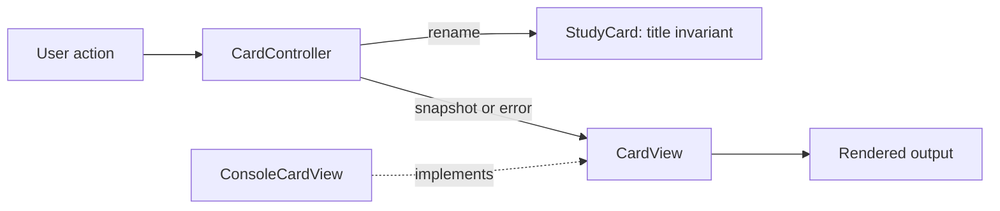
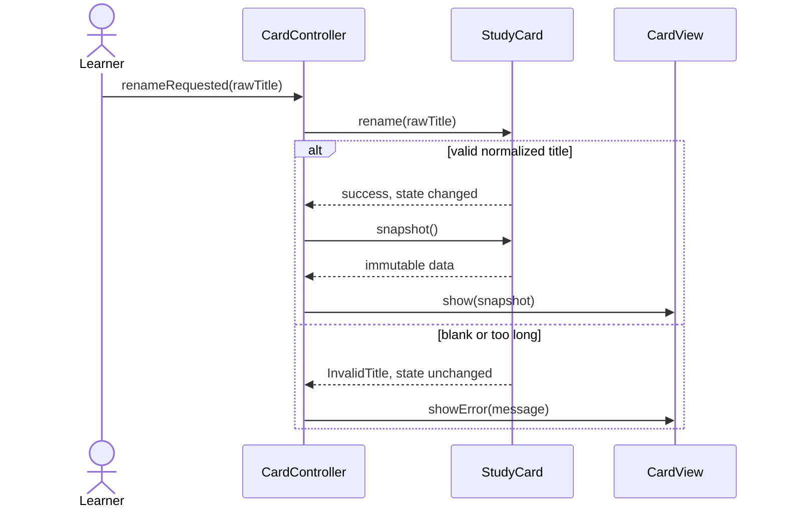

# MVC — state, input, and presentation

**Goal:** take one user action and identify who interprets it, who protects state, and who displays the result. MVC means **Model–View–Controller**, not “put three class names around the same mixed logic.”

**Source scope:** the MVC demo, `Blog`, `BlogView`, and `BlogController` were read at **5afdde64cd138ed7a8e273870598b41d63914e91**. The supplied PDF's extracted text was subsequently read in the [access audit](../source-access.md#limited-original-reading-observations); its diagrams were not visually verified and this guide is not a transcription. [Original PDF, supplied GitLab directory, and pinned code](../sources.mdx#topic-guides-and-original-sources) are maintained in the shared source metadata. Code and drawings here are original teaching examples, not copies of that implementation.

## Start with one use case

A learner edits the title of a study card. A title must be nonblank after trimming and no longer than 80 characters (Java UTF-16 code units in this example). A successful edit displays the normalized title. A rejected edit displays an error **without changing the card**.

Out of scope: accounts, persistence, simultaneous editors, HTTP, and a frontend framework. The smallest useful design can run with a console view.

| Role | Owns | Must not become |
|---|---|---|
| Model | State and rules: a valid title, a safe rename operation | A passive container whose invariants only exist in one UI |
| View | Presentation of a snapshot or error | A second place that decides whether a rename is valid |
| Controller | Translate an input action into a model operation and select the response | A giant class containing every domain rule and SQL query |

The model is not necessarily a single entity class or a database table. In a larger application it includes domain objects and application/domain services. Persistence can sit behind a repository; MVC itself does not require one.

## Counterexample: everything in the click handler

Imagine a button handler that trims the title, checks its length, writes a public field, builds HTML, and saves SQL. A second keyboard shortcut can bypass validation; a console UI must duplicate the rule; changing storage risks breaking rendering. Renaming that handler “controller” does not fix those dependencies.

Refactor in this order:

1. Move the state rule into a model method that every caller uses.
2. Make presentation consume data rather than mutate the model.
3. Keep the controller focused on action orchestration and expected error translation.
4. Add a repository or service only when the use case needs storage or cross-entity coordination.

## Original Java example

This is a self-contained Java 17+ console example. In a real project these roles may live in separate files. The view gets an immutable snapshot, not the mutable card; it cannot rename the model while rendering.

```java
import java.util.Objects;

final class InvalidTitle extends RuntimeException {
    InvalidTitle(String message) { super(message); }
}

record CardSnapshot(long id, String title) {}

final class StudyCard {
    private final long id;
    private String title;

    StudyCard(long id, String title) {
        if (id <= 0) throw new IllegalArgumentException("positive id required");
        this.id = id;
        this.title = validated(title);
    }

    private static String validated(String input) {
        if (input == null || input.isBlank()) {
            throw new InvalidTitle("Title is required");
        }
        String normalized = input.strip();
        if (normalized.length() > 80) {
            throw new InvalidTitle("Title must be at most 80 characters");
        }
        return normalized;
    }

    void rename(String input) {
        String next = validated(input); // validate completely before mutation
        title = next;
    }

    CardSnapshot snapshot() { return new CardSnapshot(id, title); }
}

interface CardView {
    void show(CardSnapshot card);
    void showError(String message);
}

final class CardController {
    private final StudyCard model;
    private final CardView view;

    CardController(StudyCard model, CardView view) {
        this.model = Objects.requireNonNull(model);
        this.view = Objects.requireNonNull(view);
    }

    void show() { view.show(model.snapshot()); }

    void renameRequested(String rawTitle) {
        try {
            model.rename(rawTitle);
        } catch (InvalidTitle error) {
            view.showError(error.getMessage());
            return;
        }
        view.show(model.snapshot());
    }
}

final class ConsoleCardView implements CardView {
    public void show(CardSnapshot card) {
        System.out.println(card.id() + ": " + card.title());
    }
    public void showError(String message) {
        System.out.println("Cannot rename: " + message);
    }
}

class MvcDemo {
    public static void main(String[] args) {
        StudyCard card = new StudyCard(7, "Arrays");
        CardController controller = new CardController(card, new ConsoleCardView());
        controller.show();
        controller.renameRequested("  Hash tables  ");
        controller.renameRequested("   ");
        if (!card.snapshot().title().equals("Hash tables")) {
            throw new AssertionError("Rejected rename changed the model");
        }
    }
}
```

Expected output: `7: Arrays`, then `7: Hash tables`, then `Cannot rename: Title is required`. The final model still holds `Hash tables`.

The catch handles **only the expected domain rejection**, not arbitrary runtime failures. Presentation errors are outside that catch. If `show` fails after a valid rename, the model has already changed; MVC does not provide automatic rollback. An HTML view must escape user-controlled titles, and a network boundary needs explicit response codes and authentication.

## Draw responsibilities and runtime order



The arrows above describe this implementation's collaboration. MVC variants differ: an interactive desktop view may observe a model, whereas a web controller may return a view model and let a framework render it. There is no requirement that every MVC variant use exactly these arrows.



**Drawing order:** write the invariant inside the model first; place the controller between the input and model; add the view last; then draw the failure path. Do not start with a database box unless storage is a requirement.

## What the reviewed source actually does

The repository demonstrates a **blog console application**, not this study-card example:

- The demo constructs a `BlogView` and a `BlogController`, then adds, shows, updates, and deletes posts.
- `Blog` stores title, content, author, and `Date`, with getters and setters. This inspected model does not enforce the title invariant used in this guide.
- `BlogController` constructs its own `ArrayList` and addresses entries by **list index**. Deleting a post shifts later indices; these are not stable post IDs.
- The controller checks index bounds and delegates blog-detail/list formatting to `BlogView`. It also prints success and invalid-index messages itself, so presentation is not completely confined to the view.
- `BlogView` formats dates and prints details or lists. There is no database persistence or HTTP request handling in these reviewed files.

These observations make the example useful to discuss, not a production reference architecture. Separating storage into a repository, using stable IDs, enforcing domain rules, and moving messages behind a view contract are **proposed improvements**, not claims about the source.

## Test the boundaries

| Test | Expected observation |
|---|---|
| Rename to padded valid text | Model stores normalized text; view renders exactly once |
| Rename to null, blank, or 81 characters | Error displayed; old title unchanged; no success rendering |
| Rename to exactly 80 characters | Accepted |
| Call the model directly with invalid text | Rejected even without a controller |
| Substitute a recording view | Same model behavior without reading console output |
| Retain an old snapshot, then rename | Old snapshot is unchanged; new snapshot reflects the edit |
| Make the view throw on successful rendering | Error propagates; accepted model change remains |

For concurrent edits, a snapshot alone is insufficient: use an explicit version and a transactional compare-and-update in a service/repository. For authorization, enforce permission at the application boundary, not by hiding a button. Neither concern is automatically solved by MVC.

## Exact interview script

“I will separate the title invariant from presentation. The controller receives a rename request, asks the model to perform it, and selects either a success view or an error. The model validates before mutating, so invalid input cannot corrupt state even if it comes from another UI. The view receives an immutable snapshot. This is a local, single-threaded MVC example; persistence, authorization, and concurrent editing require additional contracts.”

**Exit checkpoints:** draw both branches without looking; explain why the model still validates; replace the console view without changing `StudyCard`; identify where a stable ID lookup would go for multiple cards; explain why controller ≠ business model and MVC ≠ a three-server deployment.

Next: apply the same “contract before implementation” habit to [HashMap](hashmap.md), or review [SOLID](solid.md).