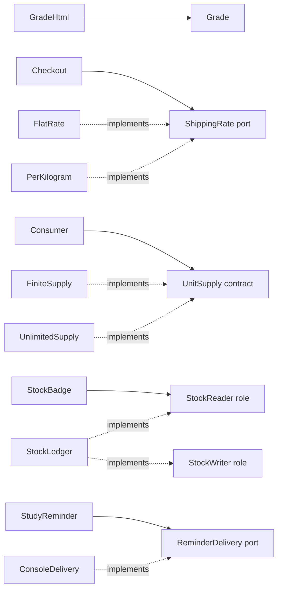

# SOLID — five practical design checks

**Goal:** explain why a boundary exists, not just expand five initials. Start with a working use case, name a likely change, and ask which callers should remain unaffected.

**Source scope (2026-11-01):** all five supplied SOLID PDF extracted texts were read. Representative violation and solution Java was inspected at **5afdde64cd138ed7a8e273870598b41d63914e91**. This is not a review of every file in the SOLID directory, an execution of that repository, or visual verification of PDF drawings. [PDFs and pinned source links](../sources.mdx#topic-guides-and-original-sources) are maintained in the catalog metadata.

| Principle | Question to ask | Concrete change pressure |
|---|---|---|
| Single Responsibility (SRP) | Which stakeholder or policy makes this code change? | Grading rules versus report layout |
| Open/Closed (OCP) | Can a known variation be added behind a stable contract? | A new shipping-price rule |
| Liskov Substitution (LSP) | Does every implementation honor the client's promises? | A non-depleting supply replaces a bin |
| Interface Segregation (ISP) | Does this client depend on operations it never needs? | A dashboard reads stock but cannot replenish it |
| Dependency Inversion (DIP) | Does application policy name an infrastructure detail? | Reminder delivery switches from console to another channel |

All Java below is **original teaching code**, independent of the external examples. Each fenced block is a separate example; modern Java syntax requires Java 17 or later. These sketches are not persistence, concurrency, or production integrations.

## 1. Single Responsibility: separate reasons to change {#srp}

SRP is about cohesion around a responsibility, not one method per class. A grade calculation and a report layout are controlled by different policies. Putting both in the same class makes a formatting request touch grading code.

### Counterexample

```java
final class GradeReportBad {
    int total(int quiz, int exam) { return quiz + exam; }
    String html(int quiz, int exam) {
        return "<strong>Score: " + total(quiz, exam) + "</strong>";
    }
}
```

### Refactor

```java
record Grade(int quiz, int exam) {
    Grade {
        if (quiz < 0 || quiz > 40 || exam < 0 || exam > 60) {
            throw new IllegalArgumentException("quiz: 0..40; exam: 0..60");
        }
    }
    int total() { return quiz + exam; }
}

final class GradeHtml {
    String render(Grade grade) {
        return "<strong>Score: " + grade.total() + "</strong>";
    }
}
```

The model owns score validity and calculation; the renderer owns HTML. The renderer formats integers only, not unescaped user text. Changing the HTML tag does not change `Grade`. Changing the grading policy still requires appropriate tests of the displayed result: separation reduces coupling, not all downstream impact.

**Reviewed-source connection:** the source's invoice counterexample combines calculation, printing, and database saving. Its solution separates `Invoice`, `InvoicePrinter`, and `InvoiceDao`; the save/print methods are demonstrations, not real storage integrations.

**Exact script:** “I see two independent reasons to change: grading policy and presentation. I will keep the score invariant in the model and move formatting to a renderer. I am separating responsibilities, not splitting every method into a class.”

**Checkpoint:** `new Grade(30, 50).total()` is 80; quiz 41 is rejected. Can you change the output from HTML to plain text without modifying score validation? Do not introduce a rendering interface until interchangeable renderers are actually useful.

## 2. Open/Closed: choose an extension point {#ocp}

OCP protects a stable workflow from a **specific anticipated variation**. It does not forbid bug fixes, guarantee that existing tests never need rerunning, or require extensibility in every direction.

### Counterexample

```java
final class ShippingBad {
    long quote(String kind, int kilograms) {
        return switch (kind) {
            case "flat" -> 500L;
            case "weight" -> Math.multiplyExact(120L, kilograms);
            default -> throw new IllegalArgumentException("unknown kind");
        };
    }
}
```

Every new pricing policy edits the dispatcher. This is acceptable for two permanently fixed options; it becomes a problem when shipping rules vary independently and frequently.

### Refactor

```java
interface ShippingRate {
    // Contract: positive kilograms; result in non-negative minor currency units.
    long quote(int kilograms);
}

record FlatRate(long cents) implements ShippingRate {
    FlatRate {
        if (cents < 0) throw new IllegalArgumentException("negative rate");
    }
    public long quote(int kilograms) {
        if (kilograms <= 0) throw new IllegalArgumentException("positive weight required");
        return cents;
    }
}

record PerKilogram(long cents) implements ShippingRate {
    PerKilogram {
        if (cents < 0) throw new IllegalArgumentException("negative rate");
    }
    public long quote(int kilograms) {
        if (kilograms <= 0) throw new IllegalArgumentException("positive weight required");
        return Math.multiplyExact(cents, kilograms);
    }
}

final class Checkout {
    private final ShippingRate rate;
    Checkout(ShippingRate rate) {
        this.rate = java.util.Objects.requireNonNull(rate);
    }
    long shippingFor(int kilograms) { return rate.quote(kilograms); }
}
```

Wiring chooses `new Checkout(new PerKilogram(120))`. A new policy can implement `ShippingRate` without modifying `Checkout`. Configuration or a factory still changes when registering it. Overflow raises `ArithmeticException`; silently wrapping into a negative monetary value is not permitted. This example omits taxes, fractional weights, and currency conversion.

**Reviewed-source connection:** the supplied invoice DAO grows save-to-database and save-to-file methods in its violation. The solution uses a `save()` interface and separate implementations. That establishes the extension boundary, not working database or file persistence.

**Exact script:** “Shipping rules are the changing axis. Checkout will depend on a small quote contract. I can add a policy without editing that workflow, while the composition point still decides which policy to use.”

**Checkpoint:** flat 500 for 3 kg returns 500; 120 per kg returns 360. Both reject zero weight. Add a capped rate and state its overflow behavior. Which class remains unchanged, and where must you still register the new implementation?

## 3. Liskov Substitution: preserve behavioral promises {#lsp}

A subtype is safe only when callers written against its contract remain correct. It must not strengthen preconditions, weaken postconditions, or break invariants. Matching a method signature is insufficient. Exceptions are not inherently LSP violations: an exception explicitly allowed by the contract may be correct.

### Counterexample

```java
interface Supply {
    // Every positive request succeeds when it is <= available().
    int available();
    void take(int units);
}

final class UnlimitedSupplyBad implements Supply {
    public int available() { return Integer.MAX_VALUE; }
    public void take(int units) {
        throw new UnsupportedOperationException("not a physical bin");
    }
}
```

A client checks `available() >= 1`, then calls `take(1)` and still fails. The implementation violates the stated success promise. Do not repair this with `instanceof` checks in every caller.

### Refactor

Use a contract that expresses the use case rather than physical storage details. `tryTake` rejects nonpositive requests; for positive input it returns false without changing state when unavailable, or true when supplied.

```java
interface UnitSupply {
    boolean tryTake(int units);
}

final class FiniteSupply implements UnitSupply {
    private int remaining;
    FiniteSupply(int initial) {
        if (initial < 0) throw new IllegalArgumentException("negative stock");
        remaining = initial;
    }
    public boolean tryTake(int units) {
        if (units <= 0) throw new IllegalArgumentException("positive units required");
        if (units > remaining) return false;
        remaining -= units;
        return true;
    }
    int remaining() { return remaining; }
}

final class UnlimitedSupply implements UnitSupply {
    public boolean tryTake(int units) {
        if (units <= 0) throw new IllegalArgumentException("positive units required");
        return true;
    }
}
```

Only clients needing a physical count depend on `FiniteSupply` or a separate inventory query. Generic consumers depend on `UnitSupply`. This is a revised abstraction, not a way to pretend the bad implementation fulfilled the old promise.

**Reviewed-source connection:** the source's bicycle throws from engine operations required by `Bike`. The solution separates common bike operations from `Engine`. The second PDF example also illustrates a null-returning `hasEngine()` breaking a caller that expects a non-null result. These are contract problems, not merely awkward inheritance names.

**Exact script:** “I will write the caller's promise before the hierarchy. Both supplies support the same request contract. A finite supply may refuse a positive request without mutation; an unlimited one can accept it. Neither adds a surprise restriction for a valid call.”

**Checkpoint:** finite stock 2 accepts 2, then rejects 1 and stays at zero. Unlimited supply accepts both. Both reject zero. This single-threaded check-and-decrement is not safe for concurrent consumers without synchronization.

## 4. Interface Segregation: design for the client {#isp}

### Counterexample

```java
interface InventoryEverything {
    int available();
    void replenish(int units);
    void resetForAudit();
}
```

A stock dashboard needs only a query. Making it depend on this interface couples it to mutation and audit operations. A read-only adapter may be forced to throw from the methods it cannot implement.

### Refactor

```java
interface StockReader { int available(); }
interface StockWriter { void replenish(int units); }

final class StockLedger implements StockReader, StockWriter {
    private int units;
    public int available() { return units; }
    public void replenish(int added) {
        if (added <= 0) throw new IllegalArgumentException("positive units required");
        units = Math.addExact(units, added);
    }
}

final class StockBadge {
    String text(StockReader stock) { return "Available: " + stock.available(); }
}
```

The ledger may implement multiple cohesive roles, while the badge sees only reading. An audit operation belongs in another explicit role when needed. Smaller interfaces do **not** implement authorization: a server must still check whether the caller is allowed to replenish.

**Reviewed-source connection:** the restaurant example forces a waiter to implement cooking and cleaning operations that throw. Its role-specific solution includes `WaiterTasks`, separating those unrelated obligations.

**Exact script:** “The dashboard depends only on a stock-reading role. The same object may also support writing, but that is not part of this client's dependency. I will keep each interface cohesive rather than mechanically making every method its own interface.”

**Checkpoint:** a test can supply `StockReader reader = () -> 7` and get “Available: 7”. The badge cannot call `replenish` through that parameter. Explain why this compile-time boundary is useful but not a security boundary.

## 5. Dependency Inversion: policy owns its port {#dip}

### Counterexample

```java
final class ReminderBad {
    void remind(String recipient) {
        System.out.println("TO " + recipient + ": Study now");
    }
}
```

Application policy is entangled with the console delivery detail. Passing a concrete console sender into the constructor would be dependency injection, but would still leave policy coupled to that concrete detail.

### Refactor

```java
interface ReminderDelivery {
    void send(String recipient, String message);
}

final class StudyReminder {
    private final ReminderDelivery delivery;
    StudyReminder(ReminderDelivery delivery) {
        this.delivery = java.util.Objects.requireNonNull(delivery);
    }
    void remind(String recipient) {
        if (recipient == null || recipient.isBlank()) {
            throw new IllegalArgumentException("recipient required");
        }
        delivery.send(recipient, "Study now");
    }
}

final class ConsoleDelivery implements ReminderDelivery {
    public void send(String recipient, String message) {
        System.out.println("TO " + recipient + ": " + message);
    }
}
```

The application-facing port describes what the policy needs, not a vendor SDK object. The composition root creates `new StudyReminder(new ConsoleDelivery())`. For a test, inject a recording lambda. A real network adapter must define failure and retry semantics; the current method simply lets adapter failures propagate.

**Reviewed-source connection:** the original MacBook violation already receives dependencies in its constructor, but their types are concrete wired devices. The solution receives `Mouse` and `Keyboard` abstractions. Thus dependency injection and dependency inversion are related but not synonymous.

**Exact script:** “My reminder policy names a delivery capability, not a transport implementation. The outer application chooses the adapter. Constructor injection supplies the dependency; the direction of the abstraction is what makes this dependency inversion.”

**Checkpoint:** inject a lambda that records recipient/message; one valid call records exactly one message. A blank recipient sends nothing. Explain whether a delivery failure should propagate, retry, or be scheduled, rather than silently swallowing it.

## Draw it in 90 seconds

This is an original relationship drawing, not copied PDF UML. A solid arrow denotes use; a dashed arrow denotes implementation.



1. Draw the clients first and write their use cases above them.
2. Add only the responsibilities or ports needed for those use cases.
3. Point dependency arrows toward the contract; put concrete implementations on the other side.
4. Annotate one invariant at each boundary: valid score, nonnegative money, request semantics, read-only client, valid recipient.
5. Cross out a proposed interface if you cannot name a useful client or variation for it.

**Exact combined script:** “First I separate independent reasons to change. Then I protect the variation I actually expect with a contract. Every implementation must preserve that contract, and each client should see only the operations it needs. Finally, application policy depends on its own capability abstraction rather than a concrete delivery detail. These are checks on a design, not a requirement to maximize interfaces.”

## Practice and exit checkpoints

| Round | Task | Pass condition |
|---|---|---|
| 5 minutes | Explain the five counterexamples without using their acronym | Name the concrete change or broken client promise |
| 10 minutes | Draw and implement one refactor from memory | Trace a success and rejection without reading the guide |
| 15 minutes | Add a new shipping rate and a recording reminder adapter | Stable clients remain unchanged; new contracts are tested |
| Follow-up | Remove an unnecessary abstraction | Justify the simpler design, not just “SOLID says so” |

Do not confuse the principles: **OCP** asks how variation is added; **DIP** asks which direction dependencies point; **LSP** asks whether replacements behave correctly; **ISP** asks what a particular client must depend on; **SRP** asks why a module changes. One refactor may help several principles, but each has a different test.

Next: apply responsibility boundaries to [MVC](mvc.md), then practise invariants in [a HashMap](hashmap.md).