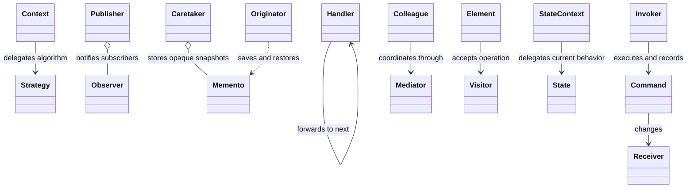
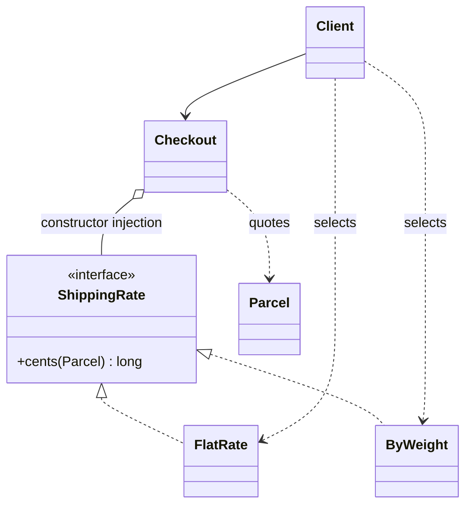
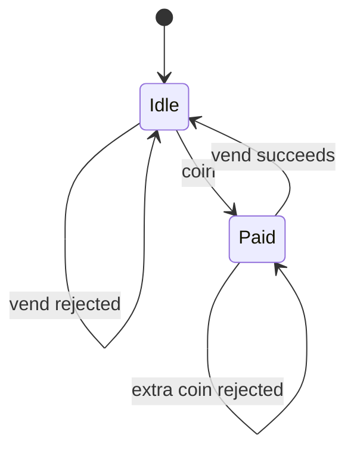

Behavioral patterns answer **who does the work, who knows whom, and how behavior changes over time**. Name the concrete source of change before naming a pattern. A short conditional can be better than a class hierarchy when the rules are few and stable.

## Reading map and source boundaries

- [Strategy](#strategy), [Observer](#observer), [Chain of Responsibility](#chain-of-responsibility), [Null Object](#null-object).
- [Command](#command), [Iterator](#iterator), [Mediator](#mediator), [Visitor](#visitor).
- [Memento](#memento), [Template Method](#template-method), [Interpreter](#interpreter), [State](#state).

All Java blocks are **original teaching snippets**, not copied or verified repository implementations. They are independent Java 17 examples, not production-ready systems. Null Object is grouped here pragmatically because it supplies default behavior; it is not one of the original 23 GoF patterns. State is a supplemental repository topic in this reading set.

**What was actually reviewed:** the available extracted Strategy PDF text, including vehicle drive modes and shopping-cart payment strategies, was read. Its vehicle example uses constructor injection; its cart example uses a setter to change payment strategies. The other PDF links below are supplied references **not reviewed for this guide**. Reading extracted text does not establish that the original PDF's visual layout or diagrams were inspected.

Repository observations at commit **5afdde64cd138ed7a8e273870598b41d63914e91**:

- The inspected [Vehicle context](https://gitlab.com/shrayansh8/lld-lowleveldesign/-/blob/5afdde64cd138ed7a8e273870598b41d63914e91/src/main/java/com/conceptcoding/behavioralpatterns/strategy/vehicledrivemodes/solution/context/Vehicle.java) receives `DriveStrategy` in its constructor and delegates `drive()`. It does not expose a strategy setter. The inspected [HybridVehicle](https://gitlab.com/shrayansh8/lld-lowleveldesign/-/blob/5afdde64cd138ed7a8e273870598b41d63914e91/src/main/java/com/conceptcoding/behavioralpatterns/strategy/vehicledrivemodes/solution/context/HybridVehicle.java) forwards the supplied strategy to its parent. Do not confuse “selectable at runtime during construction” with “replaceable on the same instance.”
- The inspected [ATM IdleState](https://gitlab.com/shrayansh8/lld-lowleveldesign/-/blob/5afdde64cd138ed7a8e273870598b41d63914e91/src/main/java/com/conceptcoding/interviewquestions/atm/ATMStates/IdleState.java) handles card insertion by setting a new `HasCardState` on the ATM. This supports that one transition only; it is not a review of the ATM's cash consistency or authentication guarantees.
- [Pinned behavioral category](https://gitlab.com/shrayansh8/lld-lowleveldesign/-/tree/5afdde64cd138ed7a8e273870598b41d63914e91/src/main/java/com/conceptcoding/behavioralpatterns) is a category source for other topics. No exact Null Object implementation was established in the inspected category; its explanation here is original supplemental teaching, not a repository implementation claim.

## Relationship map

These are independent collaborations. Strategy delegates one algorithm; Observer fans out a notification; a chain forwards a request; Command gives a request an object identity; Memento stores state rather than behavior.



## Strategy {#strategy}

**Problem and concrete example.** A delivery checkout calculates shipping prices using either a flat rate or a weight-based rate. Putting all rate rules in a growing `if/else` block couples checkout to every tariff. Subclassing checkout for each tariff is also awkward when checkout has other independent variations. Extract the changing calculation, not the whole checkout.

**Participants.** `ShippingRate` is the strategy contract; `FlatRate` and `ByWeight` are concrete strategies; `Checkout` is the context; the composition root or request handler is the client that chooses a strategy. `Parcel` contains calculation input. Selection policy and algorithm execution are different responsibilities.

**Runtime steps.** (1) Validate the parcel. (2) The caller selects a tariff based on product configuration or user choice. (3) Construct a checkout with that strategy. (4) Checkout delegates to `cents()`. (5) The chosen implementation computes the quote; checkout remains unaware of its formula.



### A deeper original Java example

Money is represented in minor units (cents), and weight in whole grams. Rounding bills each started kilogram. The strategy is fixed per checkout instance to avoid a shared mutable setter racing between requests; runtime selection still occurs when constructing the context.

```java
record Parcel(int grams) {
    Parcel {
        if (grams <= 0) throw new IllegalArgumentException("positive grams required");
    }
}
interface ShippingRate { long cents(Parcel parcel); }
record FlatRate(long price) implements ShippingRate {
    FlatRate {
        if (price < 0) throw new IllegalArgumentException("negative price");
    }
    public long cents(Parcel parcel) { return price; }
}
record ByWeight(long perStartedKg) implements ShippingRate {
    ByWeight {
        if (perStartedKg < 0) throw new IllegalArgumentException("negative rate");
    }
    public long cents(Parcel parcel) {
        long kilos = (parcel.grams() + 999L) / 1000L;
        return Math.multiplyExact(kilos, perStartedKg);
    }
}
final class Checkout {
    private final ShippingRate rate;
    Checkout(ShippingRate rate) {
        this.rate = java.util.Objects.requireNonNull(rate);
    }
    long shippingCents(Parcel parcel) {
        return rate.cents(java.util.Objects.requireNonNull(parcel));
    }
}
class StrategyDemo {
    public static void main(String[] args) {
        Parcel parcel = new Parcel(1200);
        Checkout flat = new Checkout(new FlatRate(500));
        Checkout weight = new Checkout(new ByWeight(300));
        System.out.println(flat.shippingCents(parcel));   // 500
        System.out.println(weight.shippingCents(parcel)); // 600
        Checkout free = new Checkout(p -> 0L); // Stateless one-method strategy
        System.out.println(free.shippingCents(parcel));   // 0
    }
}
```

**Dry run.** With 1,200 grams, `ByWeight` computes `(1200 + 999) / 1000 = 2` using integer division, then `2 × 300 = 600` cents. The flat strategy ignores weight and returns 500. Neither checkout needs a tariff-specific branch. The client still must decide which strategy to supply; the pattern does not magically eliminate selection logic.

**Use versus simpler design.** Use when algorithms change independently, are reused, or need isolated testing. A function/lambda is already a useful strategy for a tiny stateless algorithm; a class makes configuration and collaborators explicit. A two-case switch may be clearer if the domain is closed and stable. Strategy introduces more objects and requires a common contract: a tariff that needs unsupported input may indicate that the interface is too narrow. State changes behavior based on lifecycle transitions; Strategy usually represents an externally selected policy.

**Exact interview sentence:** “I would use Strategy because shipping calculation varies independently of checkout, and I would inject the selected algorithm while keeping validation and selection policy explicit.”

**Practice/checkpoint.** Test 1, 999, 1,000, and 1,001 grams; at 300 cents per started kilogram, expect 300, 300, 300, and 600. Reject zero weight. Add a configured premium rate without editing `Checkout`. Then inject a fake strategy returning 123 and confirm checkout delegates exactly once. Explain why a shared setter-based checkout would need a concurrency policy.

[Supplied Strategy PDF — extracted text reviewed](https://drive.google.com/file/d/1smTeCvuc9aQwZS7gd-vxPs75wezuYAFp/view?usp=drive_link).

## Observer {#observer}

**Problem and concrete example.** A stock counter must update a dashboard and notify a restock service whenever quantity changes. Hard-coding both consumers into the stock model makes every new consumer a model change. Let consumers subscribe to an event contract instead.

**Participants.** `Stock` is the publisher; `IntConsumer` is the observer contract; dashboard/restock callbacks are observers; registration code wires them together. An event value is preferable to making every observer inspect mutable publisher internals.

**Runtime steps.** (1) Subscribers register. (2) Stock commits a valid quantity. (3) The publisher iterates a snapshot of listeners and sends the new value. (4) A returned subscription handle removes a listener when its owner is finished.

```java
final class Stock {
    private int quantity;
    private final java.util.List<java.util.function.IntConsumer> listeners =
        new java.util.ArrayList<>();
    Runnable subscribe(java.util.function.IntConsumer listener) {
        listeners.add(java.util.Objects.requireNonNull(listener));
        return () -> listeners.remove(listener);
    }
    void setQuantity(int value) {
        if (value < 0) throw new IllegalArgumentException("negative stock");
        quantity = value;
        for (var listener : java.util.List.copyOf(listeners)) listener.accept(value);
    }
}
```

**Use versus simpler design.** Use for a changing set of local dependent consumers. One direct call is clearer for one mandatory collaborator. This sketch is synchronous and single-threaded: a slow listener blocks the setter, and an exception prevents later listeners from being called even though state already changed. Choose fail-fast versus failure isolation explicitly. Snapshot iteration permits unsubscribe during callbacks but does not solve reentrant updates or multithreading. Observer is not automatically a durable broker or reliable distributed delivery mechanism.

**Exact interview sentence:** “I would use Observer for one-to-many change notifications, with explicit subscription lifetime, ordering, and listener-failure semantics.”

**Practice/checkpoint.** Subscribe two collectors, update once, unsubscribe one, then update again. Check delivery counts of one and two. Decide what should happen when the first callback throws and when a callback updates stock recursively.

[Supplied Observer PDF — not reviewed](https://drive.google.com/file/d/1l3T-TsuhWyQx8us5lxeh-bt4KR_8tr9w/view?usp=drive_link).

## Chain of Responsibility {#chain-of-responsibility}

**Problem and concrete example.** An expense claim needs approval from a team lead up to 100 units, then a manager up to 1,000, then rejection or executive review. A sender should not know which approver ultimately accepts it. Compose handlers that either handle the request or forward it.

**Participants.** `Approver` is the handler contract; `LimitApprover` is a concrete handler; `next` links the chain; the expense service sends a request to its head. The final handler defines what happens if nobody accepts.

**Runtime steps.** (1) Build a chain ending in an explicit rejection handler. (2) Send the claim to the head. (3) Each handler accepts if eligible, otherwise calls the next. (4) Stop at the first successful approval. For 600, the 100-limit lead forwards and the 1,000-limit manager accepts.

```java
interface Approver { String approve(int amount); }
record LimitApprover(String name, int limit, Approver next) implements Approver {
    public String approve(int amount) {
        if (amount < 0) throw new IllegalArgumentException("negative claim");
        return amount <= limit ? name : next.approve(amount);
    }
}
// Approver reject = amount -> { throw new IllegalArgumentException("too large"); };
// Approver chain = new LimitApprover("lead", 100,
//     new LimitApprover("manager", 1000, reject));
```

**Use versus simpler design.** Use when routing order or handler membership changes independently. A small fixed `if/else` is easier for a stable three-level rule. Distinguish this **first-handler-wins** example from middleware pipelines where every handler may run before and after the next. Specify ordering, no-handler behavior, and whether retries may repeat side effects. Prevent cycles and missing terminal handlers.

**Exact interview sentence:** “I would use Chain of Responsibility so each approver can handle or forward the request, with an explicit order and terminal rejection policy.”

**Practice/checkpoint.** Trace amounts 50, 600, and 1,500. Reverse the first two handlers and explain why the manager now handles small claims too; order is behavior, not incidental wiring.

[Supplied Chain of Responsibility PDF — not reviewed](https://drive.google.com/file/d/1niWAA5Vy3gC8i6xU96igcYVR_ygZmboT/view?usp=drive_link).

## Null Object — pragmatic behavioral grouping {#null-object}

**Problem and concrete example.** A batch importer optionally reports progress. Repeated `if (progress != null)` checks obscure the import logic. A no-op implementation expresses “progress reporting intentionally disabled” while preserving the normal collaborator contract.

**Participants.** `Progress` is the collaborator interface; a console reporter is a real implementation; `NoProgress` is the Null Object; the importer is the client. Configuration decides whether silence is valid before supplying the object.

**Runtime steps.** (1) Startup selects a real reporter or `NoProgress.INSTANCE`. (2) The importer always calls `done(rows)`. (3) A real reporter emits an update; the Null Object deliberately does nothing. (4) No null branching is needed in the loop.

```java
interface Progress { void done(int rows); }
enum NoProgress implements Progress {
    INSTANCE;
    public void done(int rows) { /* Deliberately silent. */ }
}
record Importer(Progress progress) {
    Importer { java.util.Objects.requireNonNull(progress); }
    void importRow(String row) {
        if (row.isBlank()) throw new IllegalArgumentException("empty row");
        progress.done(1);
    }
}
```

**Use versus simpler design.** Use only when doing nothing is a valid domain result. A local null check is fine at one boundary. Use `Optional` or an explicit error when absence must be acknowledged. Never replace missing authorization, payment processing, or mandatory audit logging with success-looking no-ops; that hides configuration failures. Null Object is a pragmatic behavioral grouping here, not a claimed original GoF category.

**Exact interview sentence:** “I would use a Null Object only where no action is a valid policy, so clients can call the contract uniformly without hiding mandatory failures.”

**Practice/checkpoint.** Run the importer with a counting reporter and with `NoProgress`. Verify the row validation still runs in both cases. Explain why a `NoPayment` returning success would be unsafe.

[Supplied Null Object PDF — not reviewed](https://drive.google.com/file/d/1LUQFI4vDRn6mAsgmDMVCO4lmOXX50dDc/view?usp=drive_link). No exact repository implementation was established.

## Command — undo and redo {#command}

**Problem and concrete example.** A text editor needs toolbar actions, keyboard shortcuts, and undo/redo history to trigger the same edits. If button handlers mutate text directly, the history cannot replay or reverse those operations uniformly. Represent each user action as an object holding its receiver and operation data.

**Participants.** `Edit` is the command interface; `Append` is a concrete command; `StringBuilder` is the receiver; `History` is the invoker and history owner; a button or shortcut creates a fresh command per action.

**Runtime steps.** (1) Execute a new command. (2) Only after success, push it onto undo and clear redo. (3) Undo reverses the most recent command and moves it to redo. (4) Redo executes that command again and moves it back. (5) A new edit after undo discards the old future branch.

```java
interface Edit { void execute(); void undo(); }
final class Append implements Edit {
    private final StringBuilder document;
    private final String text;
    private int before;
    Append(StringBuilder document, String text) {
        this.document = document;
        this.text = java.util.Objects.requireNonNull(text);
    }
    public void execute() {
        before = document.length();
        document.append(text);
    }
    public void undo() { document.setLength(before); }
}
final class History {
    private final java.util.Deque<Edit> undo = new java.util.ArrayDeque<>();
    private final java.util.Deque<Edit> redo = new java.util.ArrayDeque<>();
    void perform(Edit edit) {
        edit.execute();
        undo.push(edit);
        redo.clear();
    }
    void undo() {
        if (undo.isEmpty()) return;
        Edit edit = undo.peek();
        edit.undo();
        undo.pop();
        redo.push(edit);
    }
    void redo() {
        if (redo.isEmpty()) return;
        Edit edit = redo.peek();
        edit.execute();
        redo.pop();
        undo.push(edit);
    }
}
```

**Use versus simpler design.** Use when actions need history, queuing, logging, or multiple invokers. A direct method call is simpler for a one-off irreversible operation. This sketch assumes fresh command instances, a single thread, and no document mutation outside history. Commands must define failure atomicity; preserving stack positions alone cannot roll back a partially applied command. Sending an email cannot truly be undone, and refunding a payment is a compensating action, not time reversal. Mementos can help commands restore local state when an inverse is difficult.

**Exact interview sentence:** “I would use Command to give each edit an executable identity and reversible history, with new edits clearing redo and failures never silently corrupting the history.”

**Practice/checkpoint.** Append `A`, append `B`, undo, redo: expect `A`, `AB`, `A`, `AB`. Undo and append `C`: expect `AC`, and redo must do nothing. Explain why reusing the same mutable `Append` instance for two history entries breaks its saved `before` value.

[Supplied Command PDF — not reviewed](https://drive.google.com/file/d/183IjgJ6pQDHswDQiwWMazetTpdK6SWaV/view?usp=drive_link).

## Iterator {#iterator}

**Problem and concrete example.** A playlist client should visit songs without knowing whether they are stored in an array, linked list, or paged service. It also needs two independent traversals without a single shared cursor. An iterator separates traversal state from the collection itself.

**Participants.** `Playlist` is the aggregate implementing `Iterable`; each returned `Iterator` owns a cursor; songs are elements; the player is the client. In ordinary Java, prefer the existing collection iterators instead of custom traversal classes.

**Runtime steps.** (1) Obtain a fresh iterator. (2) Ask `hasNext()`. (3) Call `next()` to return the current element and advance. (4) Exhaustion throws `NoSuchElementException`. (5) A second iterator starts independently at zero.

```java
record Playlist(java.util.List<String> songs) implements Iterable<String> {
    Playlist { songs = java.util.List.copyOf(songs); }
    public java.util.Iterator<String> iterator() {
        return new java.util.Iterator<String>() {
            private int index;
            public boolean hasNext() { return index < songs.size(); }
            public String next() {
                if (!hasNext()) throw new java.util.NoSuchElementException();
                return songs.get(index++);
            }
        };
    }
}
```

**Use versus simpler design.** Use to hide traversal representation or support custom traversal order. A standard `for` loop over a list is already using this idea and needs no new pattern framework. This sample takes an immutable snapshot; live collections need documented mutation behavior. Fail-fast is best-effort bug detection, not thread safety. Database cursor iterators also need explicit resource closing and fetch/error policies.

**Exact interview sentence:** “I would use Iterator to keep traversal state separate from storage and give each caller an independent, well-defined traversal.”

**Practice/checkpoint.** Interleave two iterators over `A, B`; advancing one must not advance the other. Call `next()` on an exhausted and an empty iterator and verify the specified exception.

[Supplied Iterator PDF — not reviewed](https://drive.google.com/file/d/1-AR6mJkZydatqHIxA58EreRzDt33_MqQ/view?usp=drive_link).

## Mediator {#mediator}

**Problem and concrete example.** In a chat room, each participant could hold references to every other participant, but membership changes would force many updates. Route communication through a room object that knows who is currently present and how messages are delivered.

**Participants.** `Room` is the mediator; registered users/callbacks are colleagues; a message includes the sender identity. The room centralizes routing, while participants own their display or input behavior.

**Runtime steps.** (1) Members join the room. (2) A member submits a message to the room, not directly to peers. (3) The room verifies membership and selects recipients. (4) It delivers to everyone except the sender. (5) Leaving removes the registration.

```java
final class Room {
    private final java.util.Map<String, java.util.function.Consumer<String>> members =
        new java.util.LinkedHashMap<>();
    void join(String name, java.util.function.Consumer<String> inbox) {
        members.put(name, inbox);
    }
    void leave(String name) { members.remove(name); }
    void send(String from, String text) {
        if (!members.containsKey(from)) throw new IllegalArgumentException("not a member");
        var snapshot = new java.util.LinkedHashMap<>(members);
        snapshot.forEach((name, inbox) -> {
            if (!name.equals(from)) inbox.accept(from + ": " + text);
        });
    }
}
```

**Use versus simpler design.** Use when interaction rules among multiple peers are more complex than each peer's own behavior. Direct calls are simpler for two stable collaborators. Observer describes subscriptions to events; Mediator owns coordination policy and may use observers internally. Avoid a mediator that absorbs all domain logic. The sketch is local and synchronous, not authenticated chat: real sender identity must come from a trusted session, with failure isolation, backpressure, and thread-safety policies.

**Exact interview sentence:** “I would use Mediator to centralize interaction rules so colleagues depend on one coordination contract rather than on every peer.”

**Practice/checkpoint.** Register three inboxes, send from one, and verify exactly two deliveries. Remove a member and repeat. Decide whether duplicate names should replace a registration or be rejected instead of leaving it accidental.

[Supplied Mediator PDF — not reviewed](https://drive.google.com/file/d/1SVx1ZYrJ_nqdHQ6Uq390wSt1TMX5vPOU/view?usp=drive_link).

## Visitor {#visitor}

**Problem and concrete example.** A stable document model contains text and images. New operations—plain-text export, accessibility checking, statistics—should not each be added as methods on every model class. A visitor places one operation across many element types in its own object.

**Participants.** `Node` is the element interface with `accept`; `TextNode` and `ImageNode` are concrete elements; `Visitor` declares a visit method for each element type; `PlainText` implements one operation. The caller or a separate traversal walks a document.

**Runtime steps.** (1) The caller invokes `node.accept(visitor)`. (2) Dynamic dispatch selects the concrete node's `accept`. (3) That method calls `visitor.visit(this)`, where `this` has the concrete node type. (4) Overload selection and visitor dispatch reach the correct type-specific operation: the familiar double-dispatch collaboration.

```java
interface Node { String accept(Visitor visitor); }
record TextNode(String text) implements Node {
    public String accept(Visitor visitor) { return visitor.visit(this); }
}
record ImageNode(String alt) implements Node {
    public String accept(Visitor visitor) { return visitor.visit(this); }
}
interface Visitor {
    String visit(TextNode node);
    String visit(ImageNode node);
}
final class PlainText implements Visitor {
    public String visit(TextNode node) { return node.text(); }
    public String visit(ImageNode node) { return "[image: " + node.alt() + "]"; }
}
```

**Use versus simpler design.** Use when element types are relatively stable but operations are frequently added. A normal polymorphic method is simpler for one core behavior; pattern matching over a small sealed hierarchy may also be clearer. Adding a new element type changes the visitor interface and every implementation. Visitors can require exposing data and do not automatically traverse composites: decide whether the visitor or the tree owns traversal.

**Exact interview sentence:** “I would use Visitor when the element hierarchy is stable but new type-specific operations are frequent, accepting that new element types will require updating visitors.”

**Practice/checkpoint.** Add a character-count visitor without changing existing nodes, then sketch the changes needed for a new `TableNode`. Explain why calling `visit(node)` where the static type is merely `Node` does not replace the `accept` step in this interface design.

[Supplied Visitor PDF — not reviewed](https://drive.google.com/file/d/1vX_USKxmI-wqOwsV3tMD4OGj6a-usJdn/view?usp=drive_link).

## Memento {#memento}

**Problem and concrete example.** A settings editor supports canceling changes to text and cursor position. External history code should not reach into every private field to reconstruct the editor. Let the editor create and restore an opaque snapshot of its own state.

**Participants.** `Editor` is the originator; `Snapshot` is the memento; a history stack or dialog controller is the caretaker. The caretaker stores snapshots but does not edit their contents. An owner check prevents accidentally restoring another editor's state.

**Runtime steps.** (1) Before a change, call `save()`. (2) The caretaker retains the snapshot. (3) Edit normally. (4) On cancel/undo, return that snapshot to the same originator. (5) The originator restores its fields without the caretaker knowing their representation.

```java
final class Editor {
    private String text = "";
    private int cursor;
    static final class Snapshot {
        private final Editor owner;
        private final String text;
        private final int cursor;
        private Snapshot(Editor owner, String text, int cursor) {
            this.owner = owner; this.text = text; this.cursor = cursor;
        }
    }
    void replace(String value) {
        text = java.util.Objects.requireNonNull(value);
        cursor = text.length();
    }
    Snapshot save() { return new Snapshot(this, text, cursor); }
    void restore(Snapshot snapshot) {
        if (snapshot.owner != this) throw new IllegalArgumentException("wrong editor");
        text = snapshot.text;
        cursor = snapshot.cursor;
    }
    String text() { return text; }
}
```

**Use versus simpler design.** Use when restoring encapsulated local state matters and an inverse operation is difficult. Copying an immutable value directly is simpler for a small form. A memento stores **state**, whereas a command stores **behavior**; they can work together. Mutable nested objects need independent snapshots, and full copies can consume large memory. Snapshots do not undo external effects such as already-delivered notifications or database commits.

**Exact interview sentence:** “I would use Memento so the object can save and restore its own encapsulated state while the history manager only stores opaque snapshots.”

**Practice/checkpoint.** Save `draft`, replace with `published`, and restore; expect `draft`. Attempt restoration into another editor and expect rejection. Propose a history size limit and explain how sharing immutable text differs from sharing a mutable buffer.

[Supplied Memento PDF — not reviewed](https://drive.google.com/file/d/1hc0cbjPKURcsvlMMkfMsq4yFXisS9Z2b/view?usp=drive_link).

## Template Method {#template-method}

**Problem and concrete example.** Several data imports must read input, validate it, and save it in that order. CSV and JSON differ in parsing, not in the workflow invariant. Put the algorithm skeleton in a base class and expose only the steps intended to vary.

**Participants.** `ImportFlow` defines the template method; subclasses implement `parse()` and `save()`; the client calls `run()`. Optional hooks can provide defaults, but mandatory validation should not be an optional no-op hook.

**Runtime steps.** (1) The client calls the final template method. (2) It invokes subclass parsing. (3) It enforces shared validation. (4) It invokes subclass persistence only when validation succeeds. Subclasses cannot reorder the final method's steps.

```java
abstract class ImportFlow {
    final void run(String input) {
        java.util.List<String> rows = parse(input);
        if (rows.isEmpty()) throw new IllegalArgumentException("empty import");
        save(java.util.List.copyOf(rows));
    }
    protected abstract java.util.List<String> parse(String input);
    protected abstract void save(java.util.List<String> rows);
}
```

**Use versus simpler design.** Use when related implementations share a stable algorithm skeleton and controlled inheritance is appropriate. A function calling injected parser and repository dependencies is often simpler and more flexible. Template Method varies steps through inheritance; Strategy varies a collaborator through composition and can be selected independently. Too many hooks make order and invariants difficult to reason about. A final method cannot guarantee transactionality inside an overridden `save()`.

**Exact interview sentence:** “I would use Template Method to fix the workflow order while allowing subclasses to implement only the steps that genuinely vary.”

**Practice/checkpoint.** Implement an in-memory CSV importer and record `parse`, then `save`. Verify empty parsed input never reaches `save`. Refactor to injected functions and compare testing and reuse costs.

[Supplied Template Method PDF — not reviewed](https://drive.google.com/file/d/15qaWbbBxXeZD3uC_7jfVHwPZxxiAm-jV/view?usp=drive_link).

## Interpreter {#interpreter}

**Problem and concrete example.** A feature-rule language allows `member`, `paid`, and expressions such as `member AND paid`. Scattering special-case string checks through application code makes nested rules hard to reason about. Represent the tiny grammar as an expression tree whose nodes evaluate against a context.

**Participants.** `Rule` is the abstract expression; `Flag` is a terminal expression; `And` is a nonterminal combining two rules; a map is the evaluation context; a parser or client constructs the tree. Parsing and interpreting are separate operations.

**Runtime steps.** (1) Construct an expression tree for a validated rule. (2) Supply a context mapping names to values. (3) An `And` evaluates its left child and, if true, its right child. (4) A `Flag` resolves its name; an unknown name is an error rather than silently granting access.

```java
interface Rule { boolean eval(java.util.Map<String, Boolean> context); }
record Flag(String name) implements Rule {
    public boolean eval(java.util.Map<String, Boolean> context) {
        Boolean value = context.get(name);
        if (value == null) throw new IllegalArgumentException("unknown flag: " + name);
        return value;
    }
}
record And(Rule left, Rule right) implements Rule {
    public boolean eval(java.util.Map<String, Boolean> context) {
        return left.eval(context) && right.eval(context);
    }
}
// new And(new Flag("member"), new Flag("paid"))
//     .eval(java.util.Map.of("member", true, "paid", false)) == false
```

**Use versus simpler design.** Use for a small, well-defined grammar with composable rules. Direct predicates are simpler when no language needs storing or editing. For a substantial language, prefer a maintained parser/evaluator with bounded resources rather than hand-building a general language. This sketch interprets an already-constructed tree; it does not parse text, enforce precedence, or validate every name before short-circuit evaluation. Bound input length, nesting depth, and evaluation cost for untrusted rules; never substitute arbitrary code execution.

**Exact interview sentence:** “I would use Interpreter for a small grammar represented as an expression tree, separating parsing, validation, and evaluation against a bounded context.”

**Practice/checkpoint.** Add `Or` and `Not`, evaluate `member AND NOT paid`, and test missing flags. Explain why a misspelled flag in a short-circuited branch may escape runtime detection and why a separate validation pass helps.

[Supplied Interpreter PDF — not reviewed](https://drive.google.com/file/d/1jnzOCqy1ICoPkI0d-N9HolZacVtlbeJD/view?usp=drive_link).

## State — supplemental vending-machine and ATM topic {#state}

**Problem and concrete example.** A one-item vending machine accepts a coin only when idle and dispenses only after payment. A single method full of state conditionals becomes fragile as refunding, out-of-stock, and maintenance states arrive. Represent state-dependent behavior in state objects and make legal transitions explicit.

**Participants.** `Vending` is the context; `Mode` is the state contract; `Idle` and `Paid` are concrete states; a customer sends events. The context owns the current state; transitions in this example are initiated by state handlers.

**Runtime steps.** (1) Start in idle. (2) `coin()` delegates to idle, which installs paid. (3) `vend()` delegates to paid and returns the item while transitioning back to idle. (4) Repeated coin insertion or vending without payment is rejected. This toy has unlimited inventory and no real payment or hardware integration.

```java
interface Mode {
    void coin(Vending machine);
    String vend(Vending machine);
}
final class Vending {
    private Mode mode = new Idle();
    void transition(Mode next) { mode = java.util.Objects.requireNonNull(next); }
    void coin() { mode.coin(this); }
    String vend() { return mode.vend(this); }
}
final class Idle implements Mode {
    public void coin(Vending machine) { machine.transition(new Paid()); }
    public String vend(Vending machine) { throw new IllegalStateException("pay first"); }
}
final class Paid implements Mode {
    public void coin(Vending machine) { throw new IllegalStateException("already paid"); }
    public String vend(Vending machine) {
        machine.transition(new Idle());
        return "snack";
    }
}
```



**Use versus simpler design.** Use when states have substantial, distinct behavior and transition rules. An enum plus a transition table is often clearer for a small finite-state machine. Strategy selects interchangeable policy; State expresses lifecycle-dependent permissions and usually governs transitions. In an ATM, “card present” is not “PIN verified”; use separate transitions. For real vending or cash withdrawal, make stock/cash reservation, hardware failure, refund, and concurrency semantics explicit—changing a state reference alone is not an atomic financial operation.

**Exact interview sentence:** “I would use State because legal operations depend on lifecycle state, and I would specify the transition table and failure behavior before splitting handlers into classes.”

**Practice/checkpoint.** Verify `vend()` fails initially, `coin(); vend()` returns one snack, and another `vend()` fails. Add a refund event only in paid state. For an ATM, draw Idle → CardPresent → Authenticated and explain why card insertion alone cannot permit withdrawal. The pinned ATM observation above supports only the Idle → HasCard transition; no State PDF was supplied.