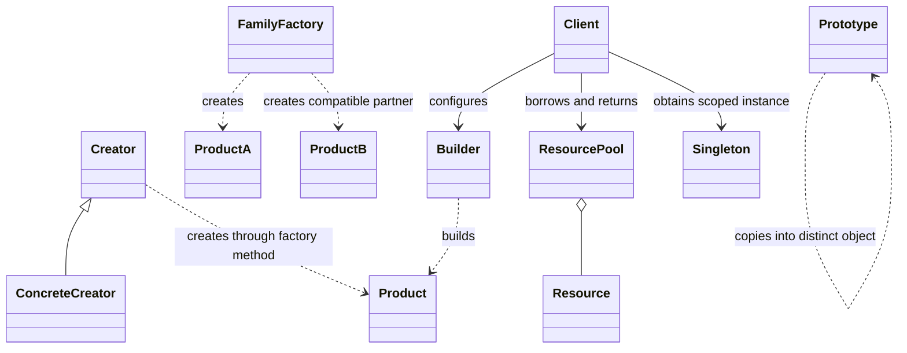

Creational patterns answer **who creates an object, with which configuration, and with what lifetime?** Start with a constructor. Add a pattern only when creation policy or ownership has become a real source of change.

## Reading map and source boundaries

- [Factory Method](#factory-method): subclasses select a product.
- [Abstract Factory](#abstract-factory): select a compatible product family.
- [Builder](#builder): assemble and validate a configured object.
- [Singleton](#singleton): constrain one instance within a scope.
- [Object Pool](#object-pool): lease scarce, reusable resources.
- [Prototype](#prototype): copy an existing configuration; supplemental repository topic.

All Java blocks below are **original teaching snippets**, not copied or verified repository implementations. They are independent Java 17 sketches, not a production library; concurrency and lifecycle limits are called out explicitly. Linked PDFs are supplied reading references, **not reviewed PDFs** for this group.

Repository observations are pinned to commit **5afdde64cd138ed7a8e273870598b41d63914e91**:

- The inspected [Factory Method creator](https://gitlab.com/shrayansh8/lld-lowleveldesign/-/blob/5afdde64cd138ed7a8e273870598b41d63914e91/src/main/java/com/conceptcoding/creationalpatterns/factory/factorymethod/ShapeFactory.java) declares abstract `createShape()` returning `Shape`. This is a subclass extension point, not just a switch-based simple factory.
- The inspected [car family interface](https://gitlab.com/shrayansh8/lld-lowleveldesign/-/blob/5afdde64cd138ed7a8e273870598b41d63914e91/src/main/java/com/conceptcoding/creationalpatterns/abstractfactory/CarFactory.java) creates both interior and exterior products; its default assembly method requests both from the same factory.
- The inspected [prototype Student](https://gitlab.com/shrayansh8/lld-lowleveldesign/-/blob/5afdde64cd138ed7a8e273870598b41d63914e91/src/main/java/com/conceptcoding/creationalpatterns/prototype/solution/Student.java) copies ID, name, branch, and private roll number via a constructor. Its `clone()` does **not** copy `inHighSchool`; this is a useful copy-contract pitfall, not evidence that every field is preserved.
- Other repository links in the catalog are labelled **category source**, not claims of reviewed exact implementations. [Browse the pinned creational category](https://gitlab.com/shrayansh8/lld-lowleveldesign/-/tree/5afdde64cd138ed7a8e273870598b41d63914e91/src/main/java/com/conceptcoding/creationalpatterns).

## Relationship map

These are separate relationships, not one mandatory architecture. Builder constructs; a pool lends an already-created resource; a prototype creates a distinct copy. Sharing one singleton is not the same as either copying or leasing.



## Factory Method {#factory-method}

**Problem and concrete example.** A reporting workflow always renders and delivers a report, but a CSV exporter and an HTML exporter need different formatter objects. If the base workflow constructs a CSV formatter directly, every new export type changes that workflow. Move just the creation choice behind an overridable method.

**Participants.** `ExportJob` is the creator and owns the stable workflow; `CsvJob` is a concrete creator; `Formatter` is the product contract; the lambda below is a concrete product. A client chooses the creator.

**Runtime steps.** (1) The client constructs `CsvJob`. (2) `export()` calls `formatter()`. (3) Dynamic dispatch selects the subclass factory method. (4) The returned product formats the value without the workflow knowing its concrete type.

```java
interface Formatter { String format(int count); }
abstract class ExportJob {
    protected abstract Formatter formatter();
    final String export(int count) { return formatter().format(count); }
}
final class CsvJob extends ExportJob {
    protected Formatter formatter() { return n -> "count\n" + n; }
}
```

**Use versus simpler design.** Use this when an extensible class hierarchy already owns a workflow and subclasses legitimately control construction. A static method with a switch is a **Simple Factory**, not necessarily Factory Method in the GoF sense. For two fixed formats, a constructor-injected formatter or small factory function avoids extra subclasses. Do not subclass a whole workflow merely to rename `new`.

**Exact interview sentence:** “I would use Factory Method because the workflow is stable but subclasses must choose which product it creates.”

**Practice/checkpoint.** Add an HTML creator without modifying `ExportJob`. Then replace subclassing with constructor injection and explain which version is easier to test. Expected output for `new CsvJob().export(3)` is two lines: `count`, then `3`.

[Supplied Factory Method PDF — not reviewed](https://drive.google.com/file/d/1nsb2UJ1y8YTYSCllNDu7xx-YuxfRRUAg/view?usp=drive_link).

## Abstract Factory {#abstract-factory}

**Problem and concrete example.** A desktop application needs a light button with a light checkbox, or a dark button with a dark checkbox. Choosing those independently can accidentally mix families. Give the client one factory that supplies every product in a selected family.

**Participants.** `UiFactory` is the abstract factory; `DarkUi` is one concrete factory; `Button` and `Checkbox` are different product interfaces. The screen is the client. A family groups compatible products; it does not mean all products implement the same interface.

**Runtime steps.** (1) Startup selects the theme factory. (2) The screen asks that factory for both products. (3) Each product is used through its own interface. (4) Selecting a light factory changes the family without changing screen logic.

```java
interface Button { String paint(); }
interface Checkbox { String paint(); }
interface UiFactory {
    Button button();
    Checkbox checkbox();
}
final class DarkUi implements UiFactory {
    public Button button() { return () -> "dark button"; }
    public Checkbox checkbox() { return () -> "dark checkbox"; }
}
```

**Use versus simpler design.** Use when products have a real compatibility rule: theme, operating system, or vendor protocol. A record containing two configured objects is enough for one fixed family. Adding a new family is easy; adding a new product kind, such as a slider, requires updating every factory. Factory Method varies one creation hook; Abstract Factory supplies a family and can itself use factory methods.

**Exact interview sentence:** “I would use Abstract Factory to select a compatible family of products together, rather than let clients mix implementations independently.”

**Practice/checkpoint.** Implement `LightUi` and a screen accepting only `UiFactory`. Explain why separate global `makeButton(theme)` and `makeCheckbox(otherTheme)` calls weaken the compatibility guarantee.

[Supplied Abstract Factory PDF — not reviewed](https://drive.google.com/file/d/1iyouXyHYdbhTyptjN17oqFW8RmGKTQ87/view?usp=drive_link).

## Builder {#builder}

**Problem and concrete example.** A search request has a required query and optional page size, sort order, filters, and timeout. Positional constructors become unreadable and partially configured mutable requests can escape. A builder collects choices, then validates and creates the finished value.

**Participants.** The product is `Search`; `SearchBuilder` owns construction state; the client chooses options. An optional director can encode a reusable recipe, but a fluent builder does not require one.

**Runtime steps.** (1) Create a builder with the required query. (2) Apply optional settings. (3) `build()` checks the complete configuration. (4) Return an immutable product; later builder changes do not mutate it.

```java
record Search(String query, int limit) {
    Search {
        if (query == null || query.isBlank() || limit < 1 || limit > 100)
            throw new IllegalArgumentException("query and limit required");
    }
}
final class SearchBuilder {
    private final String query;
    private int limit = 20;
    SearchBuilder(String query) { this.query = query; }
    SearchBuilder limit(int value) { limit = value; return this; }
    Search build() { return new Search(query, limit); }
}
```

**Use versus simpler design.** Use with many meaningful options, staged construction, or cross-field validation. For two obvious required parameters, a constructor or named static factory is clearer; the tiny example is a starting point for the larger search request, not proof every record needs a builder. Builders are usually mutable and should not be shared between threads. Defensively copy collections into the product.

**Exact interview sentence:** “I would use Builder to make optional configuration readable and validate the complete object before it becomes usable.”

**Practice/checkpoint.** Add a list of filters and show that modifying the caller's original list after `build()` cannot change the request. Test blank queries and limits of zero and 101.

[Supplied Builder PDF — not reviewed](https://drive.google.com/file/d/1V5qnfvYpNiEzb3bu9221HMD8QDaTkVC9/view?usp=drive_link).

## Singleton {#singleton}

**Problem and concrete example.** A process wants one immutable registry of supported encodings. Uncontrolled construction wastes loading work and may create conflicting registries. A singleton constrains access to one instance in a defined scope; first ask whether a shared dependency provided at startup would suffice.

**Participants.** The singleton class owns its instance and creation restriction; clients obtain that instance. A Java enum provides a compact instance mechanism, while application services should preferably receive the registry as a dependency.

**Runtime steps.** (1) The JVM initializes the enum class on first active use. (2) It creates `INSTANCE`. (3) Callers in that class-loader scope reuse the same value. (4) Instance methods expose the read-only registry behavior.

```java
enum EncodingRegistry {
    INSTANCE;
    private final java.util.Set<String> names =
        java.util.Set.of("UTF-8", "UTF-16");
    boolean supports(String name) { return names.contains(name); }
}
```

**Use versus simpler design.** Use only when uniqueness within the stated scope is a requirement. A dependency-injection container with application scope often gives easier tests and explicit dependencies. One Java singleton is **not** one instance across multiple class loaders, JVMs, containers, or machines. Safe initialization does not make mutable instance fields thread-safe. Avoid using a singleton as a global bag of session state; a single database connection is not a connection pool.

**Exact interview sentence:** “I would first define the uniqueness scope; a Java Singleton gives one instance per defining class loader, not a distributed singleton or automatic thread safety.”

**Practice/checkpoint.** Replace direct global access with a constructor-injected lookup interface. Explain how a test supplies a registry containing only one encoding, without resetting shared global state.

[Supplied Singleton PDF — not reviewed](https://drive.google.com/file/d/1P_ptiVovd0ERLtMqVbgJVd9r5mYme-k_/view?usp=drive_link).

## Object Pool {#object-pool}

**Problem and concrete example.** Opening a database connection is expensive and the database permits only a bounded number. Creating one per query is wasteful; sharing one concurrently is unsafe. A pool lends exclusive temporary access to one of several resources and takes it back afterward.

**Participants.** The pool tracks idle and leased resources; a resource performs work; a lease represents ownership; the borrower must release the lease. A resource factory creates replacements for broken resources.

**Runtime steps.** (1) Acquire a resource or wait with a deadline. (2) Validate it if needed. (3) Use it exclusively. (4) On close, reset session state and return it, or discard it if unhealthy. (5) Wake another waiter. Capacity includes both idle and borrowed resources.

This client-side sketch uses a deliberately abstract pool contract; it does **not** implement a correct concurrent pool:

```java
interface Session { void execute(String sql); }
interface Lease extends AutoCloseable {
    Session resource();
    void close(); // Pool implementation resets and returns exactly once.
}
interface SessionPool { Lease acquire(); }
final class QueryRunner {
    void run(SessionPool pool) {
        try (Lease lease = pool.acquire()) {
            lease.resource().execute("SELECT 1");
        }
    }
}
```

**Use versus simpler design.** Use for expensive, scarce resources, not small ordinary Java objects that the allocator and garbage collector handle well. For production database access, use a maintained pool such as HikariCP rather than this interface sketch. A cache shares retained results; a pool manages borrowing and return. Required policies include bounded capacity, acquisition timeout, leak detection, idempotent close, shutdown, and eviction of broken connections.

**Exact interview sentence:** “I would pool this resource because creation is expensive and capacity is limited, and I would make exclusive leases, timeout, reset, and return-on-failure explicit.”

**Practice/checkpoint.** With capacity two, describe what the third borrower does. Inject an exception during the query and verify the lease closes. Explain why returning an open transaction unchanged contaminates the next borrower.

[Supplied Object Pool PDF — not reviewed](https://drive.google.com/file/d/1NymzCEjJq7c_w1XQrjpt77xk-M1KrvWo/view?usp=drive_link).

## Prototype — supplemental repository topic {#prototype}

**Problem and concrete example.** A drawing editor has a configured “warning label” with text, colors, and tags. A user duplicates it and edits the copy. Rebuilding every setting externally exposes implementation details and easily misses fields. Let the configured object define its own copy contract.

**Participants.** `Label` is a concrete prototype; `copy()` is its copy operation; the editor is the client. A prototype registry is optional. A copy constructor is often clearer than Java's `Cloneable` machinery.

**Runtime steps.** (1) Select a configured prototype. (2) Request a new copy. (3) Copy mutable owned state according to the contract. (4) Customize the copy while leaving the original unchanged. Decide separately whether persistent identity should be copied or regenerated.

```java
final class Label {
    String text;
    final java.util.List<String> tags;
    Label(String text, java.util.List<String> tags) {
        this.text = text;
        this.tags = new java.util.ArrayList<>(tags);
    }
    Label copy() { return new Label(text, tags); }
}
```

**Use versus simpler design.** Use when a meaningful configured instance already exists or construction details should remain encapsulated. A constructor is simpler for a small value. This copy owns a new list but shares immutable strings; nested mutable tag objects would require a deeper policy. Deep-copying database sessions or cyclic graphs is not automatically correct. Copying can be expensive and must not silently duplicate business identifiers.

**Exact interview sentence:** “I would use Prototype to duplicate an existing configuration, with an explicit contract for mutable references and identity rather than assuming a shallow clone is independent.”

**Practice/checkpoint.** Copy a label, append a tag to the copy, and verify the original list is unchanged. Add a boolean field and write a preservation test; compare that test with the inspected repository's omitted `inHighSchool` field. This supplemental topic has a repository reference, not a supplied PDF.