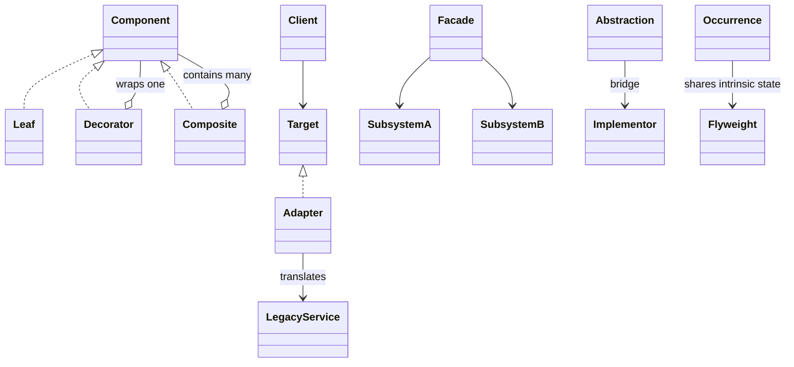

Structural patterns answer **how objects fit together**. Composition means an object holds another object and delegates work. The same arrow in a diagram can express very different intentions: adding behavior, guarding access, converting an interface, or separating independent dimensions.

## Reading map and source boundaries

- [Decorator](#decorator): wrap to add behavior.
- [Proxy](#proxy): stand in for an object and control access.
- [Composite](#composite): treat leaves and nested groups uniformly.
- [Adapter](#adapter): translate an incompatible boundary.
- [Facade](#facade): offer a simpler subsystem entry point.
- [Bridge](#bridge): vary two dimensions independently.
- [Flyweight](#flyweight): share immutable representation across many occurrences.

All Java blocks are **original teaching snippets**, not copied or verified repository implementations. Each is an independent Java 17 sketch. The supplied PDF links are reading references; **none of this group's PDFs was reviewed** for this guide.

Narrow source observations at commit **5afdde64cd138ed7a8e273870598b41d63914e91**:

- The inspected [file-system Directory](https://gitlab.com/shrayansh8/lld-lowleveldesign/-/blob/5afdde64cd138ed7a8e273870598b41d63914e91/src/main/java/com/conceptcoding/structuralpatterns/composite/filestructure/solution/Directory.java) implements `FileSystemComponent`, stores a list of that interface, and delegates `printContents()` to every child. This demonstrates recursive uniformity, not a complete filesystem with permissions or symlink handling.
- The inspected [LetterFactory](https://gitlab.com/shrayansh8/lld-lowleveldesign/-/blob/5afdde64cd138ed7a8e273870598b41d63914e91/src/main/java/com/conceptcoding/structuralpatterns/flyweight/wordprocessor/solution/LetterFactory.java) caches by character and creates letters with fixed Arial/10 styling. The inspected [DocumentCharacter](https://gitlab.com/shrayansh8/lld-lowleveldesign/-/blob/5afdde64cd138ed7a8e273870598b41d63914e91/src/main/java/com/conceptcoding/structuralpatterns/flyweight/wordprocessor/solution/DocumentCharacter.java) stores character, font, and size in final fields while receiving row and column in `display()`. A multi-font editor needs a richer key than this fixed-style example.
- [Pinned structural category](https://gitlab.com/shrayansh8/lld-lowleveldesign/-/tree/5afdde64cd138ed7a8e273870598b41d63914e91/src/main/java/com/conceptcoding/structuralpatterns) is a category source, not a claim that every implementation was inspected.

## Relationship map

The wrapper and tree are separate examples. A decorator holds one component to enhance it; a composite holds many components to aggregate them. Both can preserve the component interface.



## Decorator {#decorator}

**Problem and concrete example.** A coffee shop offers milk, syrup, both, or double milk. A subclass for every combination grows exponentially. Wrap a basic drink with independently composable additions instead.

**Participants.** `Drink` is the component interface; `Coffee` is the concrete component; `Milk` is a decorator containing another `Drink`; checkout is the client. A common abstract decorator base is optional when the interface is small.

**Runtime steps.** (1) Construct the base coffee. (2) Wrap it with milk, then another milk if requested. (3) Checkout calls the outermost `cents()`. (4) Each layer calls inward and adds its own contribution as the calls return.

```java
interface Drink { int cents(); }
record Coffee() implements Drink {
    public int cents() { return 200; }
}
record Milk(Drink inner) implements Drink {
    public int cents() { return inner.cents() + 40; }
}
// new Milk(new Milk(new Coffee())).cents() == 280
```

**Use versus simpler design.** Use when behavior combinations are independently useful and clients should keep the same interface. If toppings are only data, a list of prices and a sum is simpler. Wrappers increase call depth and can make debugging harder. Order matters for operations such as discount-then-tax or compress-then-encrypt; price addition happens to commute here.

**Exact interview sentence:** “I would use Decorator to add independently composable responsibilities while preserving the original component interface.”

**Practice/checkpoint.** Add a 10% discount wrapper and compare putting it outside versus inside `Milk`. Explain why the two totals differ and specify integer-rounding rules.

[Supplied Decorator PDF — not reviewed](https://drive.google.com/file/d/19W73JBOtOtOzIHmKBA-4ACqCXwv60pB0/view?usp=drive_link).

## Proxy {#proxy}

**Problem and concrete example.** An employee directory has a costly remote backend and access must be checked before data is returned. A proxy presents the directory interface but controls whether and when the real directory is called. Other proxy motives include lazy creation and remote invocation.

**Participants.** `Directory` is the subject interface; the real directory is the delegate; `GuardedDirectory` is the proxy; the caller uses only the subject. Authorization policy is injected from a trusted identity boundary, not accepted as a user-supplied boolean.

**Runtime steps.** (1) A caller requests a name. (2) The proxy checks permission. (3) If denied, it throws without calling the delegate. (4) If allowed, it forwards the call and returns the result. The sample predicate stands in for a real policy service.

```java
interface Directory { String name(int employeeId); }
record GuardedDirectory(
        Directory real,
        java.util.function.IntPredicate mayRead) implements Directory {
    public String name(int employeeId) {
        if (!mayRead.test(employeeId)) throw new SecurityException("denied");
        return real.name(employeeId);
    }
}
```

**Use versus simpler design.** Use when access, location, or lifecycle should be transparent to clients. A direct authorization call in one service is simpler for a single entry point. Decorator adds responsibilities; Proxy primarily controls access to the represented subject, although their structures can look identical. A caching proxy needs invalidation and user-aware cache keys; caching must not bypass authorization. A proxy is not a security boundary if callers can reach an unguarded backend.

**Exact interview sentence:** “I would use Proxy to control access to the same subject interface, and I would verify that no alternate path bypasses the policy.”

**Practice/checkpoint.** Use a counting fake delegate. Assert a rejected request leaves its invocation count at zero, and an accepted request increments it once.

[Supplied Proxy PDF — not reviewed](https://drive.google.com/file/d/1S0fRkyGAmhGupC02Xqi6YEfMmeaBxi_K/view?usp=drive_link).

## Composite — file system {#composite}

**Problem and concrete example.** A file explorer calculates total bytes for either one file or an arbitrarily nested folder. Repeated `instanceof File` / `instanceof Folder` branches spread tree knowledge across clients. A shared node interface lets a folder recursively ask its children for the same operation.

**Participants.** `Entry` is the component; `FileEntry` is a leaf; `Folder` is the composite containing entries; the explorer is the client. Child management belongs to the folder rather than forcing files to pretend they can contain children.

**Runtime steps.** (1) Build a folder containing files and other folders. (2) Ask the root for `bytes()`. (3) A file returns its size. (4) A folder recursively sums child results. A tree with files of 10 and 20 bytes totals 30 regardless of their nesting.

```java
interface Entry { long bytes(); }
record FileEntry(long bytes) implements Entry {}
record Folder(java.util.List<Entry> children) implements Entry {
    Folder { children = java.util.List.copyOf(children); }
    public long bytes() {
        return children.stream().mapToLong(Entry::bytes).sum();
    }
}
```

**Use versus simpler design.** Use when the domain genuinely has a recursive part-whole structure with useful uniform operations. A flat list is better for non-nested data. This sketch models a tree, not OS filesystem semantics: symlinks can introduce cycles, hard links can double-count storage, permissions can fail mid-traversal, and deep trees may require iterative traversal. Define whether size means logical bytes or unique physical storage.

**Exact interview sentence:** “I would use Composite because both a file and a folder support the same operation, while a folder computes its result recursively over child components.”

**Practice/checkpoint.** Build an empty folder and a two-level tree; expect zero and the sum of all leaf sizes. Describe how a visited-node set changes traversal if links turn the tree into a graph.

[Supplied Composite PDF — not reviewed](https://drive.google.com/file/d/1FIBgNSJY-YkZYJO7WIKsY_io6tVIBkCa/view?usp=drive_link).

## Adapter {#adapter}

**Problem and concrete example.** Shipping code expects kilograms, but a legacy scale reports pounds. Changing the shipping interface to expose pounds leaks a vendor detail into every client. An adapter converts the legacy contract into the contract the application already understands.

**Participants.** `MetricScale` is the target interface; `PoundScale` is the adaptee; `ScaleAdapter` implements the target and contains the adaptee; shipping is the client.

**Runtime steps.** (1) Inject the legacy scale into the adapter. (2) Shipping calls `kilograms()`. (3) The adapter calls `pounds()`. (4) It converts the unit and returns the target representation. The same boundary can translate errors and identifiers, not just method names.

```java
interface PoundScale { double pounds(); }
interface MetricScale { double kilograms(); }
record ScaleAdapter(PoundScale legacy) implements MetricScale {
    public double kilograms() { return legacy.pounds() * 0.45359237; }
}
```

**Use versus simpler design.** Use when integrating an incompatible vendor or legacy API that should not dictate your domain interface. A conversion function is simpler when there is only one calculation and no object contract to preserve. Unlike Decorator, Adapter intentionally changes the interface; unlike Facade, its primary goal is compatibility, not reducing subsystem complexity. Decide precision, range validation, and error mapping at the boundary.

**Exact interview sentence:** “I would use Adapter to translate the vendor's contract into our existing domain interface without making clients depend on vendor details.”

**Practice/checkpoint.** A fake scale reports 10 pounds; expect approximately 4.5359237 kilograms. Define what happens when the device reports a negative weight, NaN, or a timeout rather than silently accepting it.

[Supplied Adapter PDF — not reviewed](https://drive.google.com/file/d/1BKx6HITzyw-c1RjX4372aH_L4b1-5S1w/view?usp=drive_link).

## Facade {#facade}

**Problem and concrete example.** To start a movie, an app must power the projector, select a stream, and dim the lights. Every UI repeats that sequence and knows all subsystem APIs. A facade exposes a task-oriented operation without preventing advanced clients from using the subsystems directly.

**Participants.** `MovieFacade` is the facade; `Projector` and `Lights` are subsystems; the UI is the client. The facade coordinates but does not need to own every subsystem's internal behavior.

**Runtime steps.** (1) The UI calls `start(title)`. (2) The facade powers the projector. (3) It starts the title. (4) It dims the lights. The order is part of the task contract, not something each UI must rediscover.

```java
interface Projector { void powerOn(); void play(String title); }
interface Lights { void dim(); }
record MovieFacade(Projector projector, Lights lights) {
    void start(String title) {
        projector.powerOn();
        projector.play(title);
        lights.dim();
    }
}
```

**Use versus simpler design.** Use when several clients need a stable, simplified subsystem workflow. A local helper is enough for one small caller. A facade does not automatically provide transactions or rollback: if `play()` fails, the projector may remain on. An order-processing facade still needs explicit payment compensation and idempotency; calling several services in one method is not atomic. Keep facades focused to avoid a giant “everything service.”

**Exact interview sentence:** “I would use Facade to give clients a small task-oriented API over several subsystems, while keeping failure and rollback semantics explicit.”

**Practice/checkpoint.** Record calls in fakes and verify the start sequence. Make `play()` fail and choose whether to power off or leave the projector ready for retry; document that policy rather than assuming rollback.

[Supplied Facade PDF — not reviewed](https://drive.google.com/file/d/1YpWHwZmOFIlFd-ftign3jtZWhOWEjwy0/view?usp=drive_link).

## Bridge {#bridge}

**Problem and concrete example.** Notifications vary by urgency (normal or urgent) and delivery channel (email or SMS). Inheritance for every pairing produces `UrgentEmail`, `UrgentSms`, `NormalEmail`, and so on. Split the two dimensions and connect them through composition.

**Participants.** `Notice` is the abstraction; `UrgentNotice` refines it; `Channel` is the implementor interface; email/SMS implementations deliver messages. Here “abstraction” refers to the high-level domain API, not merely the Java `abstract` keyword.

**Runtime steps.** (1) The client selects an urgency object and a channel independently. (2) `send()` applies urgency formatting. (3) It delegates transport to the channel. (4) A new channel can serve all notice variants without new cross-product subclasses.

```java
interface Channel { void deliver(String text); }
class Notice {
    protected final Channel channel;
    Notice(Channel channel) { this.channel = channel; }
    void send(String text) { channel.deliver(text); }
}
final class UrgentNotice extends Notice {
    UrgentNotice(Channel channel) { super(channel); }
    @Override void send(String text) { channel.deliver("URGENT: " + text); }
}
```

**Use versus simpler design.** Use when two dimensions really evolve independently. If urgency is just one boolean prefix, a single class and a channel parameter are simpler. Strategy also delegates, but emphasizes choosing an algorithm for one task; Bridge emphasizes separating two independently extensible dimensions. Adapter usually repairs an existing mismatch; Bridge is a deliberate separation of an abstraction from its implementation axis.

**Exact interview sentence:** “I would use Bridge to separate urgency from transport so each dimension can evolve without creating a subclass for every combination.”

**Practice/checkpoint.** Add a push-notification channel and show that neither `Notice` nor `UrgentNotice` changes. Then ask whether urgency deserves a hierarchy at all in the current requirements.

[Supplied Bridge PDF — not reviewed](https://drive.google.com/file/d/1byU7bYbjdkhIFU2je3Ck8IqjrFZvrRkr/view?usp=drive_link).

## Flyweight — word processor {#flyweight}

**Problem and concrete example.** A long document contains thousands of occurrences of the same letter in the same font. Storing identical glyph metadata on every occurrence wastes memory. Share the immutable representation, but keep position and selection state separate for each occurrence.

**Participants.** `Glyph` is the flyweight containing intrinsic (shared) state; `Glyphs` is the factory/cache; `PlacedGlyph` is the occurrence holding extrinsic (per-use) coordinates. Rendering combines the shared glyph with the occurrence's position.

**Runtime steps.** (1) Request a glyph by character, font, and size. (2) The factory returns an existing equal glyph or stores a new one. (3) Each document occurrence references it and stores its own coordinates. (4) Moving one occurrence changes its position, not the shared glyph.

```java
record Glyph(char letter, String font, int size) {}
record PlacedGlyph(Glyph glyph, int row, int column) {}
final class Glyphs {
    private final java.util.Map<Glyph, Glyph> cache = new java.util.HashMap<>();
    Glyph get(char letter, String font, int size) {
        Glyph key = new Glyph(letter, font, size);
        return cache.computeIfAbsent(key, k -> k);
    }
}
```

**Use versus simpler design.** Use after measuring a large population with substantial repeated immutable state. Ordinary objects are simpler for a small document, and cache overhead can exceed savings. Every property affecting shared representation must be part of the key; caching only `A` is wrong if Arial and Times differ. This sketch is single-threaded and unbounded: production code needs ownership, concurrent access, and retention policies. A flyweight is safely shared simultaneously; a pooled resource is normally leased exclusively. Real text rendering may require shaped glyph runs rather than one Java `char` per visible symbol.

**Exact interview sentence:** “I would use Flyweight to share immutable glyph representation while keeping position and other per-occurrence state outside the shared object.”

**Practice/checkpoint.** Request the same letter/font/size twice and verify reference reuse, then request a different size and verify a different object. For 100,000 occurrences but 300 distinct glyph configurations, explain why positions still require per-occurrence storage.

[Supplied Flyweight PDF — not reviewed](https://drive.google.com/file/d/1oCmas08vpcpiEMqYkIYEvjkNWIQ9lDGm/view?usp=drive_link).